# AI Tender Evaluation Platform

A web platform that helps a procurement committee evaluate vendor proposals for a tender. AI reads the documents, proposes requirements and grades with cited evidence, and the committee reviews every suggestion, settles disagreements, and finalizes one consolidated report.

**AI proposes, people decide.** Every AI grade is a suggestion that a member agrees with or overrides, with a written note. Members evaluate independently: nobody sees another member's grades until the rules allow it, and the database enforces that.

## Status

The design is complete. Phases 0 and 1 of the [roadmap](docs/roadmap-plan.md) are built: the local environment, the contract pipeline, CI, the platform spine (sign-in, users and invitations, tenders and committees, the Chair, audit, row-level security) and the first screens. Documents, requirements and evaluation are not built yet. What was assumed and what is still open is in [`docs/decisions.md`](docs/decisions.md).

## What it does

```mermaid
flowchart LR
    up["Administrator uploads<br/>RFP, BRD and proposals"]
    idx["Documents become<br/>searchable, citable passages"]
    ext["Members extract and review<br/>requirements with AI help"]
    base["Chair confirms the<br/>requirements baseline"]
    scr["Committee screens<br/>each proposal"]
    gr["AI grades every proposal<br/>against every requirement,<br/>with evidence"]
    rev["Each member reviews<br/>independently and submits"]
    con["Chair settles<br/>disagreements"]
    fin["Report finalized<br/>and exported"]
    up --> idx --> ext --> base --> scr --> gr --> rev --> con --> fin
```



- Supports PDF and DOCX files only. No scanned documents and no OCR. English only.
- Every requirement and every grade points to a document, a page and a passage that the viewer can open and highlight.
- Every change is recorded in one audit trail. Nothing is deleted for good from the interface.
- Four roles: Administrator, Committee Member, Chair (a member designated per tender) and Observer (read-only).

## Architecture in one paragraph

A React single-page application talks to a Spring Boot reactive REST API and signs in at Keycloak. The API owns every business rule and is the only component that writes to PostgreSQL, where row-level security enforces independence. Uploads are streamed into RustFS (S3-compatible). Background work travels over NATS JetStream to a Python worker image that runs in two roles: `ingest` parses and indexes documents into Qdrant, and `agent` runs LangGraph graphs that extract requirements, pre-check proposals and grade them. Neither Python role connects to the database; the API stores what they publish. OpenBao holds secrets, and Arize Phoenix holds traces. Read [`docs/solution-architecture.md`](docs/solution-architecture.md) for the diagrams and rules.

## Technology

| Layer | Choice |
| --- | --- |
| Front end | React single-page application |
| Backend | Spring Boot, reactive, R2DBC |
| Database | PostgreSQL 15 or later, row-level security |
| Identity | Keycloak, realm `tender-eval` |
| Secrets | OpenBao |
| Object storage | RustFS |
| Messaging | NATS JetStream |
| AI plane | Python 3.12, LangChain and LangGraph 1.x, one image, two roles |
| Vector index | Qdrant |
| Observability | OpenTelemetry, Arize Phoenix |
| Contract | OpenAPI 3.1 |

## Documentation

| Read | For |
| --- | --- |
| [`AGENTS.md`](AGENTS.md) and [`CLAUDE.md`](CLAUDE.md) | Rules for coding agents and how to work in this repository |
| [`docs/solution-architecture.md`](docs/solution-architecture.md) | The parts, their responsibilities, flows, security, decisions |
| [`docs/roadmap-plan.md`](docs/roadmap-plan.md) | Phases, exit criteria, risks |
| [`docs/implementation-guide.md`](docs/implementation-guide.md) | How to build each part, in what order, and what never to do |
| [`docs/design/01-ux-requirements.md`](docs/design/01-ux-requirements.md) | What users must be able to do (127 requirements) |
| [`docs/design/02-ux-design.md`](docs/design/02-ux-design.md) | Screens, wireframes, states, visual and content rules |
| [`docs/design/03-data-model-design.md`](docs/design/03-data-model-design.md) | 47 tables, status changes, security policies, retention |
| [`docs/design/04-platform-integration-design.md`](docs/design/04-platform-integration-design.md) | REST rules, Keycloak, RustFS, NATS, flows, configuration |
| [`docs/design/05-ai-pipeline-design.md`](docs/design/05-ai-pipeline-design.md) | Parsing, indexing, agent graphs, grounding, quality gate |
| [`api/openapi.yaml`](api/openapi.yaml) | The REST contract: 135 operations, 193 schemas |
| [`infra/keycloak/tender-eval-realm.json`](infra/keycloak/tender-eval-realm.json) | The identity realm |

Diagrams in all documents are Mermaid and render in GitHub, GitLab and most Markdown viewers.

## Repository layout

```text
docs/        architecture, roadmap, implementation guide, design/ (five design documents)
api/         openapi.yaml
contracts/   JSON Schemas for NATS messages, exported from the Pydantic models
infra/       keycloak realm, NATS and RustFS provisioning, local environment
backend/     Spring Boot application
worker/      Python package tender_worker
frontend/    React application
```

## Getting started

You need Docker with Compose v2, GNU make, Node 22.12 or newer, [uv](https://docs.astral.sh/uv/), `curl`, `jq` and `bc`. Java 25 and Python 3.12 are downloaded by Gradle and uv on first use. Roughly 6 GB of memory and 10 GB of disk are enough.

```bash
git clone https://github.com/ahmedmohamedut/ai-tender-eval-platform.git
cd ai-tender-eval-platform
make up            # creates .env from .env.example, builds, starts, waits until everything is healthy
make verify-env    # roles, buckets, streams, secret paths, gateway limits, bootstrap sign-in
make test          # unit, integration (Docker) and the walking slice
make down
```

| Where | What |
| --- | --- |
| http://localhost:18080 | Gateway: the single-page application and `/api/v1` |
| http://localhost:18081 | Keycloak. Sign in as `BOOTSTRAP_ADMIN_EMAIL` with `BOOTSTRAP_ADMIN_TEMP_PASSWORD` from `.env` (you are asked to change it). Admin console: `KC_BOOTSTRAP_ADMIN_*`. |
| http://localhost:18025 | Mail catcher |
| http://localhost:19001 | RustFS console |
| http://localhost:16006 | Phoenix |

Development users, created by `make up` (`make seed-dev-users` repeats it safely). Sign in with the email:

| Email | Role | Password |
| --- | --- | --- |
| `admin@example.test` | Administrator | `BOOTSTRAP_ADMIN_TEMP_PASSWORD` from `.env`; Keycloak asks you to change it |
| `member01@example.test`, `member02@example.test` | Committee member | `DEV_SEED_USER_PASSWORD` from `.env` |
| `observer01@example.test` | Observer | `DEV_SEED_USER_PASSWORD` from `.env` |

All values in `.env.example` are throwaway development values. Host ports are non-standard on purpose; change them in `.env`.

Other commands: `make lint`, `make api` (lint the contract, generate server interfaces and the typed client), `make contracts` (export message schemas), `make up-infra` (dependencies only), `make clean` (delete local data). The full list is in [`AGENTS.md`](AGENTS.md).

Before building a feature read [`AGENTS.md`](AGENTS.md), then the [implementation guide](docs/implementation-guide.md), sections 1 and 12.

## Principles that shape every change

1. The model proposes and code verifies. A grade is stored only when each of its citations matches the text of a passage the model was shown.
2. The browser reaches only the backend and Keycloak. Originals cannot be downloaded.
3. Workers have no database access. The backend stores what they publish.
4. Snapshots are immutable: a confirmed baseline and a finalized report are never edited, only replaced by a new version.
5. History is appended, never erased.
6. Contract first: change `openapi.yaml` or a message model before the code that uses it.
