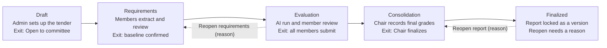

# AI Tender Evaluation Platform – UX Requirements

Oct 11, 2026 · @Ahmed

## Purpose and scope

This document defines what each user of the platform must be able to do, from creating a tender to reading the final evaluation report.

**In scope**

- Web UX for the Procurement Administrator, Committee Member and Committee Chair
- Tender setup, document and vendor management, requirement extraction and review, proposal screening, evaluation and the consolidated report
- Cross-cutting behaviour: AI jobs, notifications, audit trail, accessibility, language

**Out of scope**

- AI model design and backend architecture
- Financial or commercial evaluation, contract award, any vendor-facing portal, scanned documents (OCR), languages other than English

**Working assumptions**

- One RFP per tender. Each vendor submits one technical proposal, possibly as several files.
- The AI proposes and people decide: nothing AI-generated is final until a person confirms it.
- The committee works on one shared requirements list and evaluates each vendor independently.
- The application is desktop-first.

**How to read the requirements**

- IDs follow `UX-<area>-<nn>`, for example UX-REQ-06. They are stable, so tests and tickets can cite them.
- Priority: **M** = must have for first release, **S** = should have, **C** = could have.
- **Assumed values are numeric defaults chosen so design can proceed; they are listed under Assumed parameters. Every decision taken so far is recorded under Decis**ions.

**Key terms**

| Term | Meaning |
| --- | --- |
| Requirements baseline | The confirmed, locked, versioned list of requirements that every vendor is evaluated against |
| Screening | A quick check that a proposal is complete enough to be evaluated |
| Evaluation sheet | One vendor's proposal graded requirement by requirement, with rationale and evidence |
| Override | A person changing something the AI produced (a requirement field or a grade) |
| Consolidated report | All vendors, all members and the final grades in one place |

## Roles and permissions

Three roles carry the flow you described. This document adds a Chair designation, so that one person's confirmation counts, and an optional read-only Observer for audit.

| Action | Admin | Chair | Member | Observer |
| --- | --- | --- | --- | --- |
| Manage users and roles | Yes | No | No | No |
| Create or edit a tender, its committee and its Chair | Yes | No | No | No |
| Upload RFP, BRD and proposals; create vendors | Yes | No | No | No |
| View RFP, BRD and requirements | View | Yes | Yes | View |
| Start requirement extraction | No | Yes | Yes | No |
| Edit, add or delete requirements | No | Yes | Yes | No |
| Set the scoring model; confirm or reopen the requirements baseline | No | Yes | No | No |
| Open vendor proposals | Yes | After declaration | After declaration | View |
| Record screening checklist and recommendation | No | Yes | Yes | No |
| Confirm a screening decision | No | Yes | No | No |
| Review, override and submit own evaluation | No | Yes | Yes | No |
| See other members' grades during evaluation | Progress only | After own submission | After own submission | No |
| Record final grades and finalize the report | No | Yes | No | No |
| Open the consolidated report | Yes | Yes | After finalization | Final only |
| Export the report | Yes | Yes | No | No |
| View the audit trail | Yes | No | No | Yes |

| ID | Requirement | Priority |
| --- | --- | --- |
| UX-ROL-01 | The roles are Procurement Administrator, Committee Member, Committee Chair (a member designated per tender) and Observer (read-only, for audit). | M (Observer: C) |
| UX-ROL-02 | When creating a tender the admin designates one committee member as Chair. The Chair confirms the requirements baseline, confirms screening decisions, records final grades and finalizes the report. No approval by all members is required. | M |
| UX-ROL-03 | A control the user can never use in their role is hidden. A control that depends on state is disabled with a one-line reason, for example "Requires confirmed requirements". | M |
| UX-ROL-04 | Members see only the tenders they are assigned to; the admin sees all. Opening a tender without access shows a "no access" page that names who to ask, never a blank page or an error code. | M |
| UX-ROL-05 | The admin can invite users, assign roles and deactivate users. Deactivating a user with work in progress asks whether to keep it as read-only history or reassign it. | M |

## Lifecycle and statuses

A tender moves through five stages, and each stage ends only when a person confirms. The same status words must appear on every screen (UX-GEN-10).

**Diagram 1: tender lifecycle · 5 stages, 2 reopen paths**

Screening can start while requirements are still in review; accepted vendors wait for the baseline (UX-SCR-06). Reopening the requirements baseline marks only the affected evaluation rows Outdated. Reopening a finalized report creates a new version and keeps the old one.

| Object | Statuses | Moves on when |
| --- | --- | --- |
| Tender | Draft, Requirements, Evaluation, Consolidation, Finalized (and Archived) | Admin opens it to the committee; Chair confirms the baseline; all members submit; Chair finalizes |
| Document | Uploading, Processing, Ready, or Failed | Automatically |
| Requirement | Unreviewed, Reviewed, Confirmed (Deleted rows can be restored) | A member reviews it; the Chair confirms the baseline |
| Proposal (per vendor) | Uploaded, In screening, then Accepted, Rejected or Resubmission requested, then Evaluating and Evaluated. Older versions become Superseded. | The Chair confirms screening; the evaluation job completes |
| Job | Queued, Running, then Completed, Completed with warnings, Failed or Cancelled | Automatically; a user can cancel |
| Evaluation row (per member) | Not reviewed, then Agreed or Overridden. Flags: Needs clarification, Outdated, Not evaluated | A member acts; the baseline or proposal changes |
| Member evaluation (per vendor) | Not started, In progress, Submitted. Can become Reopened or Outdated. | The member submits; the Chair reopens |

## Global UX principles

Five principles shape every screen: the AI proposes and people decide, every claim has evidence, every change has a reason, nothing changes out of sight, and the user always knows what to do next.

| ID | Requirement | Priority |
| --- | --- | --- |
| UX-GEN-01 | AI output is always a suggestion. Nothing AI-generated becomes final until a person confirms it: the requirements baseline, a member's evaluation and the final report each need an explicit human action. | M |
| UX-GEN-02 | Every AI-generated value carries an "AI" label. Every human change shows who made it, when, and the original AI value. | M |
| UX-GEN-03 | Every requirement and every grade links to its evidence: the source passage in the RFP or BRD, or the passage in the vendor's proposal. The link opens the document viewer at the right page with the passage highlighted. | M |
| UX-GEN-04 | Every override (edit, delete, grade change, rejection, reinstatement) requires a justification note. Save stays disabled until the note has at least 10 characters (see Assumed parameters). | M |
| UX-GEN-05 | Every change to data is written to the audit trail (see UX-AUD). | M |
| UX-GEN-06 | Long-running work never blocks the screen. The user can leave and return, and sees status from anywhere (see UX-JOB). | M |
| UX-GEN-07 | Deleting is a soft delete with a visible Undo or Restore. A confirmation names the object being deleted, never just "Are you sure?". | S |
| UX-GEN-08 | A persistent header shows the tender, the vendor (where relevant) and the current stage, with a "Next step" prompt that tells the user what is expected of them now. | M |
| UX-GEN-09 | Notes and edits in progress are saved automatically as drafts. Leaving a screen with unsaved changes warns the user. | S |
| UX-GEN-10 | Status words are used consistently everywhere, taken from the vocabulary in Lifecycle and statuses, with the same colour, icon and label on every screen. | M |

## Administrator journeys

The administrator prepares everything the committee needs: a tender, its documents, its vendors and their proposals. Journey: sign in, open the tender list, create a tender, upload the RFP (and BRD), release the tender to the committee, create vendors, upload proposals, then monitor progress.

### Sign-in

| ID | Requirement | Priority |
| --- | --- | --- |
| UX-AUTH-01 | Users sign in with email and password, or with the organisation's single sign-on where available. After sign-in an admin lands on All tenders and a member on My tenders. | M |
| UX-AUTH-02 | A failed sign-in shows one generic message that does not reveal whether the email exists. The account locks temporarily after repeated failures (see Assumed parameters). | M |
| UX-AUTH-03 | Multi-factor authentication is provided through the organisation's single sign-on where available; the platform adds none of its own. | S |
| UX-AUTH-04 | The session warns the user 2 minutes before it expires after inactivity (see Assumed parameters). Unsaved notes are kept as drafts and restored after sign-in. | M |
| UX-AUTH-05 | Users can reset their password by email, unless sign-in is handled by single sign-on. | M |

### Tenders

| ID | Requirement | Priority |
| --- | --- | --- |
| UX-TND-01 | The admin home lists all tenders with name, status, committee size, vendor count, Chair and last activity. It supports search, filter by status and sort. With no tenders it shows an empty state with a "Create tender" button. | M |
| UX-TND-02 | Create tender asks for: name (required, unique), description, committee members (required, at least one, searchable list of active users) and Chair (required, one of the members). The administrator cannot also be a member of the same tender. Optional: reference number and evaluation due date. | M |
| UX-TND-03 | A tender can be saved as Draft at any point. A readiness checklist shows what is missing (RFP uploaded, committee chosen). The admin releases the tender with "Open to committee", which needs the RFP and at least one member. Members are notified and see the tender only from that moment. Vendor proposals can be added before or after. | M |
| UX-TND-04 | The admin can edit tender details and the committee at any time. Removing or replacing a member who has work in progress asks what happens to it (keep as read-only history, or reassign), and the change is recorded. | M |
| UX-TND-05 | A progress board per tender shows the stage, each vendor's status, each member's progress (requirements reviewed, evaluations submitted), running jobs and overdue items. It shows progress, never members' grades. | S |
| UX-TND-06 | The admin can duplicate a tender (without documents) and archive a finished one. Archived tenders are read-only and hidden from the default list. | C |
| UX-TND-07 | Before a member first opens a vendor's proposal, the platform shows a confidentiality and conflict-of-interest declaration for that vendor. A member who declares a conflict is excluded from that vendor's evaluation, the admin and Chair are notified, and the declaration is recorded. | M |

### Documents

| ID | Requirement | Priority |
| --- | --- | --- |
| UX-DOC-01 | RFP upload is mandatory. Users can drag and drop or browse. Only PDF and DOCX files are accepted; other formats are rejected at once with a message. The accepted formats and the size limit are shown before upload, with a progress bar and a Cancel button while uploading. | M |
| UX-DOC-02 | BRD and other documents are optional. Each document is labelled with a type: RFP, BRD, Addendum or clarification, or Other. The type is shown wherever the document is listed. | M |
| UX-DOC-03 | After upload each document shows a processing status: Uploading, Processing, Ready or Failed. A failure states the reason in plain words (password-protected, scanned or image-only PDF, unsupported format) and what to do next. A document cannot be used for extraction until it is Ready. Scanned documents are not supported: a file without selectable text fails with a message asking for a text-based PDF or DOCX. | M |
| UX-DOC-04 | Uploading a new version keeps the old one. If requirements were already extracted from the previous version, the admin sees the impact and chooses: keep the existing requirements, or ask the committee to re-extract. After the requirements baseline is confirmed, a new RFP version is blocked unless the Chair reopens the baseline (UX-REQ-14). | M |
| UX-DOC-05 | An addendum or clarification can be uploaded after the tender is open. It is linked to the RFP, listed in the tender, announced to the committee and available for extraction. | S |
| UX-DOC-06 | The document viewer opens inside the platform with a contents outline, page thumbnails, search within the document, page numbers, zoom and text selection. It displays highlights for citations. | M |

### Vendors and proposals

| ID | Requirement | Priority |
| --- | --- | --- |
| UX-VND-01 | A vendor profile has name (required), website (URL format checked) and description. Optional: registration number and contact person. | M |
| UX-VND-02 | Creating a vendor whose name or website matches an existing one shows a warning with a link to the existing profile. | M |
| UX-VND-03 | A tender picks its vendors from the vendor list or creates one inline. Vendor records are reusable across tenders. | S |
| UX-VND-04 | The admin uploads one or more files per vendor as its technical proposal (main document and annexes), each with the processing status from UX-DOC-03. A notice states that financial or commercial proposals must not be uploaded here. | M |
| UX-VND-05 | Uploading a new proposal version keeps the old one. If AI evaluation has already run, the admin sees how many evaluations will be marked Outdated and must enter a reason. The Chair and members who have started are notified. | M |
| UX-VND-06 | Inside a tender, the vendor list shows name, number of files, proposal version, status (see Lifecycle and statuses) and who screened it. | M |

## Committee journeys: requirements

A member's first task is to turn the RFP into a reviewed list of requirements. The Chair then locks that list, together with the scoring model, as the baseline. Journey: open My tenders, open the tender, open the RFP, select sections, start extraction, check the job, review the requirements, then the Chair sets scoring and confirms.

### Finding the tender and starting extraction

| ID | Requirement | Priority |
| --- | --- | --- |
| UX-EXT-01 | My tenders lists the member's tenders with name, stage, the member's own pending tasks (for example "14 requirements to review"), due date and last activity. Opening a tender shows its documents (type, version, status), a requirements summary, a vendor summary and the Next step prompt. | M |
| UX-EXT-02 | In the viewer, the member chooses what to extract by ticking sections in the contents outline, selecting a page range, or highlighting text. The selection stays highlighted and is summarised, for example "6 sections, 24 pages". | M |
| UX-EXT-03 | Sections already extracted are marked "Extracted by [name], [date]". Selecting one again shows a warning. | M |
| UX-EXT-04 | BRD and addenda can be selected the same way. Every extracted requirement carries its source document type. | M |
| UX-EXT-05 | "Start extraction" opens a confirmation showing the scope (documents, sections, pages). Confirming creates a job, shows a message with a link to its status, and returns the member to the document. | M |
| UX-EXT-06 | When a job finishes, new requirements are added to the shared list as Unreviewed. Requirements that look like duplicates of existing ones are flagged, never silently dropped. | M |
| UX-EXT-07 | When another member's extraction is running or has covered a section, the viewer shows a banner (who, which sections, status) so members do not duplicate work. | S |
| UX-EXT-08 | The confirmation shows an estimated duration when the system can predict one. | C |

### Reviewing requirements

| ID | Requirement | Priority |
| --- | --- | --- |
| UX-REQ-01 | The requirements overview is a table with: ID, requirement text, category, importance (Mandatory or Optional), acceptance criteria, source (document and page), origin (AI or Manual), review state and last changed by. It supports search, sort, filters, and grouping by category or source. | M |
| UX-REQ-02 | A summary strip shows total requirements, mandatory and optional counts, reviewed versus total, and flagged items. | M |
| UX-REQ-03 | The source cell opens the viewer at the source passage, highlighted. | M |
| UX-REQ-04 | A member edits text, category, importance and acceptance criteria inline or in a side panel. Categories come from a managed list (admin-configurable: S, PG-21). A new installation starts with a list of seven (Functional, Technical, Security, Integration, Support and maintenance, Commercial, Compliance) that the administrator can change. Saving requires a justification note (UX-GEN-04). | M |
| UX-REQ-05 | Delete asks for a reason: duplicate, out of scope, not a requirement, or other. Marking a duplicate asks which requirement is kept. Deleted rows stay under a "Deleted" filter and can be restored. | M |
| UX-REQ-06 | A member can add a requirement the AI missed, with text, category, importance, acceptance criteria and an optional source reference. It is labelled "Manual". | M |
| UX-REQ-07 | A member can merge two or more requirements into one, and split a compound requirement into several. Source references are kept. | S |
| UX-REQ-08 | Bulk actions on selected rows: mark reviewed, change category, change importance. One note covers the batch and is stored on every row. | S |
| UX-REQ-09 | Each row has a Reviewed state. Rows left unchanged can be marked reviewed one by one or in bulk, so "agreed" is distinguishable from "not looked at". | M |
| UX-REQ-10 | The AI flags rows that need attention: possible duplicate, compound requirement, low confidence, or conflict with another source. Flagged rows can be filtered and sorted to the top. | M |
| UX-REQ-11 | Each requirement has a history panel with the original AI text, every change, who made it, when, and the note. | M |
| UX-REQ-12 | If two members edit the same requirement, the second to save sees what changed and who changed it, and must choose. Nothing is overwritten silently. | M |
| UX-REQ-13 | "Confirm requirements" is available to the Chair (see UX-ROL-02). It first checks that every row is reviewed, no flags are open, and every requirement has a category, importance and acceptance criteria. Failures are listed with links to the rows. A summary dialog shows the counts and the scoring model. On confirmation the list becomes baseline v1, is locked, members are notified and evaluation is unlocked. | M |
| UX-REQ-14 | After confirmation the list is read-only. The Chair can "Reopen requirements" with a reason. The dialog says which evaluations will be affected: only rows tied to changed requirements are marked Outdated. Confirming again creates the next baseline version. | M |
| UX-REQ-15 | The requirements list can be exported to Excel with all fields and source references. | S |

### Scoring model

| ID | Requirement | Priority |
| --- | --- | --- |
| UX-SCO-01 | Before confirming the baseline, the Chair configures scoring: points per grade (default: Fully compliant 1.0, Partially compliant 0.5, Non-compliant 0), category weights (default: equal), and the mandatory rule in UX-SCO-04. | M |
| UX-SCO-02 | The scoring model is part of the baseline: locked and versioned with it, and changed only by reopening (UX-REQ-14). | M |
| UX-SCO-03 | Wherever a score appears, an info control explains how it was calculated and shows the inputs. | M |
| UX-SCO-04 | A mandatory requirement graded Non-compliant flags the vendor "Fails mandatory requirement". The system flags; it never disqualifies a vendor automatically. | M |

## Committee journeys: screening and evaluation

Once the baseline exists, members screen proposals, review the AI's grades requirement by requirement, and submit one evaluation per vendor. Journey: screen a proposal, the Chair confirms acceptance, the evaluation job runs, the member reviews the sheet and overrides where needed, then submits.

### Proposal screening

| ID | Requirement | Priority |
| --- | --- | --- |
| UX-SCR-01 | The screening page for a vendor shows its files in the viewer, proposal metadata (version, upload date, uploaded by) and a screening checklist. | M |
| UX-SCR-02 | The checklist has default items: all mandatory documents present, signed where required, in the required language, within any page limit, and no financial information included. The Chair can edit the checklist per tender before screening starts. | M (editing: S) |
| UX-SCR-03 | An optional AI pre-check compares the proposal's structure with the format the RFP asks for and lists missing sections. It only suggests; a person ticks the checklist. | C |
| UX-SCR-04 | Each member records a recommendation per vendor: Accept, Reject or Request resubmission. Reject and Request resubmission require a reason. All recommendations are visible to the committee. | M |
| UX-SCR-05 | The Chair confirms the decision (UX-ROL-02). Confirming Accept queues the evaluation job. The decision shows who confirmed it and when. | M |
| UX-SCR-06 | If the baseline is not confirmed yet, an accepted vendor shows "Accepted, waiting for requirements". The job starts automatically once the baseline is confirmed. | M |
| UX-SCR-07 | A rejected vendor is excluded from evaluation but stays in the report as "Not evaluated: rejected at screening", with the reason. The Chair can reinstate it with a note. Request resubmission notifies the admin, and a new proposal version goes through screening again. | M |

### Grades and what each rationale must say

| Grade | Meaning | The rationale must state |
| --- | --- | --- |
| Fully compliant | The proposal commits to everything in the acceptance criteria. | Where the vendor commits to it, with page and excerpt. Example: "States on page 12 that this is part of the scope." |
| Partially compliant | The proposal covers some but not all of what is required. | What is covered and what is missing. Example: "Delivers a and b; the RFP requires a, b, c and d." |
| Non-compliant | The proposal excludes the requirement or does not address it. | The reason type: Explicitly excluded (with citation) or Not addressed. |

AI uncertainty is not a fourth grade. A reviewer who cannot tell can set a separate "Needs clarification" flag (UX-EVA-06).

### Evaluation sheet

| ID | Requirement | Priority |
| --- | --- | --- |
| UX-EVA-01 | When screening is confirmed as Accepted and the baseline is confirmed, an evaluation job starts automatically. Each vendor's status is visible to every member (UX-JOB), and members are notified when it completes. | M |
| UX-EVA-02 | The sheet has one row per requirement showing: ID, requirement (with category and importance), AI grade, rationale summary, evidence citations, the member's grade, the member's note and review state. A row expands to show the full acceptance criteria, full rationale, all evidence and the list of missing elements. | M |
| UX-EVA-03 | Each grade has a label, an icon and a colour; colour never carries meaning alone. A help control shows the definitions from the grades table. | M |
| UX-EVA-04 | Rationales follow the structure in the grades table. A Non-compliant grade states its reason type: Explicitly excluded or Not addressed. | M |
| UX-EVA-05 | The sheet and the proposal viewer open side by side. Clicking a citation scrolls the proposal to the page and highlights the passage. A row with several citations lets the member step through them. A row with no evidence says "No evidence found" explicitly. | M |
| UX-EVA-06 | A member can flag any row "Needs clarification" with a note. This is not a grade. Flagged rows collect into a per-vendor clarification list that can be exported. | S |
| UX-EVA-07 | To change a grade, the member picks the new grade and writes a justification note (UX-GEN-04). The AI grade stays visible beside it and the row shows "Overridden". | M |
| UX-EVA-08 | "Agree with AI" marks a row reviewed with the AI grade in one click. Rows left untouched do not count as reviewed. Bulk "Agree" on selected rows is available (S). | M |
| UX-EVA-09 | The sheet supports search, sort and filters by grade, importance, category, review state, overridden, flagged, low AI confidence and Outdated. The filter state is kept while the member moves between vendors. | M |
| UX-EVA-10 | Keyboard shortcuts move to the next or previous unreviewed row, set a grade and open the evidence. A help panel lists them. | S |
| UX-EVA-11 | A cross-vendor view shows one requirement with every accepted vendor's grade, rationale and evidence side by side, with next and previous controls. | S |
| UX-EVA-12 | While evaluating a vendor, a member does not see other members' grades or notes for that vendor. They become visible after the member submits that vendor's evaluation (decision Q2). | M |
| UX-EVA-13 | "Submit evaluation" is per vendor. Pre-checks: every row reviewed, every override has a note, every flagged row has a decision. Failures are listed with links. A confirmation says the evaluation becomes read-only and visible to the others. The Chair can reopen a member's submitted evaluation with a reason. | M |
| UX-EVA-14 | When the baseline or the proposal changes, affected rows are marked Outdated and must be reviewed again. The member can re-run the AI for outdated rows only. Previous grades stay in the row history. | M |
| UX-EVA-15 | Each AI row has a quick feedback control (useful or not useful, with optional reason tags such as "wrong page" or "missed evidence"). | S |
| UX-EVA-16 | A live summary shows the member's own result for the vendor: compliance score, counts per grade, mandatory failures, progress, and a breakdown by category. It follows UX-SCO-03. | M |
| UX-EVA-17 | The tender view shows the member's progress per vendor (not started, in progress, submitted, outdated) and the next vendor that needs work. | M |
| UX-EVA-18 | If a job fails in part or in full, completed rows are kept. Failed rows show "Not evaluated" with a Retry control, and the member can still grade them manually. | M |

## Consolidated evaluation report

The report is where the committee's decision is made and recorded. It must show the AI grade, each member's grade and the final grade side by side, and it must lock when finalized.

| Part | Content |
| --- | --- |
| Header | Tender, baseline version, committee, scoring model, status (In progress or Finalized), date |
| Progress | Per vendor and member: Not started, In progress or Submitted |
| Overview | Vendors ranked by final score, compliance percentage, mandatory failures, grade counts, agreement level |
| Matrix | Requirements against vendors with the final grade; each cell expands to the AI grade, member grades, notes and evidence |
| Disagreements | Rows where members differ, with the Chair's final grade and justification |
| Screening outcomes | Vendors rejected at screening, with reasons |
| Appendix | Clarification lists, override statistics, AI model version, audit summary |

| ID | Requirement | Priority |
| --- | --- | --- |
| UX-RPT-01 | Until every member has submitted an evaluation of a vendor, the admin and Chair see only the progress matrix for that vendor. Once all have submitted, that vendor's results open in the report, labelled "In progress" until the report is finalized. Members can open the report once it is finalized. | M |
| UX-RPT-02 | A progress matrix shows, per vendor and member, Not started, In progress or Submitted, and who is outstanding. The admin or Chair can send a reminder. | M (reminder: S) |
| UX-RPT-03 | The overview ranks vendors by final score and shows compliance percentage, mandatory failures, the count of each grade and an agreement level between members. A vendor that fails a mandatory requirement is flagged, not removed. | M |
| UX-RPT-04 | The matrix lists requirements against vendors with the final grade. A cell expands to show the AI grade, each member's grade and note, the rationale and the evidence links. | M |
| UX-RPT-05 | Rows where members' grades differ are marked "Disagreement", listed first when that filter is on, and counted in the header. | M |
| UX-RPT-06 | Where all members agree, the final grade is that grade. For each disagreement the Chair records the final grade with a justification note, after seeing every member's grade and note. The Chair decides; no voting rule applies. | M |
| UX-RPT-07 | Scores in the report use final grades and the baseline's scoring model, and are explainable per UX-SCO-03. | M |
| UX-RPT-08 | "Finalize report" is available to the Chair once every accepted vendor has all members' submissions (or the missing ones are formally excluded with a reason) and every disagreement has a final grade. Finalizing locks the report as a version stamped with the date, baseline version and who finalized it. Changing it afterwards needs "Reopen" with a reason and creates a new version. Earlier versions stay viewable. | M |
| UX-RPT-09 | Export to PDF (formal report) and Excel (full matrix with grades, notes and evidence references). Each export states the committee, baseline version, scoring model, AI model version and finalization date. | M |
| UX-RPT-10 | The matrix can be filtered and sorted by category, importance, grade, vendor and disagreement, and shown for one vendor at a time. | S |
| UX-RPT-11 | Vendors rejected at screening appear in their own section with the reasons. | M |
| UX-RPT-12 | A print-friendly layout is available. | C |
| UX-RPT-13 | The report shows how often the AI was overridden (counts and percentages per vendor), without ranking individual members. | S |

## Cross-cutting requirements

Four things apply on every screen: AI jobs, notifications, the audit trail, and the quality bar for language, accessibility and performance.

### Jobs

| ID | Requirement | Priority |
| --- | --- | --- |
| UX-JOB-01 | A job center is reachable from the header on every screen. It lists jobs for the user's tenders with type (document processing, requirement extraction, evaluation), target, started by, start time, status, progress and duration. | M |
| UX-JOB-02 | Job states are Queued, Running, Completed, Completed with warnings, Failed and Cancelled. Each has a distinct label and icon. | M |
| UX-JOB-03 | A running job shows named steps (for example "Reading document", "Extracting requirements", "Checking duplicates") and a progress bar. Estimated time remaining is shown when known. | M (estimate: S) |
| UX-JOB-04 | The user can leave and return. Completion or failure triggers an in-app notification and, if enabled, an email that links to the result. | M |
| UX-JOB-05 | A failure explains the cause in plain words and offers an action: Retry, Change selection or Contact admin. Results produced before the failure are kept. | M |
| UX-JOB-06 | The member who started a job, or the Chair, can cancel a queued or running job. | S |
| UX-JOB-07 | Jobs belong to the tender: all committee members see the same jobs and the same results. | M |
| UX-JOB-08 | Starting a job that overlaps a running job on the same scope shows a warning, with the choice to wait or continue. | M |

### Notifications

| ID | Requirement | Priority |
| --- | --- | --- |
| UX-NOT-01 | Notifications are sent for: being added to a tender, tender opened, job completed or failed, requirements confirmed or reopened, proposal screened, evaluation ready, evaluation reopened for me, new proposal version, all members submitted (to admin and Chair), and report finalized. | M |
| UX-NOT-02 | A notification center in the header shows the unread count, groups items by tender and links to the object. Users choose email notifications per type. | M (email choice: S) |
| UX-NOT-03 | Stages can have optional due dates, with automatic reminders before they pass. | S |

### Audit trail

| ID | Requirement | Priority |
| --- | --- | --- |
| UX-AUD-01 | For every change the audit trail records who, their role, when (with time zone), the object, the action, the values before and after, the justification note, and the source (person, AI or system). | M |
| UX-AUD-02 | The audit trail is append-only. Nobody, including the admin, can edit or delete entries. | M |
| UX-AUD-03 | The admin and Observer can search and filter the audit trail by tender, vendor, user, action and date, and export it as CSV. | M |
| UX-AUD-04 | Each AI run records the model version, run time, input scope (documents, pages, baseline version) and outcome, visible in the audit trail and in exports. | M |

### Quality bar

| ID | Requirement | Priority |
| --- | --- | --- |
| UX-NFR-01 | The UI, all documents (RFP, BRD and proposals) and all AI output are in English only. Other languages and right-to-left layouts are out of scope. | M |
| UX-NFR-02 | The application meets WCAG 2.2 AA: full keyboard operation, visible focus, screen-reader labels, sufficient contrast, and no meaning carried by colour alone. | M |
| UX-NFR-03 | The layout is desktop-first, optimised for widths of 1280 px and above. Tablets support reading and reviewing. Phones show status and notifications only. | M (phone: C) |
| UX-NFR-04 | Performance targets (assumed, see Assumed parameters): a 500-row sheet scrolls without lag, filters respond in under 1 second, a jump to a cited page takes under 2 seconds, and a 300-page document opens in under 3 seconds. | M |
| UX-NFR-05 | Every screen defines its empty, loading, error, no-permission and session-expired states, each with a plain-language message and a next action. Example: a requirements page with no requirements says "Select sections in the RFP to extract requirements" and links to the RFP. | M |
| UX-NFR-06 | Contextual help explains grades, importance and statuses in tooltips. A first-use tour is offered for each role. | S (tour: C) |
| UX-NFR-07 | The viewer disables download and print for members, logs every proposal access and can overlay a watermark with the user's name and time. | M (watermark: C) |
| UX-NFR-08 | Dates and times show in the user's time zone in one consistent format. Dates and numbers follow English conventions. | S |

## Screen inventory

Twenty screens cover the whole flow. The design phase should start from this list and the shared components below.

| ID | Screen | Used by | Purpose | Requirements |
| --- | --- | --- | --- | --- |
| PG-01 | Sign-in | All | Authenticate and reset password | UX-AUTH-01 to 05 |
| PG-02 | All tenders | Admin | List, search and filter tenders; start a new tender | UX-TND-01 |
| PG-03 | Create or edit tender | Admin | Name, description, committee, Chair, due date, open to committee | UX-TND-02 to 04 |
| PG-04 | Tender documents | Admin | Upload RFP, BRD and addenda; processing status; versions | UX-DOC-01 to 05 |
| PG-05 | Vendors and proposals | Admin | Vendor profiles; proposal files and versions | UX-VND-01 to 06 |
| PG-06 | Tender progress board | Admin | Stage, vendor and member progress, running jobs | UX-TND-05 |
| PG-07 | User management | Admin | Invite users, assign roles, deactivate | UX-ROL-05 |
| PG-08 | My tenders | Member, Chair | Tenders with the member's pending tasks | UX-EXT-01 |
| PG-09 | Tender home | Member, Chair | Documents, requirements and vendor summaries, Next step | UX-EXT-01, UX-GEN-08 |
| PG-10 | Document viewer with extraction | Member, Chair | Read, select sections, start extraction | UX-DOC-06, UX-EXT-02 to 08 |
| PG-11 | Requirements overview | Member, Chair | Review, edit, add, delete, merge, split, history | UX-REQ-01 to 12, UX-REQ-15 |
| PG-12 | Baseline and scoring | Chair | Set scoring, run pre-checks, confirm or reopen the baseline | UX-REQ-13, UX-REQ-14, UX-SCO-01 to 04 |
| PG-13 | Conflict declaration | Member, Chair | Declare per vendor before first access | UX-TND-07 |
| PG-14 | Proposal screening | Member, Chair | Checklist, recommendations, Chair decision | UX-SCR-01 to 07 |
| PG-15 | Evaluation sheet with proposal viewer | Member, Chair | Review grades and evidence, override, submit | UX-EVA-01 to 10, UX-EVA-12 to 18 |
| PG-16 | Cross-vendor requirement view | Member, Chair | Compare all vendors on one requirement | UX-EVA-11 |
| PG-17 | Job center | All | Job list and status | UX-JOB-01 to 08 |
| PG-18 | Notification center | All | Unread items grouped by tender | UX-NOT-01 to 03 |
| PG-19 | Consolidated evaluation report | Admin, Chair; members after finalization | Progress, overview, matrix, disagreements, final grades, finalize, export | UX-RPT-01 to 13 |
| PG-20 | Audit trail | Admin, Observer | Search, filter, export | UX-AUD-01 to 04 |
| PG-21 | Categories | Admin | Add, rename, reorder, deactivate the managed category list | UX-REQ-04 |

### Shared components

| Component | Used on | Requirements |
| --- | --- | --- |
| Document viewer with citation highlights | PG-10, PG-11, PG-14, PG-15 | UX-DOC-06, UX-GEN-03 |
| Justification note dialog | PG-11, PG-12, PG-14, PG-15, PG-19 | UX-GEN-04 |
| Status chip and grade chip | Every screen | UX-GEN-10, UX-EVA-03 |
| History panel | PG-11, PG-15 | UX-REQ-11, UX-EVA-14 |
| Confirmation dialog with pre-check list | PG-12, PG-15, PG-19 | UX-REQ-13, UX-EVA-13, UX-RPT-08 |
| Job status banner | PG-10, PG-11, PG-14, PG-15 | UX-JOB-03, UX-JOB-04 |
| Empty, error and no-access states | Every screen | UX-NFR-05, UX-ROL-04 |

## Decisions

All 14 questions are decided. Twelve use the proposed default; Q6 (language) and Q8 (file formats) were decided differently.

| # | Decision | Outcome | Applied in |
| --- | --- | --- | --- |
| Q1 | Who confirms the requirements baseline and screening decisions | The Chair alone | UX-ROL-02, UX-REQ-13, UX-SCR-05 |
| Q2 | Visibility of grades before submission | Members do not see each other's grades before they submit. The admin sees progress only. | UX-EVA-12, UX-RPT-01, permissions table |
| Q3 | Settling grade disagreements | The Chair decides, with a justification note | UX-RPT-06 |
| Q4 | Scoring | Fully compliant 1.0, Partially compliant 0.5, Non-compliant 0. Equal category weights. A failed mandatory requirement flags the vendor and never disqualifies it. | UX-SCO-01 to 04 |
| Q5 | Vendor records and blind evaluation | Vendor records are reusable across tenders. Blind evaluation is not included. | UX-VND-03 |
| Q6 | Languages | **Changed from default.** English only: UI, RFPs, BRDs, proposals and AI output. No right-to-left layout. | UX-NFR-01, UX-NFR-08 |
| Q7 | Sign-in | Email and password, plus single sign-on where available. Multi-factor authentication only through single sign-on. | UX-AUTH-01 to 05 |
| Q8 | File formats | **Changed from default.** PDF and DOCX only. Scanned documents are not supported. | UX-DOC-01, UX-DOC-03 |
| Q9 | Download, print and watermark | Members cannot download or print proposals. A watermark is optional. | UX-NFR-07 |
| Q10 | Clarification requests to vendors | Exported as a list, not sent from the platform | UX-EVA-06 |
| Q11 | Members and the final report | Members can open the report once it is finalized | UX-RPT-01 |
| Q12 | Due dates and reminders | Optional per stage | UX-NOT-03, UX-TND-02 |
| Q13 | Retention | Nothing is deleted from the UI; finished tenders are archived | UX-TND-06, UX-AUD-02 |
| Q14 | Admin as committee member; Chair role | No overlap between the two roles in one tender. The Chair role is included. | UX-ROL-01, UX-ROL-02, UX-TND-02 |

### Assumed parameters

These values were not part of the decisions above. They are set here so design can proceed and can change without affecting the structure.

| Parameter | Assumed value | Used in |
| --- | --- | --- |
| Minimum length of a justification note | 10 characters | UX-GEN-04 |
| Failed sign-in lockout | 5 failed attempts, then locked for 15 minutes | UX-AUTH-02 |
| Session inactivity timeout | 30 minutes, with a warning 2 minutes before | UX-AUTH-04 |
| Maximum upload size | 100 MB per file | UX-DOC-01 |
| Performance targets | A 500-row sheet scrolls without lag; filters respond in under 1 second; a cited page opens in under 2 seconds; a 300-page document opens in under 3 seconds | UX-NFR-04 |
