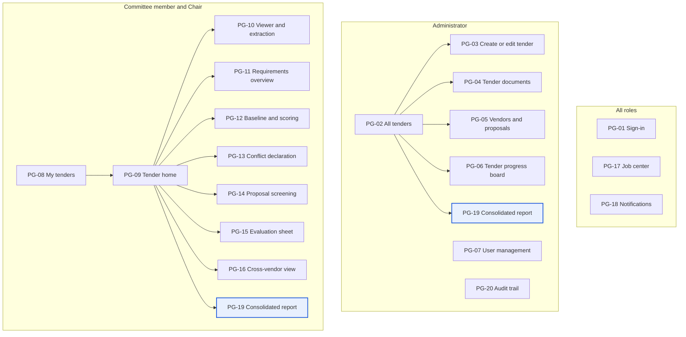
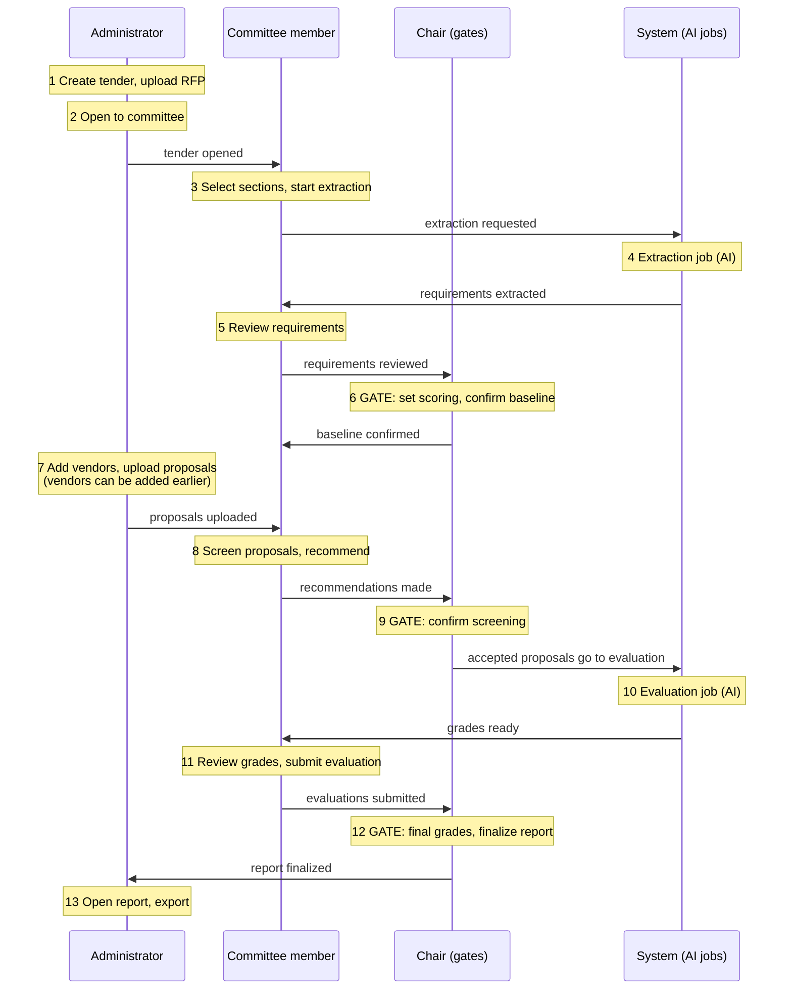
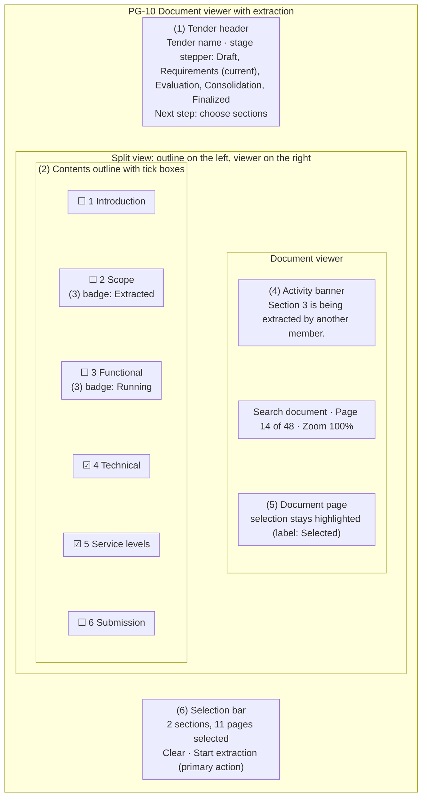
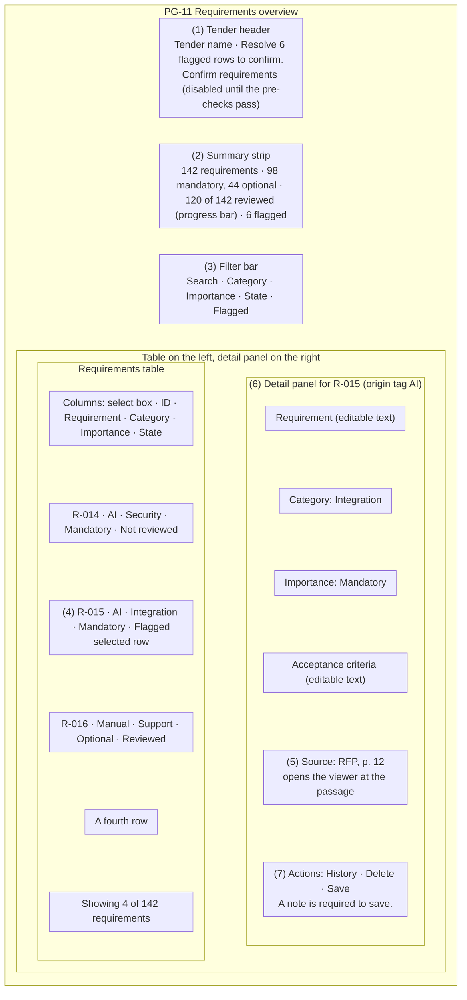
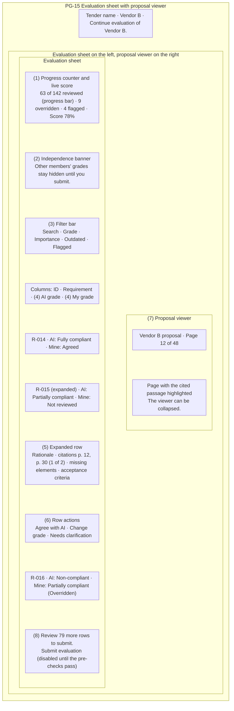

# AI Tender Evaluation Platform – UX Design

Oct 11, 2026 · @Ahmed

## Overview and design principles

This document turns the UX requirements into a design the team can build: structure, flows, key screens, components, states and visual foundations. Requirement IDs (UX-REQ-06) and screen IDs (PG-11) refer to AI Tender Evaluation Platform – UX Requirements.

**This document decides**

- How the 20 screens are organised and how users move between them
- The layout of the four most complex screens, as low-fidelity wireframes
- The behaviour and states of the shared components
- Visual foundations, content standards and a usability test plan

**This document does not decide**

- A brand identity. None was supplied, so the styling is neutral and token-based and can be re-skinned.
- High-fidelity mockups, front-end implementation or AI model behaviour.

**Working assumptions**

- Desktop-first, optimised for 1280 px and wider. Tablets read and review; phones show status only (UX-NFR-03).
- English only, left-to-right (UX-NFR-01).
- WCAG 2.2 AA is the accessibility bar (UX-NFR-02).

**Design principles**

| Principle | What it means in the interface | Requirements |
| --- | --- | --- |
| The next step is always visible | A persistent tender header shows the stage and a "Next step" prompt for the current user. | UX-GEN-08 |
| Evidence is one click away | Every requirement and grade carries a citation link that opens the document at the passage, highlighted. | UX-GEN-03 |
| AI suggests, people decide | AI values are labelled and kept visible beside any human change. Nothing becomes final without an explicit confirmation. | UX-GEN-01, UX-GEN-02 |
| Every override explains itself | One justification pattern is used for every edit, delete, grade change and rejection. | UX-GEN-04 |
| Progress is never ambiguous | "Reviewed" is separate from "not looked at", and counters show how much is left. | UX-REQ-09, UX-EVA-08 |
| Meaning never rests on colour alone | Every status and grade has an icon, a label and a colour. | UX-EVA-03, UX-NFR-02 |
| Dense where people work, calm elsewhere | Review screens are compact tables with a side panel. Setup screens are spacious forms. | UX-EVA-09, UX-TND-02 |

## Roles and design implications

The Chair is a committee member with extra actions, so there are two experiences to design (administrator and committee) rather than three, plus a read-only Observer view.

| Role | Goal | What the design must do | Main screens |
| --- | --- | --- | --- |
| Procurement Administrator | Prepare the tender correctly, keep it moving and produce the final record | Guide setup with a readiness checklist, make upload and processing status obvious, show progress without exposing grades, open the report only when results are in | PG-02 to PG-07, PG-19, PG-20 |
| Committee Member | Turn the RFP into a reviewed requirements list, then judge each vendor fairly and quickly | Make hundreds of rows quick to review, keep evidence beside every grade, show what is left, protect independence | PG-08 to PG-11, PG-13 to PG-19 |
| Committee Chair | Everything a member does, plus confirming the baseline, deciding screening, settling disagreements and finalizing | Present each gate with its pre-checks, surface disagreements as a queue, make finalization feel weighty and reversible only with a reason | PG-12, PG-14, PG-19 |
| Observer (optional) | Audit the process without influencing it | Read-only views of the final report and the audit trail | PG-19, PG-20 |

**Design consequences**

- Chair-only controls appear in place on the same screens a member uses, not in a separate area (UX-ROL-03). A member sees them disabled with a reason, or hidden when never relevant.
- The administrator never sees grades or notes while evaluation is in progress, so the progress board and report show counts and status, not content (UX-TND-05, UX-RPT-01).
- Members spend most of their time on three screens: the requirements overview (PG-11), the evaluation sheet (PG-15) and the document viewer. These get the most design attention.

## Information architecture

Two separate trees share one shell: administrators manage tenders from All tenders, and committee members work inside a tender from My tenders. They meet at the report.

**Diagram 1: sitemap · 20 screens, 3 areas**

The sign-in, job center and notification screens are global. Observers see only PG-19 (once final) and PG-20.

**Navigation rules**

- The entry point depends on role: administrators land on All tenders, members on My tenders (UX-AUTH-01).
- Inside a tender the tabs are the main navigation. The left navigation stays as the way out.
- Jobs and Notifications are reachable from the top bar on every screen. A notification opens the exact object it names (UX-NOT-02).
- PG-13 is not a destination. It appears the first time a member opens a vendor's proposal (UX-TND-07).
- PG-16 opens from a row in PG-15 and returns to the same row.
- Every requirement, evaluation row and citation has a link that opens the screen at that position, so notifications, history entries and exports can point to it.

## End-to-end journey

The journey has 13 steps across three people and the system. AI jobs start only after a person confirms, and the Chair holds three gates: the baseline, screening and the final grades.

**Diagram 2: journey swimlane · 4 lanes, 13 steps**

The numbers in the drawing match the table, which links each step to its screen and requirements.

| Step | Screen | Requirements |
| --- | --- | --- |
| 1 | PG-03, PG-04 | UX-TND-02, UX-DOC-01 |
| 2 | PG-03 | UX-TND-03 |
| 3 | PG-10 | UX-EXT-02, UX-EXT-05 |
| 4 | PG-17 (status) | UX-JOB-01 to 05 |
| 5 | PG-11 | UX-REQ-01 to 12 |
| 6 | PG-12 | UX-REQ-13, UX-SCO-01 |
| 7 | PG-05 | UX-VND-04 |
| 8 | PG-13, PG-14 | UX-TND-07, UX-SCR-04 |
| 9 | PG-14 | UX-SCR-05 |
| 10 | PG-17 (status) | UX-EVA-01 |
| 11 | PG-15 | UX-EVA-02 to 13 |
| 12 | PG-19 | UX-RPT-05, UX-RPT-06, UX-RPT-08 |
| 13 | PG-19 | UX-RPT-09 |

## App shell and page patterns

Every screen sits in one shell and uses one of six page templates, so users learn the layout once and designers build screens from a small kit.

### App shell

| Area | Contents | Notes |
| --- | --- | --- |
| Top bar (56 px) | Product name, breadcrumb (All tenders / tender name), job center with running count, notification bell with unread count, user menu | Job center and notifications are reachable from every screen (UX-JOB-01, UX-NOT-02) |
| Left navigation (240 px, 64 px collapsed) | Admin: Tenders, Vendors, Users, Audit trail. Member and Chair: My tenders, Jobs. Observer: Reports, Audit trail. | The Vendors item opens the vendor list inside PG-05 |
| Tender header band (72 px) | Tender name, status chip, stage stepper (Draft, Requirements, Evaluation, Consolidation, Finalized), and the Next step prompt with its primary action | Shown on every screen inside a tender (UX-GEN-08) |
| Tender tabs | Overview, Documents, Requirements, Vendors, Evaluation, Report | Tabs a role cannot use are hidden. Tabs that depend on stage are disabled with a reason, for example Report before finalization (UX-ROL-03). |

### Page templates

| Template | Used by | Layout |
| --- | --- | --- |
| T1 List page | PG-02, PG-08, PG-17, PG-18, PG-20 | Title, search and filters, table, empty state with one primary action |
| T2 Form page | PG-01, PG-03, PG-07 | Single column up to 640 px, readiness checklist beside it, sticky save bar |
| T3 Workspace page | PG-04, PG-05, PG-06, PG-09 | Stacked sections with a status chip and primary action each |
| T4 Review table with side panel | PG-11, PG-14 | Summary strip, filter bar, table, right panel for details and history, bulk action bar when rows are selected |
| T5 Split view | PG-10, PG-15, PG-16 | Data on the left, document viewer on the right, resizable divider, either pane can be collapsed |
| T6 Report page | PG-19, PG-12 | Sticky summary header, progress, overview, matrix with a sticky filter bar |

Dialogs (T7) are used only for decisions that change state or need a note: justification, confirmation with pre-checks, reopen and finalize.

### Next step prompt

The prompt names the one thing the current user should do now. The copy below is illustrative.

| Role and stage | Prompt | Primary action |
| --- | --- | --- |
| Admin, Draft, RFP missing | Upload the RFP and choose the committee, then open the tender. | Open to committee (disabled with a reason) |
| Member, Requirements | 14 requirements are waiting for your review. | Review requirements |
| Chair, all requirements reviewed | Requirements are ready to confirm. | Confirm requirements |
| Member, Evaluation | Vendor B needs your review: 63 of 142 rows reviewed. | Continue evaluation |
| Admin, Evaluation | 2 of 4 members have submitted for Vendor A. | View progress |
| Chair, Consolidation | 6 disagreements need a final grade. | Open disagreements |
| Anyone, Finalized | The report is finalized. | Open report |

### Responsive behaviour

| Width | Behaviour |
| --- | --- |
| 1280 px and wider | Full layout, split view side by side |
| 768 to 1279 px | Left navigation collapses to icons. In split view the document viewer opens as a drawer over the data pane. |
| Below 768 px | Only My tenders, Jobs and Notifications, in a single column (UX-NFR-03) |

## Key screens

Four screens carry most of the work and are wireframed here at low fidelity. A wireframe fixes layout, hierarchy and behaviour, not final visuals, and its sample text is illustrative. The numbers in each drawing match the table below it.

### PG-10 Document viewer with extraction

**Diagram 3: wireframe · PG-10 document viewer with extraction**

*Layout sketch, not pixel-exact: boxes show regions and their order, and each number in parentheses matches the callout table below.*

| # | Element | Behaviour | Requirements |
| --- | --- | --- | --- |
| 1 | Tender header with stage stepper and Next step prompt | Shows Requirements as the current stage and tells the member what to do next | UX-GEN-08 |
| 2 | Contents outline with tick boxes | Members tick the sections to extract. Selecting a page range or text in the viewer ticks the matching sections. | UX-EXT-02 |
| 3 | Section badges | "Extracted" or "Running", with who and when on hover. Ticking a badged section warns first. | UX-EXT-03, UX-EXT-07 |
| 4 | Activity banner | Names the other member's running extraction so work is not duplicated | UX-EXT-07 |
| 5 | Viewer with highlighted selection | Search, page navigation, zoom and text selection. The selection stays highlighted. | UX-DOC-06, UX-EXT-02 |
| 6 | Selection summary and Start extraction | Shows sections and pages. Start extraction opens a confirmation of the scope, then creates the job. | UX-EXT-05 |

### PG-11 Requirements overview

**Diagram 4: wireframe · PG-11 requirements overview**

*Layout sketch, not pixel-exact: boxes show regions and their order, and each number in parentheses matches the callout table below.*

| # | Element | Behaviour | Requirements |
| --- | --- | --- | --- |
| 1 | Tender header with Next step and Confirm requirements | The Chair sees the action. It stays disabled with the reason until the pre-checks pass, the same ones the confirmation dialog lists. | UX-GEN-08, UX-REQ-13 |
| 2 | Summary strip | Total, mandatory and optional, reviewed against total with a bar, and the flagged count. Each count applies its filter when clicked. | UX-REQ-02 |
| 3 | Filter bar | Search, category, importance, review state, flagged only, and grouping by category or source | UX-REQ-01, UX-REQ-10 |
| 4 | Table row | ID with an AI or Manual tag, text, category, importance and review state. A flagged row explains why on hover (possible duplicate, compound requirement, low confidence, conflict). Ticking rows reveals a bulk bar: mark reviewed, change category, change importance. | UX-REQ-01, UX-REQ-08 to 10 |
| 5 | Source link | Opens the document viewer at the passage, highlighted | UX-REQ-03 |
| 6 | Detail panel | Edit text, category, importance and acceptance criteria. The origin tag stays visible. | UX-REQ-04, UX-GEN-02 |
| 7 | Actions | Save needs a justification note. History opens the history panel. Delete asks for a reason and can be undone. | UX-GEN-04, UX-REQ-05, UX-REQ-11 |

### PG-15 Evaluation sheet with proposal viewer

**Diagram 5: wireframe · PG-15 evaluation sheet with proposal viewer**

*Layout sketch, not pixel-exact: boxes show regions and their order, and each number in parentheses matches the callout table below.*

| # | Element | Behaviour | Requirements |
| --- | --- | --- | --- |
| 1 | Progress counter and live score | "63 of 142 reviewed" with a bar, the overridden and flagged counts, and the live score for the member's own grades. Clicking a count applies that filter. | UX-EVA-16, UX-EVA-09 |
| 2 | Independence banner | States that other members' grades stay hidden until this vendor is submitted | UX-EVA-12 |
| 3 | Filter bar | Search, and filters by grade, importance, category, review state, overridden, flagged, low AI confidence and Outdated | UX-EVA-09 |
| 4 | Grade columns | The AI grade and the member's grade as grade chips (icon, label, colour). The AI value stays visible after an override. | UX-EVA-03, UX-EVA-07 |
| 5 | Expanded row | Rationale in the structure of the grades table, citation links ("p. 12", "1 of 2"), the list of missing elements and the acceptance criteria | UX-EVA-02, UX-EVA-04 |
| 6 | Row actions | Agree with AI marks the row reviewed. Change grade opens the justification dialog. Needs clarification flags the row. | UX-EVA-06 to 08 |
| 7 | Proposal viewer | Opens at the cited page with the passage highlighted, beside the sheet. It can be collapsed. | UX-EVA-05, UX-GEN-03 |
| 8 | Submit evaluation | Disabled with its reason until the pre-checks pass, then opens the confirmation with the pre-check list | UX-EVA-13 |

### PG-19 Consolidated evaluation report

**Diagram 6: wireframe · PG-19 consolidated evaluation report**

```mermaid
%%{init: {"flowchart": {"rankSpacing": 18, "nodeSpacing": 18, "padding": 8}}}%%
flowchart TB
    subgraph screen["PG-19 Consolidated evaluation report"]
        direction TB
        header["(1) Report status and version<br/>Tender name · chip: In progress · Baseline v3 · Weighted scoring<br/>2 vendors ranked · 1 waiting · 1 rejected at screening"]
        actions["(2) Export · Finalize report<br/>Finalize is disabled: needs every submission and 3 final grades"]
        subgraph progress["(3) Progress matrix: one row per vendor, one column per member"]
            direction TB
            ph["Vendor · Member A · Member B · Member C · Outstanding"]
            pa["Vendor A · Submitted · Submitted · Submitted · None"]
            pb["Vendor B · Submitted · Submitted · Submitted · None"]
            pc["Vendor C · Submitted · In progress · Not started · 2 members · Send reminder (admin or Chair)"]
            ph ~~~ pa ~~~ pb ~~~ pc
        end
        subgraph overview["(4) Overview: vendors ranked by final score"]
            direction TB
            oh["Rank · Vendor · Final score · Compliance · Mandatory · Grades · Agreement · AI overridden"]
            oa["1 · Vendor A · 78% · 81% · none failed · 92 / 31 / 19 · High · 9%"]
            ob["2 · Vendor B · 64% · 70% · (5) 1 failed (mandatory-failure flag) · 71 / 40 / 31 · Medium · 14%"]
            oc["– · Vendor C · (6) Results open once all members submit."]
            oh ~~~ oa ~~~ ob ~~~ oc
        end
        subgraph matrix["Matrix"]
            direction TB
            mf["(7) Matrix filter bar<br/>Vendor · Category · Importance · Grade · Disagreements (3)"]
            mh["Columns: ID · Requirement · Vendor A · Vendor B"]
            m1["R-014 · Fully compliant · Fully compliant"]
            m2["(8) R-015 · Disagreement<br/>Vendor A: Final grade needed · Vendor B: Partially compliant"]
            mf ~~~ mh ~~~ m1 ~~~ m2
        end
        subgraph expanded["(9) Expanded cell: Vendor A, R-015"]
            direction TB
            e1["AI: Partially compliant, with rationale"]
            e2["Member A: Fully compliant, with note"]
            e3["Member B: Partially compliant, with note"]
            e4["Member C: Partially compliant, with note"]
            e5["Evidence links: p. 12, p. 30"]
            e1 ~~~ e2 ~~~ e3 ~~~ e4 ~~~ e5
        end
        subgraph chair["(10) Chair's final grade"]
            direction TB
            c1["Select grade"]
            c2["Justification (required)"]
            c3["Record final grade (disabled until both are filled)"]
            c1 ~~~ c2 ~~~ c3
        end
        more["Screening outcomes follow below."]
        header ~~~ actions
        actions ~~~ progress
        progress ~~~ overview
        overview ~~~ matrix
        matrix ~~~ expanded
        expanded ~~~ chair
        chair ~~~ more
    end
```

*Layout sketch, not pixel-exact: boxes show regions and their order, and each number in parentheses matches the callout table below.*

| # | Element | Behaviour | Requirements |
| --- | --- | --- | --- |
| 1 | Report status and version | The chip reads "In progress" until the Chair finalizes. Afterwards the header shows the version, the date and who finalized it. It also names the baseline version and the scoring model, and stays visible while the page scrolls. | UX-RPT-01, UX-RPT-08 |
| 2 | Finalize report and Export | Finalize report is for the Chair and stays disabled, with its reason beside it, until every accepted vendor has all submissions (or a formal exclusion with a reason) and every disagreement has a final grade. Finalizing locks the report as a version; changing it later needs Reopen with a reason. Export offers PDF and Excel. | UX-RPT-08, UX-RPT-09 |
| 3 | Progress matrix | One row per vendor and one column per member. Each cell shows Submitted, In progress or Not started with an icon and a label, and the row says how many members are outstanding. Send reminder appears for the admin or Chair only while members are outstanding. | UX-RPT-01, UX-RPT-02 |
| 4 | Overview | Vendors are ranked by final score, with compliance percentage, mandatory failures, the count of fully, partially and non-compliant grades, the agreement level and how often the AI was overridden. The override rate is per vendor, never per member. Each score can be explained as in UX-SCO-03. The values in the drawing are illustrative. | UX-RPT-03, UX-RPT-07, UX-RPT-13 |
| 5 | Mandatory-failure flag | A vendor that fails a mandatory requirement keeps its rank and carries a flag with the number of failures. The flag uses an icon and text, not only colour. | UX-RPT-03 |
| 6 | Vendor with outstanding submissions | Results stay hidden until every member has submitted for that vendor. The row says when they will open. | UX-RPT-01 |
| 7 | Matrix filter bar | Sticky filters and sorting by vendor, category, importance and grade. The Disagreements filter lists those rows first and shows their count. The matrix can show one vendor at a time. | UX-RPT-05, UX-RPT-10 |
| 8 | Matrix grid | Requirements against vendors, each cell showing the final grade as a grade chip. A row where members' grades differ is marked "Disagreement". A cell without a final grade says so. | UX-RPT-04, UX-RPT-05 |
| 9 | Expanded cell | The AI grade, each member's grade and note, the rationale and the evidence links, which open the proposal at the cited page. | UX-RPT-04 |
| 10 | Chair's final grade | For each disagreement the Chair reads every member's grade and note, picks the final grade and writes a justification. Record final grade stays disabled until both are filled. No voting rule applies. | UX-RPT-06 |

## Design notes for all 20 screens

Each screen follows one template and has its own set of states to design; this table is the checklist for design and for QA.

| Screen | Template | Layout and main content | Primary action | States to design |
| --- | --- | --- | --- | --- |
| PG-01 Sign-in | T2 | Centred card with email, password, single sign-on button when available, reset link | Sign in | Wrong credentials (generic message), locked, session expired |
| PG-02 All tenders | T1 | Table: name, status chip, committee size, vendor count, Chair, last activity. Search and status filter. | Create tender | No tenders yet |
| PG-03 Create or edit tender | T2 | Form: name, description, committee picker, Chair, due date. Readiness checklist beside it. | Open to committee | Validation errors, removing a member with work in progress |
| PG-04 Tender documents | T3 | Document list with type, version and status chip, a drag-and-drop zone, version history | Upload document | Uploading, processing, failed with reason, unsupported format, no selectable text |
| PG-05 Vendors and proposals | T3 | Vendor list, vendor profile form, proposal files per vendor with version and status | Add vendor, Upload proposal | Duplicate vendor warning, financial-document notice, new-version impact |
| PG-06 Tender progress board | T3 | Stage stepper, vendor-by-member progress grid (status only), jobs, overdue items | Send reminder | No activity yet |
| PG-07 User management | T1 | Users with role and status, invite panel | Invite user | Deactivating a user with work in progress |
| PG-08 My tenders | T1 | Tenders with stage, the member's pending tasks and due date | Open tender | Not assigned to any tender |
| PG-09 Tender home | T3 | Documents, requirements summary, vendor list with the member's progress, Next step | Next step action | Job running, tender not yet opened |
| PG-10 Document viewer with extraction | T5 | Left: contents outline with tick boxes and extraction badges. Right: viewer. Bottom: selection summary bar. | Start extraction | Document processing, another member's extraction, overlapping selection |
| PG-11 Requirements overview | T4 | Summary strip, filters, table, side panel with details, source and history | Mark reviewed; Confirm requirements (Chair) | No requirements yet, job running, edit conflict, baseline locked |
| PG-12 Baseline and scoring | T6 | Scoring settings, pre-check list with links to failing rows, count summary | Confirm requirements | Pre-check failures, reopen dialog |
| PG-13 Conflict declaration | T7 | Vendor name, confidentiality statement, conflict yes or no with a note | Declare and continue | Conflict declared: member excluded for this vendor |
| PG-14 Proposal screening | T4 | Files in viewer, checklist, members' recommendations, Chair decision | Recommend; Confirm decision (Chair) | Waiting for requirements, rejected, resubmission requested |
| PG-15 Evaluation sheet with proposal viewer | T5 | Sheet with filters, progress and row expand. Right: proposal viewer. Top: summary strip. | Submit evaluation | Job running, failed rows, outdated rows, submitted (read-only) |
| PG-16 Cross-vendor requirement view | T5 | Requirement header, one column per vendor with grade, rationale and citations | Next requirement | A vendor not evaluated or rejected |
| PG-17 Job center | T1 | Jobs with type, target, status and progress | Retry; Cancel | No jobs, failure with reason |
| PG-18 Notification center | T1 | Items grouped by tender, unread marker | Mark all read | No notifications |
| PG-19 Consolidated evaluation report | T6 | Header, progress matrix, overview, matrix, disagreements, screening outcomes | Finalize (Chair); Export | In progress with limited results, finalized, reopened version |
| PG-20 Audit trail | T1 | Filter bar and a table with before and after values | Export CSV | No results |

## Component specifications

Eight components carry most of the interface. Each is specified once here and reused on every screen that needs it.

| Component | Anatomy | States and variants | Behaviour | Requirements |
| --- | --- | --- | --- | --- |
| Grade chip | Icon, label (Fully compliant, Partially compliant, Non-compliant) and an AI or person marker. Three distinct icon shapes: filled check, half-filled circle, cross. | AI-suggested, Agreed, Overridden (the AI grade stays visible beside it), Outdated, Not evaluated | Focusable. Click or Enter opens a popover with the grade definition from the grades table. | UX-EVA-03, UX-EVA-07, UX-GEN-02 |
| Status chip | Icon and label. One shape for every object type: tender, document, proposal, job, evaluation. | Neutral, In progress, Success, Warning, Error | The same word always has the same icon and colour on every screen. | UX-GEN-10, UX-JOB-02 |
| Citation link | Page label such as "p. 12" and a short excerpt on hover or focus | Single, Multiple ("1 of 3" with next and previous), No evidence found (not a link) | Click or Enter scrolls the viewer to the page and highlights the passage. If the viewer is collapsed, it opens first. | UX-GEN-03, UX-EVA-05, UX-REQ-03 |
| Justification note dialog | Title naming the action, the original AI value and the new value, a note field with a character counter | Empty (Save disabled), Valid, Draft restored, Saving, Error | Opens on any override. Save stays disabled until the note meets the minimum length. A draft is kept if the dialog is closed. | UX-GEN-04, UX-GEN-09 |
| Confirmation dialog with pre-checks | Title naming the action, a pre-check list with a pass or fail icon per item, a count summary, a plain statement of what becomes locked | All checks pass, Some fail (each failure links to its rows), Submitting | The primary action stays disabled until every check passes. Used for confirming requirements, submitting an evaluation and finalizing the report. | UX-REQ-13, UX-EVA-13, UX-RPT-08 |
| History panel | Timeline in a side panel: the original AI value, then each change with who, role, when, before and after, and the note | Empty (unchanged since AI), Populated | Read-only. Opens from a row. Entries cannot be edited or removed. | UX-REQ-11, UX-EVA-14, UX-AUD-01 |
| Job status banner | One-line message, current step, progress bar when known, link to the job center, and actions | Queued, Running, Completed, Completed with warnings, Failed, Cancelled | Appears where the job's result will land. Failure shows the cause and Retry. A completed banner can be dismissed. | UX-JOB-02 to 05 |
| Progress counter | Text such as "63 of 142 reviewed" with a thin bar, plus counts of overridden and flagged rows | In progress, All reviewed, Outdated rows present | Sits in the sheet header. Clicking a count applies that filter. | UX-REQ-02, UX-EVA-16 |

## Interaction and state patterns

Five interactions need exact behaviour because people repeat them hundreds of times: overriding a grade, keyboard review, running a job, resolving an edit conflict and handling outdated rows.

### Overriding a grade

1. The member selects a row. The side panel shows the AI grade, rationale and citations.
2. The member chooses a different grade from the grade chip menu. The justification dialog opens with the AI value and the new value side by side.
3. Save stays disabled until the note meets the minimum length. Closing the dialog keeps the draft.
4. On save the row shows "Overridden" with the AI grade still visible beside the new one, is marked reviewed, and the progress counter and live score update.
5. Cancel returns to the row with nothing changed.

The same steps apply to editing or deleting a requirement and to a screening rejection, with the wording of the dialog adapted (UX-GEN-04).

### Keyboard review

| Key | Action | Requirements |
| --- | --- | --- |
| Up, Down | Move between rows | UX-EVA-10 |
| N, P | Jump to the next or previous unreviewed row | UX-EVA-10 |
| A | Agree with the AI grade and mark the row reviewed | UX-EVA-08 |
| G, then 1, 2 or 3 | Choose Fully, Partially or Non-compliant; opens the justification dialog | UX-EVA-07 |
| E | Open the first citation in the viewer; repeat to step through | UX-EVA-05 |
| F | Flag the row "Needs clarification" | UX-EVA-06 |
| Enter | Expand or collapse the row | UX-EVA-02 |
| / | Focus the search field | UX-EVA-09 |
| ? | Open the shortcut list | UX-EVA-10 |

Single-key shortcuts work only while focus is in the sheet, and a setting turns them off (WCAG 2.1.4). Every action also has a visible button.

### Running a job

1. The user confirms the action. A toast says the job started and links to the job center.
2. A job status banner appears where the result will land and shows the current step.
3. The user can leave. On completion a notification links to the result, and the banner offers to show it.
4. On failure the banner states the cause in plain words with Retry. Rows completed before the failure are kept (UX-JOB-05, UX-EVA-18).

### Edit conflict

When a second member saves a requirement someone else changed, a dialog shows both versions with names and times and offers three choices: keep mine, keep theirs, or edit a merged version. Nothing is overwritten silently (UX-REQ-12).

### Outdated rows

When the baseline or a proposal changes, affected rows get an Outdated chip and a banner above the sheet says how many. A filter shows only those rows, and "Re-run AI for outdated rows" refreshes only them. The previous grade stays in the history panel (UX-EVA-14).

### State catalogue

| State | Pattern |
| --- | --- |
| Loading | Skeleton rows that match the final layout for tables and panels. A spinner only for an action in progress. |
| Empty | One sentence saying why it is empty, and one primary action |
| Error | An inline message with the cause and an action. A page-level error offers Retry and a way back. |
| No access | A page that names who to ask, never a blank page or an error code (UX-ROL-04) |
| Control not available | Disabled with a tooltip giving the reason, for example "Requires confirmed requirements" (UX-ROL-03) |
| Locked | Lock icon and a banner such as "Baseline v1 confirmed", with fields not editable (UX-REQ-14) |
| Session ending | A toast 2 minutes before expiry with "Stay signed in". After expiry, the sign-in page says drafts were saved (UX-AUTH-04). |

## Visual foundations

The palette is neutral and token-based. Every text and control colour below passes WCAG 2.2 AA, and no status relies on colour alone. Values are proposals to be replaced when a brand is supplied; the structure and the contrast targets stay.

### Colour tokens

Contrast ratios were computed with the WCAG relative-luminance formula. Text needs 4.5:1, and borders, icons and focus rings need 3:1.

| Token | Value | Used for | Contrast |
| --- | --- | --- | --- |
| text-primary | #1D2939 | Body text, headings | 14.70:1 on surface, 13.83:1 on page |
| text-secondary | #475467 | Helper text and labels | 7.69:1 on surface, 7.23:1 on page |
| surface, page | #FFFFFF, #F7F8FA | Cards and tables, app background | n/a |
| action | #175CD3 | Primary buttons, links, focus ring | 5.99:1 on surface; white text on action 5.99:1 |
| border-control | #667085 | Input and button borders | 4.97:1 on surface |
| divider | #D0D5DD | Decorative row separators only; never carries meaning | 1.47:1 |
| success on success-tint | #067647 on #ECFDF3 | Fully compliant, Completed, Confirmed | 5.40:1 |
| warning on warning-tint | #B54708 on #FFFAEB | Partially compliant, Outdated, Completed with warnings | 5.20:1 |
| error on error-tint | #B42318 on #FEF3F2 | Non-compliant, Failed, Rejected | 6.05:1 |
| info on info-tint | #175CD3 on #EFF8FF | In progress, Running, selected row | 5.57:1 |
| ai on ai-tint | #6941C6 on #F4F3FF | The AI marker | 6.02:1 |

Grade colours appear only on the chip. Rows are never tinted by grade, so a long column of grades stays readable in greyscale and does not become a traffic-light wall.

### Status and grade encoding

| Meaning | Icon | Label | Colour |
| --- | --- | --- | --- |
| Fully compliant | Filled circle with a check | Fully compliant | success |
| Partially compliant | Half-filled circle | Partially compliant | warning |
| Non-compliant | Circle with a cross | Non-compliant | error |
| Outdated | Circular arrows | Outdated | warning |
| Needs clarification | Question mark in a circle | Needs clarification | info |
| Overridden | Pencil | Overridden | neutral, with the AI value beside it |
| AI-generated | Small "AI" tag | AI | ai |
| Running | Rotating arrows | Running | info |
| Completed | Check | Completed | success |
| Failed | Triangle with an exclamation mark | Failed | error |
| Locked | Padlock | Locked, or the baseline version | neutral |

### Typography

One system sans-serif stack (system-ui, Segoe UI, Roboto, sans-serif), so no font files are loaded. Requirement and screen IDs use a monospace face. Text must stay usable at 200% zoom.

| Role | Size and line height | Weight |
| --- | --- | --- |
| Page title | 24 px / 32 px | 600 |
| Section heading | 18 px / 28 px | 600 |
| Body and table text | 14 px / 20 px | 400 |
| Button and tab | 14 px / 20 px | 500 |
| Label and caption | 12 px / 16 px | 500 |

The smallest text size is 12 px.

### Spacing, shape and density

- Spacing uses a 4 px base: 4, 8, 12, 16, 24, 32, 48.
- Controls have a 6 px corner radius and cards 8 px. Buttons are 36 px high.
- Tables have two densities. Comfortable (48 px rows) is the default on setup screens. Compact (36 px minimum, multi-line rows grow) is the default on PG-11 and PG-15, with a toggle.
- Every pointer target is at least 32 px square, above the WCAG 2.2 minimum of 24 px.

### Focus and motion

- Focus is a 2 px ring in the action colour with a 2 px offset, always visible (5.99:1 on surface, 5.63:1 on page).
- Transitions last at most 150 ms and are removed when the system asks for reduced motion. Nothing moves on its own.
- A dark theme is not designed in this release.

## Content design

Copy follows six rules so the interface reads in one voice, and so users in a high-stakes process always know what happened, why, and what to do next.

| Rule | In practice |
| --- | --- |
| Name the object and the action | "Confirm requirements", never "Confirm" or "OK" |
| Say what happens before a point of no return | State what becomes locked, and what becomes visible to others |
| Errors give cause and next step | What happened, why, and what the user can do |
| Use the fixed vocabulary | The terms below, never synonyms such as "Approved" or "Pass" |
| Describe AI as a suggestion | "AI suggestion", never "the AI decided" |
| Numbers beat adjectives | "14 requirements to review", not "several items pending" |

Tone is calm and direct: sentence case, no exclamation marks, no humour.

### Fixed vocabulary

| Concept | Use | Do not use |
| --- | --- | --- |
| Locked, versioned requirements list | Baseline, shown as "Baseline v1" | Final list, snapshot |
| A person changing an AI grade | Button "Change grade"; status "Overridden" | Edit AI, correct |
| Row not yet looked at | Not reviewed | Pending, new |
| Row the member accepted as is | Agreed | Approved |
| Question for the vendor | Needs clarification | Unclear, query |
| Result of a changed baseline or proposal | Outdated | Stale, invalid |
| Ending the committee's work on the report | Finalize report | Close, complete |
| Going back a stage | Reopen requirements, Reopen report | Undo, revert |

### Message patterns

The copy is illustrative. IDs such as R-014 are placeholders.

| Situation | Example copy |
| --- | --- |
| Empty requirements page | No requirements yet. Select sections in the RFP to extract them. [Open RFP] |
| Empty My tenders | You are not assigned to any tender yet. The administrator adds you when a tender opens. |
| Extraction running | Extracting requirements from sections 3 to 5. You can leave this page; we will notify you when it finishes. |
| Extraction failed | Extraction failed because the document could not be read. Choose the sections again, or ask the administrator for a text-based version. [Retry] |
| Unsupported format | Only PDF and DOCX files are supported. Convert the file and upload it again. |
| No selectable text | This PDF has no selectable text, so it cannot be analysed. Upload a text-based PDF or a DOCX. |
| AI marker tooltip | AI suggestion generated from the proposal. Review it before relying on it. |
| Change grade dialog | Title: Change grade for R-014. Prompt: Why are you changing the AI's grade? Your note is saved with the change. Helper: At least 10 characters. |
| Edit conflict | Another member changed this requirement while you were editing it. Choose which version to keep. |
| Confirm requirements | Confirm 142 requirements? The list becomes Baseline v1 and can no longer be edited. You can reopen it later with a reason; only affected evaluations will be marked Outdated. |
| Submit evaluation | Submit your evaluation of Vendor B? It becomes read-only and visible to the other committee members. Only the Chair can reopen it. |
| Finalize report | Finalize the report? It is locked as version 1. Reopening needs a reason and creates version 2. |
| No access | You do not have access to this tender. Ask the administrator to add you. |
| Session ending | You will be signed out in 2 minutes. [Stay signed in] |

## Accessibility checks and usability validation

Accessibility is designed in through the checks below, and the design is validated with six tasks that mirror the committee's real work.

### Accessibility design checks

| Check | Design decision |
| --- | --- |
| Keyboard only | Focus order runs header, tabs, filters, table, side panel, viewer. Skip links jump to the sheet and to the document (WCAG 2.4.1). Arrow keys move inside the grid and Tab leaves it. |
| Screen reader structure | The sheet is a data grid with column headers. A row announces requirement ID, grade and review state. A live region announces job changes and counter updates, for example "63 of 142 reviewed". |
| Colour independence | Every status and grade has an icon, a label and a colour (see Visual foundations). |
| Citations and the viewer | Opening a citation moves focus to the highlighted passage and announces "Page 12 of 48". The highlight has an outline as well as a tint. Escape returns focus to the citation link. |
| Dialogs | Focus is trapped and returns to the trigger on close. The title is the accessible name. A disabled Save button is explained in text, not only by its appearance. |
| Forms | Visible labels on every field, never placeholder-only. Errors appear inline and in a summary at the top of the form. |
| Zoom and reflow | Usable at 200% zoom. Forms reflow to a single column at 320 CSS px (WCAG 1.4.10); wide tables scroll inside their own container. |
| Timeouts | A warning 2 minutes before sign-out, with a way to extend (WCAG 2.2.1) |
| Shortcuts | Single-key shortcuts can be turned off (WCAG 2.1.4) |
| Target size | At least 32 px, above the WCAG 2.2 minimum of 24 px (2.5.8) |

### Usability validation plan

Method: moderated sessions on a clickable prototype built from these wireframes. Proposed participants: five people who have served on tender or evaluation committees (members and Chairs) and three who administer procurement.

| Task | Screens | Success measure |
| --- | --- | --- |
| 1. Extract requirements from two sections of an RFP, then find the job status | PG-10, PG-17 | Completed without help; job status found in under 1 minute |
| 2. Review 20 requirements: delete a duplicate, add a missing one, change a category with a note | PG-11 | All four actions completed, every change has a note |
| 3. Open a row graded Partially compliant, check the evidence, then change the grade | PG-15 | Cited passage found in under 30 seconds; override saved with a note |
| 4. As Chair, confirm the baseline after a failed pre-check | PG-12 | Failing rows identified from the dialog and fixed without help |
| 5. As administrator, find out who has not submitted and why grades are not visible yet | PG-06, PG-19 | Outstanding members named correctly; the independence rule explained in the participant's own words |
| 6. As Chair, settle a disagreement and finalize the report | PG-19 | Final grade recorded with a note; the consequences of finalizing described correctly |

Measures: task completion without help (target 80% or more), time on task, errors, and the System Usability Scale (target 68 or higher, the common benchmark average).

**Risks to watch for in the sessions**

- Rubber-stamping: do members open the citation before choosing "Agree", or does the AI grade anchor them?
- Whether disabled controls and their reasons are understood, especially for Chair-only actions
- Whether the sheet's density helps experienced reviewers or overwhelms new ones
- Whether "Reviewed" and "Agreed" are understood as different things

## Requirement coverage and open design questions

Every section of the requirements document has a home in this document, and six questions need an answer before visual design and prototyping can finish.

### Requirement coverage

| Requirements section | Where it is designed | Screens |
| --- | --- | --- |
| Roles and permissions | Roles and design implications; Information architecture | All screens, by role |
| Lifecycle and statuses | End-to-end journey; Interaction and state patterns | PG-06, PG-09 |
| Global UX principles | Overview and design principles; Content design | All screens |
| Administrator journeys | App shell and page patterns; Design notes for all 20 screens | PG-01 to PG-07 |
| Committee journeys: requirements | Key screens; Design notes for all 20 screens | PG-08 to PG-12 |
| Committee journeys: screening and evaluation | Key screens; Interaction and state patterns | PG-13 to PG-16 |
| Consolidated evaluation report | Key screens | PG-19 |
| Cross-cutting requirements: jobs, notifications, audit trail | Interaction and state patterns; Design notes for all 20 screens | PG-17, PG-18, PG-20 |
| Cross-cutting requirements: quality bar | Visual foundations; Accessibility checks and usability validation | All screens |
| Screen inventory | Information architecture; Design notes for all 20 screens | PG-01 to PG-20 |

### Open design questions

| # | Question | Why it matters | Needed before |
| --- | --- | --- | --- |
| 1 | Is there a brand or design system to apply? | The palette in Visual foundations is a neutral placeholder. A real brand means recomputing every contrast ratio. | Visual design |
| 2 | How are DOCX proposals shown in the viewer: converted to PDF pages or rendered as they are? | Citations point to page numbers, which must be the same for every member. | Prototype |
| 3 | Does the organisation provide single sign-on? | PG-01 is designed with and without the button, but only one version should ship. | Prototype |
| 4 | Is the print layout (UX-RPT-12, Could have) in the first release? | It is not drawn in this document. | Visual design |
| 5 | Which tool is the clickable prototype built in, and in what format does design hand off to development? | It decides how components and tokens are delivered. | Prototype |
| 6 | Can the team provide a real RFP and two proposals, anonymised? | The wireframes use invented text and numbers. Real documents set realistic lengths, requirement counts and grade mixes, and are needed for the usability tests. | Usability test |

Wireframe values, such as 142 requirements or a 78% score, are illustrative and carry no meaning for scoring.
