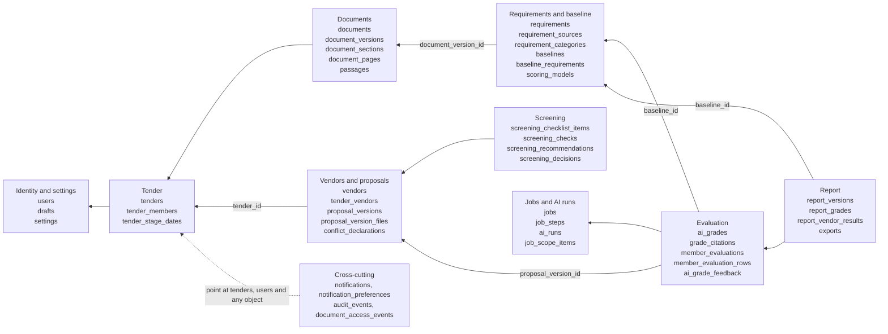
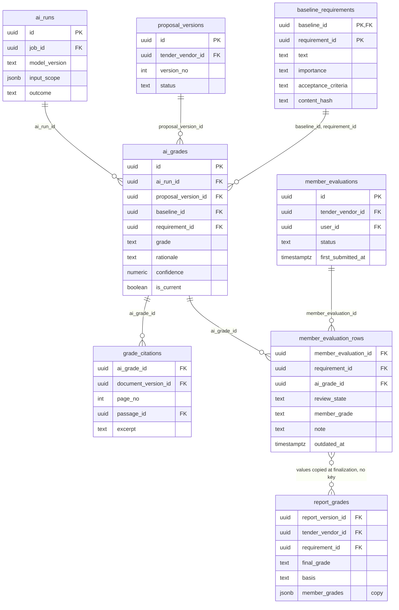
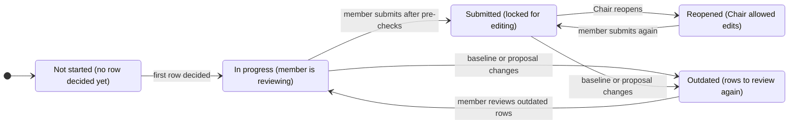

# AI Tender Evaluation Platform – Data Model Design

Oct 11, 2026 · @Ahmed

## Purpose, scope and data principles

This document defines the database model behind the tender evaluation platform: what is stored, how it is linked, and which rules the database enforces itself. It realises AI Tender Evaluation Platform – UX Requirements and follows the screens in AI Tender Evaluation Platform – UX Design. Requirement IDs such as UX-REQ-13 refer to the requirements document.

**Scope.** Application data only: users, tenders, documents and their extracted text, requirements, scoring, screening, AI and human grades, the report, jobs, notifications and the audit trail. Prompting, retrieval strategy and infrastructure are out of scope, except where they leave data behind (model runs, citations). They are designed in AI Tender Evaluation Platform – Platform Integration Design (API, Keycloak, RustFS, NATS) and AI Tender Evaluation Platform – AI Pipeline Design (worker, agent, Qdrant).

**Assumptions**

- A relational database, PostgreSQL 15 or later. Keys are UUIDv7. All times are stored as timestamptz in UTC and shown in the user's time zone (UX-NFR-08).
- Files stay in object storage. The database holds their metadata, storage key and content hash.
- Extracted text, pages and passages are stored in the database so that citations can be resolved and searched. Embeddings for retrieval sit in Qdrant, one point per passage, with the passage id as the point id (see Platform Integration Design).
- One organisation per deployment, so tables carry no organisation key.
- English only (UX-NFR-01), so full-text search uses the English configuration.

**Data principles**

| # | Principle | What it means in the schema | Requirements |
| --- | --- | --- | --- |
| 1 | AI output is a suggestion, stored apart from human decisions | AI grades are immutable rows. A person's agreement or override is a separate row that points to the AI grade, so both stay visible. | UX-GEN-01, UX-GEN-02 |
| 2 | Anything confirmed is a locked snapshot | Confirming the requirements copies them into a baseline version. Finalizing the report copies the final grades into a report version. Snapshots are never updated. | UX-REQ-13, UX-REQ-14, UX-SCO-02, UX-RPT-08 |
| 3 | History is appended, never erased | The interface deletes nothing for good. Rows are soft-deleted, older versions are marked Superseded, and finished tenders are archived. | UX-GEN-07, UX-DOC-04, UX-TND-06 |
| 4 | Every change is recorded in one audit trail | Each write goes through a service that also writes an audit event with the values before and after. The audit table is append-only. | UX-GEN-05, UX-AUD-01, UX-AUD-02 |
| 5 | Independence is enforced by the database | Row-level security hides a member's grades and notes from everyone else until the rules in Independence and access are met. | UX-EVA-12, UX-RPT-01 |
| 6 | Evidence is stored by reference | Every requirement and every AI grade points to a document version, a page and a passage, so the viewer can open and highlight it. | UX-GEN-03, UX-EVA-05 |
| 7 | Business rules are constraints where possible | One Chair per tender, a note of at least 10 characters for every override, and valid status changes are checked by the database, not only by the interface. | UX-ROL-02, UX-GEN-04 |
| 8 | Concurrent edits are detected | Editable rows carry a row_version. A save that names an old version is refused, and the second editor sees what changed. | UX-REQ-12 |

**Conventions.** Table names are plural snake_case. Every table has id, created_at and updated_at, except append-only tables, which have no updated_at. Editable tables add row_version. Soft-deleted rows carry deleted_at and deleted_by. Enumerations are stored as text with a check constraint; their values are listed in Enumerations and status values. The tables below show business columns only, and foreign keys are named after the table they point to.

## Domain overview

The model has eleven areas. Each links back to one tender, and the evaluation and report areas also point at the proposal version and the locked baseline their grades were produced from.

**Diagram 1: domain overview · 11 areas, 10 main links**

The drawing shows the main tables of each area; the entity catalogue lists all of them. Evaluation points at both the proposal version and the baseline, so a grade always records what it was graded against.

### The evaluation core

Grades are the most sensitive data in the model. The AI writes one immutable row per requirement and proposal version. Each member's decision is a separate row that points at the AI grade, so the AI value stays visible beside an override (UX-EVA-07). The report copies the final grades when it is finalized, so a finalized report never changes.

**Diagram 2: evaluation core · 8 tables**

## Entity catalogue

Tables are grouped by the eleven areas in the overview. The standard columns from Conventions are not repeated here, and a column ending in _id points to the table of that name unless the note says otherwise. The requirements behind each area are listed in Requirement traceability.

### Identity and settings

| Table | Key columns | Rules and notes |
| --- | --- | --- |
| **users** | email, display_name, role, status, sso_subject, time_zone, last_sign_in_at | role is admin, member or observer, kept as a copy of the Keycloak realm role. Chair is not a role: it is a flag on the tender membership. email is unique ignoring case. sso_subject holds the Keycloak subject and is required and unique. Keycloak keeps the credentials, the lockout, the sessions and the invitation and reset tokens, so none of them is stored here. A deactivated user stays in the table, so their past work keeps its author. |
| **drafts** | user_id, object_type, object_id, field, body, saved_at | Autosaved notes and edits in progress. One row per user and field, overwritten on each save and removed when the real save succeeds. Only its author can read it. |
| **requirement_categories** | name, sort_order, is_active | The managed list that requirements and scoring weights use. Names are unique. A category that is in use is deactivated, never deleted. A new installation is seeded with seven starter categories (migration V23, only while the table is empty); the list is global, not per tender. |
| **settings** | key, value, description, changed_by | Holds the assumed parameters: note length (10 characters) and upload limit (100 MB). Lockout and the session timeout are realm settings in Keycloak. Services read them, so a value can change without a release. |
| **idempotency_keys** | user_id, idempotency_key, operation, request_hash, response_status, response_body, location, expires_at | Added in Phase 1 (not in the original 47). Remembers the first answer to a job or export start for 24 hours, so a repeat with the same key returns it instead of creating another job (PI 2.1). Unique on (user_id, key, operation). A key reused with a different request hash is refused with 422. |

### Tender

| Table | Key columns | Rules and notes |
| --- | --- | --- |
| **tenders** | name, reference_no, description, status, opened_at, archived_at, created_by | status is draft, requirements, evaluation, consolidation or finalized. Archiving sets archived_at and keeps the status, so the stage the tender reached is not lost. name is unique among tenders that are not soft-deleted. Opening to the committee needs an RFP and at least one member, which the service checks. |
| **tender_members** | tender_id, user_id, is_chair, status, added_at, removed_at, removal_handling, reassigned_to_user_id | status is active or removed. A partial unique index allows one active Chair per tender, and the Chair must be an active member. A trigger rejects users whose role is admin, so the administrator cannot also sit on the committee. removal_handling is kept_as_history or reassigned. |
| **tender_stage_dates** | tender_id, stage, due_date, reminder_lead_days, last_reminded_at, removed_at | Optional, one row per stage (requirements, evaluation, consolidation). The evaluation row holds the due date entered when the tender is created, so tenders has no due-date column of its own. |

### Documents

| Table | Key columns | Rules and notes |
| --- | --- | --- |
| **documents** | tender_id, doc_type, title, parent_document_id | doc_type is rfp, brd, addendum, other or proposal. A partial unique index allows one active RFP per tender. An addendum points to the RFP through parent_document_id. Proposal files are documents too, so one viewer and one evidence structure serve both. The current version is the highest version_no that is not superseded. |
| **document_versions** | document_id, version_no, file_name, file_format, size_bytes, sha256, storage_key, status, failure_reason, page_count, uploaded_by, superseded_at | file_format is pdf or docx. size_bytes may not exceed the upload limit. status is uploading, processing, ready or failed. failure_reason is the failure code of the document_processing job (password_protected, no_selectable_text, unsupported_format, source_unavailable, index_unavailable, timeout or other), and the plain-language message is built in the interface. The file lives in object storage and only storage_key is kept here. Unique on (document_id, version_no). |
| **document_pages** | document_version_id, page_no, width, height, render_key | One row per page. render_key is the key of the rendered PDF in object storage, the same on every page of the version. A DOCX file is converted to pages when it is processed, so the page numbers the viewer shows and citations use are the converted ones. |
| **document_sections** | document_version_id, parent_section_id, title, level, sort_order, start_page, end_page | The contents outline used to tick sections for extraction. It is built from headings or the PDF outline. A document with neither has no sections and is selected by page range. |
| **passages** | document_version_id, section_id, page_no, passage_no, text, bbox, char_start, char_end, content_hash | The smallest citable unit, such as a paragraph or a table cell block. bbox holds the rectangles on the page, so the viewer can highlight the passage. Rows never change after processing. Reprocessing means a new document version. Citations and requirement sources point at passages. A passage id is derived from the document version and the passage number, so a retried parse gives the same ids, and it is also the id of the passage's point in the vector index. |

### Vendors and proposals

| Table | Key columns | Rules and notes |
| --- | --- | --- |
| **vendors** | name, normalized_name, website, normalized_domain, description, registration_no, contact_person | Reusable across tenders. A new vendor is checked against normalized_name and normalized_domain, and a match shows a warning with a link to the existing profile. It is not a hard rule. website must be a valid URL. |
| **tender_vendors** | tender_id, vendor_id, added_by, added_at, removed_at | One row per vendor in a tender, unique on (tender_id, vendor_id). Everything vendor-specific in a tender hangs on this row, so removing a vendor from a tender never touches the vendor record. |
| **proposal_versions** | tender_vendor_id, version_no, status, change_reason, uploaded_by, uploaded_at, superseded_at | status is uploaded, in_screening, accepted, rejected, resubmission_requested, evaluating, evaluated or superseded. A partial unique index allows only one version per vendor that is not superseded. change_reason is required from version 2 when AI evaluation has already run. |
| **proposal_version_files** | proposal_version_id, document_version_id, file_role, sort_order | file_role is main or annex, and each proposal version has exactly one main file. An unchanged annex can be linked to the next version without uploading it again. |
| **conflict_declarations** | tender_vendor_id, user_id, has_conflict, statement, declared_at | One per member and vendor, recorded before the member first opens the proposal. Immutable once saved. has_conflict set to true excludes the member from that vendor's evaluation and notifies the admin and the Chair. |

### Screening

| Table | Key columns | Rules and notes |
| --- | --- | --- |
| **screening_checklist_items** | tender_id, label, sort_order, is_default, is_active | Seeded with the five default items when a tender is created. The Chair edits them before screening starts and they are locked after that. Items are deactivated, not deleted, so earlier checks stay meaningful. |
| **screening_checks** | proposal_version_id, checklist_item_id, user_id, is_checked, note | One row per member, item and proposal version. Whether the checklist should be shared instead of per member is an open question. |
| **screening_prechecks** | proposal_version_id, ai_run_id, expected_section, found, note | Optional AI suggestions that compare the proposal's structure with the format the RFP asks for. Nothing reads them to make a decision. |
| **screening_recommendations** | proposal_version_id, user_id, recommendation, reason | recommendation is accept, reject or request_resubmission. A check constraint requires reason for the last two. One current row per member and proposal version, readable by the whole committee. |
| **screening_decisions** | proposal_version_id, decision, reason, decided_by, decided_at, is_reinstatement | Append-only. A trigger requires decided_by to be the tender's Chair. Accept queues the evaluation job. Reject and request_resubmission need a reason. Reinstating a rejected vendor adds a row with is_reinstatement true and a note, and the latest row is the current decision. |

### Requirements and baseline

| Table | Key columns | Rules and notes |
| --- | --- | --- |
| **requirements** | tender_id, display_no, text, category_id, importance, acceptance_criteria, origin, review_state, extraction_ai_run_id, ai_original, delete_reason, duplicate_of_requirement_id, merged_into_requirement_id, split_from_requirement_id, last_changed_by | The shared, editable working list, versioned with row_version. display_no is the ID people see (for example REQ-014), unique within the tender and never reused. importance is mandatory or optional, origin is ai or manual, and review_state is unreviewed, reviewed or confirmed. ai_original keeps the AI's first text, category, importance and criteria for the history panel. A deleted row keeps delete_reason (duplicate, out_of_scope, not_a_requirement or other), and a duplicate must name the row that is kept. A merge or split links the old and new rows. |
| **requirement_sources** | requirement_id, document_version_id, passage_id, page_no, quote | One or more per requirement, so a merge keeps every source. Required for AI requirements and optional for manual ones. The source document type comes from the document, so it is not copied. |
| **requirement_flags** | requirement_id, flag_type, detail, related_requirement_id, raised_by_ai_run_id, resolved_at, resolved_by | flag_type is possible_duplicate, compound, low_confidence or conflict. A flag is resolved, never deleted. Confirming a baseline needs no open flag. |
| **baselines** | tender_id, version_no, status, requirement_count, confirmed_by, confirmed_at, reopened_by, reopened_at, reopen_reason | status is confirmed, reopened or superseded. A trigger requires confirmed_by to be the Chair. Locked on insert. Only status and the reopen columns can change, and only in the order confirmed, reopened, superseded. At most one baseline per tender is confirmed or reopened. Unique on (tender_id, version_no). |
| **baseline_requirements** | baseline_id, requirement_id, display_no, text, category_name, importance, acceptance_criteria, sources, content_hash | A full copy of every confirmed requirement. The key is (baseline_id, requirement_id), so a requirement keeps its identity across versions. content_hash covers text, importance and acceptance criteria. Never updated or deleted. |
| **scoring_models** | tender_id, baseline_id, points_fully, points_partially, points_non, mandatory_rule | While the Chair sets scoring, baseline_id is empty and the row is editable, one per tender. Confirming the baseline copies it into a locked row that carries baseline_id. Defaults are 1.0, 0.5 and 0. mandatory_rule accepts only flag_only, so the rule is stored with the scoring and the system never disqualifies a vendor. |
| **scoring_category_weights** | scoring_model_id, category_id, weight | Equal by default. A weight must be positive. Weights in a locked model cannot change. |

### Jobs and AI runs

Phase 2 added six operational columns to jobs for the message loop (PI 5.5 to 5.8): `last_status_seq` (a status with a lower number never replaces a higher one), `last_status_at` (the silence watchdog), `command_published_at` (the queued watchdog), `result_parts`, `counts` and `warnings` (what the final status reported). They hold no business data.

| Table | Key columns | Rules and notes |
| --- | --- | --- |
| **jobs** | tender_id, job_type, target_type, target_id, status, started_by, current_step, progress_percent, queued_at, started_at, finished_at, failure_code, failure_message, retry_of_job_id, cancelled_by, scope_hash, last_status_seq, last_status_at, command_published_at, result_parts, counts, warnings | job_type is document_processing, requirement_extraction, evaluation or screening_precheck. status is queued, running, completed, completed_with_warnings, failed or cancelled. started_by is empty when the system starts the job, for example processing after an upload or evaluation after a screening decision. Only the starter or the Chair can cancel. scope_hash lets the service find an overlapping job on the same scope. Jobs belong to the tender, so every committee member can read them. |
| **job_steps** | job_id, step_no, name, status, started_at, finished_at | The named steps shown in the job center, such as Reading document. status is pending, running, completed or failed. |
| **job_scope_items** | job_id, document_version_id, section_id, page_from, page_to | What the job was asked to read. A completed extraction job's items are what mark a section Extracted by name and date, and what the banner for other members reads. |
| **ai_runs** | job_id, run_type, model_name, model_version, prompt_version, input_scope, started_at, finished_at, outcome, warning_count | One row each time the AI is run. A retry or an outdated-rows re-run is a new job, so it gets its own run. input_scope records the documents, pages and baseline version used. outcome is succeeded, partial or failed. Immutable once finished. |

### Evaluation

| Table | Key columns | Rules and notes |
| --- | --- | --- |
| **ai_grades** | ai_run_id, proposal_version_id, baseline_id, requirement_id, outcome, failure_code, grade, non_compliance_reason, rationale_summary, rationale, missing_elements, confidence, requirement_hash, is_current | Immutable. outcome is graded or failed. A failed row shows Not evaluated, has no grade and carries a failure_code (ungrounded, invalid_output or model_error); the code is empty on a graded row. grade is fully_compliant, partially_compliant or non_compliant. non_compliance_reason (explicitly_excluded or not_addressed) is required for non_compliant and empty otherwise. missing_elements is required for partially_compliant. A fully compliant grade needs at least one citation, checked when the run finishes. requirement_hash records which requirement text was graded, so a later change is detectable. Only is_current may change, from true to false, when a newer grade replaces the row. Only one current grade per proposal version and requirement. |
| **grade_citations** | ai_grade_id, citation_no, document_version_id, passage_id, page_no, excerpt | Zero or more per grade, and zero means No evidence found. A trigger checks that the passage belongs to a document version linked to the grade's proposal version. page_no and excerpt are stored with the reference, so a citation list can be shown and exported without joining passages. |
| **ai_grade_feedback** | ai_grade_id, user_id, is_useful, reason_tags, comment | One per member and AI grade. Reason tags come from a fixed list, for example wrong_page and missed_evidence. Not part of the report. |
| **member_evaluations** | tender_vendor_id, user_id, status, first_submitted_at, submitted_at, reopened_at, reopened_by, reopen_reason, excluded_at, excluded_by, exclusion_reason | One per member and vendor, created for every active member when the vendor's evaluation job completes. Unique on (tender_vendor_id, user_id). status is not_started, in_progress, submitted, reopened or outdated. first_submitted_at is set once and never cleared. It is what unlocks other members' grades, so a reopen does not hide them again. A conflict declaration or a formal exclusion sets excluded_at, and an exclusion needs a reason. |
| **member_evaluation_rows** | member_evaluation_id, requirement_id, ai_grade_id, review_state, member_grade, note, needs_clarification, clarification_note, outdated_at, outdated_reason, reviewed_at | One per requirement, created with the member evaluation. review_state is not_reviewed, agreed or overridden. Agree copies the AI grade into member_grade. Override sets a different grade and needs a note of at least 10 characters after trimming, enforced by a check constraint. Needs clarification is a flag, not a grade. outdated_reason is baseline_changed or proposal_changed. Rows become read-only when the member evaluation is submitted, and editable again if the Chair reopens it. |

### Report

| Table | Key columns | Rules and notes |
| --- | --- | --- |
| **report_versions** | tender_id, version_no, baseline_id, scoring_model_id, status, created_by, finalized_by, finalized_at, reopened_from_version_id, reopen_reason | status is in_progress, finalized or superseded. A tender has at most one in_progress and one finalized version at a time. A finalized version is locked: triggers refuse any change to it or to its child rows. Reopening adds the next version as in_progress with the final grades copied and a required reason. The earlier version stays finalized until the new one is finalized, then becomes superseded. |
| **report_grades** | report_version_id, tender_vendor_id, requirement_id, ai_grade_id, ai_grade, final_grade, basis, justification, decided_by, decided_at, has_disagreement | One row per vendor and requirement. basis is all_agree or chair_decision. A chair_decision needs a justification of at least 10 characters and decided_by equal to the Chair. While the version is in progress only the Chair's decisions on disagreements exist, and the other rows are written at finalization. All values are copies, so the report cannot change when source rows do. |
| **report_member_grades** | report_grade_id, user_id, member_grade, note, review_state | A copy of each member's grade and note for that cell, written at finalization and shown in the expanded matrix cell. Append-only. |
| **report_vendor_results** | report_version_id, tender_vendor_id, outcome, rank, final_score, compliance_percent, mandatory_failures, count_fully, count_partially, count_non, agreement_level, override_count, override_percent, category_scores, reason | outcome is evaluated or rejected_at_screening, and a rejected vendor keeps its screening reason and has no rank. Computed once at finalization from the final grades and the locked scoring model, so an export always matches the screen. |
| **exports** | tender_id, export_type, source_type, source_id, format, requested_by, status, storage_key, context, created_at | export_type is report, requirements_list, clarification_list or audit_log. format is pdf, xlsx or csv. context records what the file states about itself: committee, baseline version, scoring model, AI model version and finalization date. The generated file is kept so the same export can be shown again and audited. |

### Notifications

| Table | Key columns | Rules and notes |
| --- | --- | --- |
| **notifications** | user_id, tender_id, notification_type, object_type, object_id, params, created_at, read_at, email_status, emailed_at | One row per recipient. params holds the values for the message template, such as names and counts. The text is built when it is shown, so wording can change without rewriting history. email_status is not_requested, pending, sent or failed. The unread count is the number of rows with read_at empty. A user can read only their own rows. |
| **notification_preferences** | user_id, notification_type, email_enabled | One row per user and type. No row means the default in settings. In-app notifications cannot be switched off. |

### Audit and access logs

| Table | Key columns | Rules and notes |
| --- | --- | --- |
| **audit_events** | occurred_at, actor_user_id, actor_role, source, tender_id, tender_vendor_id, object_type, object_id, action, before, after, note, batch_id, request_id | Append-only and partitioned by month on occurred_at. source is person, ai or system, and actor_user_id is empty unless source is person. before and after hold only the columns that changed. Time is stored in UTC and shown in the viewer's time zone. The application's database role has insert and select rights only, with no update, delete or truncate. batch_id ties together the rows changed by one bulk action, each with the same note. History panels read this table by object. |
| **document_access_events** | user_id, document_version_id, tender_vendor_id, opened_at, watermark_shown | One row each time a member opens a proposal in the viewer. Append-only. Whether individual page views are logged too is an open question. |

## Enumerations and status values

Every enumeration is stored as lower-case snake_case text with a check constraint. The interface turns a stored value into its label in one place, using the words in the requirements, so the same status shows the same label on every screen (UX-GEN-10). A value is added by a migration, never by editing data.

### Values

| Field | Stored values |
| --- | --- |
| users.role | admin, member, observer |
| users.status | invited, active, deactivated |
| tenders.status | draft, requirements, evaluation, consolidation, finalized |
| tender_members.status | active, removed |
| tender_members.removal_handling | kept_as_history, reassigned |
| tender_stage_dates.stage | requirements, evaluation, consolidation |
| documents.doc_type | rfp, brd, addendum, other, proposal |
| document_versions.status | uploading, processing, ready, failed |
| document_versions.failure_reason | password_protected, no_selectable_text, unsupported_format, source_unavailable, index_unavailable, timeout, other |
| proposal_versions.status | uploaded, in_screening, accepted, rejected, resubmission_requested, evaluating, evaluated, superseded |
| proposal_version_files.file_role | main, annex |
| screening_recommendations.recommendation, screening_decisions.decision | accept, reject, request_resubmission |
| requirements.importance | mandatory, optional |
| requirements.origin | ai, manual |
| requirements.review_state | unreviewed, reviewed, confirmed |
| requirements.delete_reason | duplicate, out_of_scope, not_a_requirement, other |
| requirement_flags.flag_type | possible_duplicate, compound, low_confidence, conflict |
| baselines.status | confirmed, reopened, superseded |
| scoring_models.mandatory_rule | flag_only |
| jobs.job_type | document_processing, requirement_extraction, evaluation, screening_precheck |
| jobs.status | queued, running, completed, completed_with_warnings, failed, cancelled |
| jobs.failure_code | password_protected, no_selectable_text, unsupported_format, source_unavailable, index_unavailable, llm_unavailable, no_content_in_scope, timeout, other |
| job_steps.status | pending, running, completed, failed |
| ai_runs.outcome | succeeded, partial, failed |
| ai_grades.outcome | graded, failed |
| ai_grades.failure_code | ungrounded, invalid_output, model_error |
| ai_grades.grade, member_evaluation_rows.member_grade, report_grades.final_grade | fully_compliant, partially_compliant, non_compliant |
| ai_grades.non_compliance_reason | explicitly_excluded, not_addressed |
| member_evaluations.status | not_started, in_progress, submitted, reopened, outdated |
| member_evaluation_rows.review_state | not_reviewed, agreed, overridden |
| member_evaluation_rows.outdated_reason | baseline_changed, proposal_changed |
| report_versions.status | in_progress, finalized, superseded |
| report_grades.basis | all_agree, chair_decision |
| report_vendor_results.outcome | evaluated, rejected_at_screening |
| exports.export_type | report, requirements_list, clarification_list, audit_log |
| exports.format | pdf, xlsx, csv |
| exports.status | pending, ready, failed |
| notifications.email_status | not_requested, pending, sent, failed |
| notifications.notification_type | added_to_tender, tender_opened, job_completed, job_failed, requirements_confirmed, requirements_reopened, proposal_screened, evaluation_ready, evaluation_reopened, new_proposal_version, all_members_submitted, report_finalized, due_date_reminder, manual_reminder, conflict_declared, resubmission_requested, document_added |
| audit_events.source | person, ai, system |
| audit_events.action | tender_created, tender_updated, tender_opened, tender_archived, committee_changed, user_invited, user_role_changed, user_deactivated, vendor_created, vendor_updated, document_uploaded, document_version_uploaded, proposal_version_uploaded, conflict_declared, category_created, category_updated, screening_checklist_changed, screening_checks_saved, ai_feedback_sent, requirement_created, requirement_edited, requirement_deleted, requirement_restored, requirement_merged, requirement_split, requirement_reviewed, requirement_flag_resolved, scoring_changed, baseline_confirmed, baseline_reopened, screening_recommended, screening_decided, screening_reinstated, grade_agreed, grade_overridden, row_flagged, rows_marked_outdated, evaluation_submitted, evaluation_reopened, member_excluded, report_grade_recorded, report_finalized, report_reopened, export_created, ai_run_completed, job_status_changed, user_updated, user_reactivated, user_invitation_resent, setting_changed, tender_duplicated, tender_vendor_added, document_impact_decided, document_retry_requested, job_cancelled, job_retried |

Three notification types are not in UX-NOT-01 but are required by other requirements: conflict_declared (UX-TND-07), resubmission_requested (UX-SCR-07) and document_added (UX-DOC-04 and UX-DOC-05). Not evaluated, Needs clarification and Outdated appear in the requirements as flags, not statuses, so they are stored as outcome, needs_clarification and outdated_at rather than as values of a status column.

### Allowed status changes

A trigger on each table refuses any move that is not listed here. A retry of a failed job is a new job that points back through retry_of_job_id.

| Field | From | To | Caused by |
| --- | --- | --- | --- |
| tenders.status | draft | requirements | The admin opens the tender to the committee |
| tenders.status | requirements | evaluation | The Chair confirms the baseline |
| tenders.status | evaluation | consolidation | Every accepted vendor has all members' evaluations submitted or formally excluded |
| tenders.status | consolidation | finalized | The Chair finalizes the report |
| tenders.status | evaluation, consolidation | requirements | The Chair reopens the baseline |
| tenders.status | finalized | consolidation | The Chair reopens the report |
| document_versions.status | uploading | processing | The upload completes |
| document_versions.status | processing | ready, failed | The processing job ends |
| document_versions.status | failed | processing | Retry from the job center |
| proposal_versions.status | uploaded | in_screening | The first checklist item or recommendation is saved |
| proposal_versions.status | in_screening | accepted, rejected, resubmission_requested | The Chair confirms the decision |
| proposal_versions.status | rejected | accepted | The Chair reinstates the vendor with a note |
| proposal_versions.status | accepted | evaluating | The evaluation job starts, which needs a confirmed baseline |
| proposal_versions.status | evaluating | evaluated | The evaluation job completes |
| proposal_versions.status | any other value | superseded | A newer proposal version is added |
| jobs.status | queued | running | A worker picks the job up |
| jobs.status | running | completed, completed_with_warnings, failed | The job ends |
| jobs.status | queued, running | cancelled | The starter or the Chair cancels |
| jobs.status | queued | failed | The broker refused the command, or the job never started (PI 6.2 step 2, PI 5.8). Added in Phase 1; the original table had no way to close a job that never ran. |
| member_evaluations.status | not_started | in_progress | The member saves a decision on the first row |
| member_evaluations.status | in_progress, reopened | submitted | The member submits after the pre-checks pass |
| member_evaluations.status | submitted | reopened | The Chair reopens it with a reason |
| member_evaluations.status | in_progress, submitted | outdated | Rows the member had reviewed are marked Outdated by a baseline or proposal change |
| member_evaluations.status | outdated | in_progress | The member starts reviewing the outdated rows |
| member_evaluation_rows.review_state | not_reviewed | agreed, overridden | The member acts on the row |
| member_evaluation_rows.review_state | agreed | overridden | The member changes their decision before submitting |
| member_evaluation_rows.review_state | overridden | agreed | The member returns to the AI grade before submitting |
| member_evaluation_rows.review_state | agreed, overridden | not_reviewed | The row is marked Outdated |
| requirements.review_state | unreviewed | reviewed | A member reviews, edits or bulk-marks the row |
| requirements.review_state | reviewed | confirmed | The Chair confirms the baseline |
| requirements.review_state | confirmed | reviewed | A member edits the row after the Chair reopened the baseline (open question 5) |
| baselines.status | confirmed | reopened | The Chair reopens it with a reason |
| baselines.status | reopened | superseded | The Chair confirms the next version |
| report_versions.status | in_progress | finalized | The Chair finalizes |
| report_versions.status | finalized | superseded | The next version is finalized |

## Versioning, locking and Outdated

Five things are versioned. Each version is its own set of rows. A newer version never edits an older one, and a locked version refuses updates in the database.

| Object | Stored as | A new version appears when | The earlier version |
| --- | --- | --- | --- |
| Document | document_versions, unique on (document_id, version_no) | Someone uploads a new file for the document | Kept and marked with superseded_at. Its passages, and the citations that point at them, stay valid. |
| Proposal | proposal_versions, unique on (tender_vendor_id, version_no) | The admin uploads a new version, or a resubmission after a request | Status becomes superseded. Its AI grades are kept. |
| Requirements baseline | baselines, with baseline_requirements and a locked scoring_models row | The Chair confirms the list, and again after each reopen | Status becomes superseded. Grades keep pointing at the baseline they were made against. |
| AI grade | ai_grades, one row per requirement for each run | Every evaluation run, including a re-run of outdated rows only | The older row keeps its values and gets is_current false. |
| Report | report_versions, with report_grades, report_member_grades and report_vendor_results | The Chair reopens a finalized report | Stays finalized and readable until the new version is finalized, then becomes superseded. |

A member's evaluation is not versioned. Each member has one live set of rows per vendor, and every change to it is written to audit_events with the before and after values, which is what the history panel shows.

### Member evaluation states

The five states are the values of member_evaluations.status. Submitted is the one that matters for independence. The first submission sets first_submitted_at, which opens other members' grades for that vendor, and that is never undone, even if the Chair reopens the evaluation or it later becomes Outdated. Outdated is entered from In progress or Submitted, and only for members who had already reviewed rows.

**Diagram 3: member evaluation · 5 states, 6 moves**

### How Outdated is detected

**A requirement changes.** Each AI grade stores the requirement_hash it was made against. When the Chair confirms the next baseline, the service compares that hash with the content_hash of the same requirement_id in the new baseline. For every row where they differ, outdated_at is set, outdated_reason becomes baseline_changed, review_state returns to not_reviewed and member_grade is cleared. The earlier decision stays in audit_events as the before value. Rows for unchanged requirements are untouched, so only the affected rows need a new review (UX-REQ-14). New requirements get new rows.

**A proposal changes.** Adding a proposal version marks every row of that vendor Outdated with the reason proposal_changed, because the evidence may have moved. The admin sees the count first and must enter a reason (UX-VND-05).

**Re-running the AI.** A member can re-run the AI for the outdated rows only. The run adds new ai_grades rows, sets is_current to false on the ones they replace, and points each member row at the new grade. Earlier grades stay and can be opened from the row history (UX-EVA-14).

**Reopening a report.** The Chair's reopen adds the next report version in progress, with the final grades copied and the reason recorded. The tender returns to consolidation. The earlier finalized version stays readable until the new one is finalized.

**Reopening an evaluation.** The Chair reopens a submitted evaluation with a reason. Its status becomes reopened and its rows are editable again until the member submits.

## Independence and access

The database decides who can read and write each row, so a mistake in the interface cannot reveal a member's grades. Each request runs in a transaction that sets the signed-in user and role (for example with SET LOCAL), and row-level security policies read them together with tender_members, conflict_declarations and member_evaluations. The application connects with a role that does not own the tables, so it cannot switch the policies off.

### Functions the API role may call (Phase 3)

Four small functions carry rules that a policy alone cannot express. `app_baseline_locked(tender_id)` and `app_can_edit_requirements(tender_id)` are read by the requirement, scoring and snapshot policies. `app_requirement_history(requirement_id)` returns a requirement's audit rows to a committee member, because members cannot read `audit_events` directly; it checks tender access inside. `app_chair_move_stage(tender_id, to_stage)` runs as its owner and lets only the active Chair, read from `tender_members`, move a tender between requirements and evaluation, and between evaluation or consolidation and requirements; every other stage change stays with the existing path.

### Functions and triggers added for screening and evaluation (Phase 4)

`app_cleared_for_vendor(vendor)` is true for a member who declared "no conflict" for the vendor and is not excluded from it; `app_can_read_document_version`, the grade and citation policies, the release rule for another member's rows and the write policy on a member's own rows all use it. `app_can_read_grades(version)` adds the administrator's release rule. `ingest_sync_member_evaluations(version)` is the only way member evaluations and rows are created or re-pointed; the AI-ingest connection may execute it and it returns counts, so that connection has no privilege on any member table. `app_mark_rows_outdated(vendor, reason, requirements, note)` outdates only rows whose requirement hash differs from the confirmed baseline (the Chair, `baseline_changed`) or whose grade belongs to a replaced proposal version (the administrator, `proposal_changed`); it keeps the member's earlier decision on the row (`previous_*`) and writes audit events without any grade, because the administrator and the Observer read the audit trail. Triggers: the five default checklist items seed with each tender; screening checks and recommendations move a proposal to `in_screening`, belong to one member and proposal version and close once the Chair has decided; the Chair's decision (append-only) moves the proposal version; an evaluation job moves it to `evaluating` and, when completed with at least one stored grade, to `evaluated`; a declared conflict excludes the member from an existing evaluation. A grade other than "not addressed" needs at least one citation at commit, a citation is stored with its grade and names the passage, page and excerpt of a file of the graded proposal, and a grade names the requirement and hash of the tender's baseline and the run of that proposal version's evaluation job.

### Read rules

| Rows | Reader | Can read when |
| --- | --- | --- |
| Tenders and everything that hangs on them: documents, vendors, requirements, baselines, screening, jobs | Chair and members | The tender is one they are an active member of |
|  | Admin | Always |
|  | Observer | Always, as read-only. The requirements do not say whether an Observer is limited to some tenders, so this is an open question |
| Proposal files, pages and passages | Chair and members | They have a conflict declaration for that vendor with has_conflict false, and they are not excluded |
|  | Admin and Observer | Always |
| ai_grades and grade_citations | Chair and members | Same condition as the proposal files |
|  | Admin | The admin rule for member_evaluation_rows below |
| member_evaluations (status and dates only, no grades) | Admin, Chair and members of the tender | Always. This is the progress matrix |
| member_evaluation_rows (grades, notes, flags) | The member who owns them | Always |
|  | Another member, or the Chair | Their own evaluation of that vendor has first_submitted_at set, and the owner's evaluation is submitted |
|  | Admin | Every member's evaluation of that vendor is submitted or formally excluded |
|  | Observer | Never directly. Only through the finalized report |
| screening_recommendations | Chair and members | Always, for their tenders |
|  | Admin | Not individual recommendations. Admin reads decisions and progress only |
| report_vendor_results, report_grades, report_member_grades | Admin and Chair | An in-progress version, once every member's evaluation of that vendor is submitted or excluded. A finalized version, always |
|  | Members and Observer | Finalized versions only |
| audit_events, document_access_events | Admin and Observer | Always |
|  | Everyone else | Never directly. History panels read a view that returns only events on objects the reader may already read, and never another member's evaluation rows before the rules above release them |
| drafts | The author | Always, and nobody else |

### Write rules

| Action | Enforced by |
| --- | --- |
| Confirm or reopen a baseline, confirm a screening decision, record a final grade, finalize or reopen a report, reopen a member's evaluation | A trigger checks that the acting user is the tender's active Chair |
| Create or edit tenders, committees, vendors, proposals and the RFP | Policy: admin only |
| Add a user who is an admin to a committee | A trigger on tender_members refuses it |
| Edit requirements | Policy: an active member or Chair of the tender, and no baseline of that tender is in the confirmed state |
| Change a member evaluation row | Policy: the owner only, and the evaluation is not submitted. Nobody else can change it, including the Chair |
| Write ai_runs, ai_grades, grade_citations and extracted requirements | Only the AI-ingest connection, which the backend's result handler uses (the worker and the agent never open a database connection). It can insert but cannot read member_evaluation_rows, so AI output never depends on a human decision |
| audit_events and document_access_events | Insert and select only, for every role |

The policies follow UX-EVA-12 and the permissions table: peers' grades open after a member's own submission. UX-RPT-01 is narrower, because it limits the Chair to the progress matrix in the report until every member has submitted. The policies above allow the broader rule and leave the narrower one to the report screen. If the Chair should see nothing of other members before every submission, the Chair's condition on member_evaluation_rows changes to the admin condition. This is listed in the open questions.

## AI output and evidence

The AI proposes and people decide, so the model keeps the AI's output, the person's decision and the evidence in separate places that point at each other. Nothing the AI wrote is edited afterwards.

### How one evaluation run is stored

| Step | What is written |
| --- | --- |
| 1 | A confirmed Accept decision creates an evaluation job for the proposal version. If the baseline is not confirmed yet, the version waits in accepted and the service creates the job when the baseline is confirmed (UX-SCR-06). |
| 2 | The agent's first status message names the model and its version, the prompt version and the input scope (document versions, pages and baseline version), and the backend adds the ai_runs row from it. The same message lists the step names, and the backend adds the job_steps rows. |
| 3 | The agent sends its grades in batches. For each requirement in the baseline the backend adds one ai_grades row, with the rationale and any missing elements, and zero or more grade_citations rows that point at passages. |
| 4 | When the run ends, the service checks the rules from the catalogue: a citation for a fully compliant grade, a reason type for a non-compliant one, missing elements for a partial one. It then sets the run outcome and the job status. |
| 5 | For every active member who is not excluded, the service creates the member_evaluations row and one member_evaluation_rows row per requirement. Each points at the current AI grade with review_state not_reviewed, and the member is notified that the evaluation is ready. |

If part of a run fails, completed rows are kept (UX-EVA-18). A requirement that failed gets an ai_grades row with outcome failed, a failure_code and no grade, and its member row shows Not evaluated. A retry is a new job that points back through retry_of_job_id. Its run writes new grades only for the failed rows, and those replace the failed ones as current. A member can also grade a Not evaluated row by hand. It is stored as overridden, and the note rule applies.

Requirement extraction is stored the same way. The extraction run creates requirements with origin ai, extraction_ai_run_id, ai_original and their requirement_sources. A possible duplicate, a compound requirement or a low-confidence item gets a requirement_flags row, and nothing is dropped silently (UX-EXT-06). The agent raises the possible duplicate, compound and conflict flags, and the backend raises the low-confidence flag from the confidence value and the setting.

### Reading a decision back

| Question | Where the answer is |
| --- | --- |
| What did the AI say, and why? | The ai_grades row: grade, rationale_summary, rationale, missing_elements, confidence |
| Which model produced it, from what input? | ai_runs, through ai_run_id: model_version, prompt_version and input_scope, and the job behind it |
| Where is the evidence? | grade_citations, then the passage, page_no and bbox the viewer highlights |
| What did this member decide? | member_evaluation_rows: review_state, member_grade and note, with the AI grade still beside it |
| What changed on the way? | audit_events for the row, with the before and after values and the note |
| What was finally decided? | report_grades: final_grade, basis, justification, and a copy of the AI grade and of every member's grade |

### Evidence by reference

A citation names a document version, a passage and a page. The viewer opens that page and highlights the passage's bbox. The reference stays valid for good, because passages never change and earlier document versions are kept. Citations are ordered by citation_no, so the member can step through them (UX-EVA-05), and a grade with none says No evidence found. Requirements point at the RFP or BRD in the same way through requirement_sources, which also keep every source of a merged requirement.

### Confidence, feedback and statistics

confidence is a number from 0 to 1 on each AI grade. The threshold that counts as Low AI confidence for the sheet filter is a row in settings, and its value is an open question. A member's useful or not useful vote is stored in ai_grade_feedback and never shown in the report. Override statistics for the report (UX-RPT-13) are counted per vendor at finalization into report_vendor_results. They are never grouped by member, so individual members cannot be ranked.

## Audit trail and history

Every write goes through one service layer, which saves the change and its audit event in the same transaction. There is never a change without an event, or an event without a change. The audit table is append-only (UX-AUD-02).

### What an event records

| UX-AUD-01 asks for | Stored as |
| --- | --- |
| Who | actor_user_id, empty unless the source is a person |
| Their role | actor_role, copied at the time of the event, so a later role change does not rewrite history |
| When, with time zone | occurred_at in UTC, shown in the viewer's time zone |
| The object | object_type and object_id, with tender_id and tender_vendor_id so events can be filtered |
| The action | action, from a fixed vocabulary |
| Values before and after | before and after, holding the changed columns only |
| The justification note | note |
| Person, AI or system | source |

Each AI run also writes an ai_run_completed event that carries the run id. The audit view joins ai_runs, so the trail and its exports show the model version, run time, input scope and outcome (UX-AUD-04).

### Actions that must carry a note

A check constraint on audit_events refuses these actions without a note of at least the minimum length. The services refuse them earlier, with a message the user can act on.

| Action | Why a note is required |
| --- | --- |
| requirement_edited, requirement_deleted, requirement_restored | Every override needs a justification (UX-GEN-04). A bulk action writes one event per row with the same note and the same batch_id (UX-REQ-08) |
| grade_overridden | The same rule, with the AI grade kept beside it (UX-EVA-07) |
| screening_decided with reject or request_resubmission, screening_reinstated | UX-SCR-04, UX-SCR-07 |
| baseline_reopened, evaluation_reopened, report_reopened | Each reopen needs a reason (UX-REQ-14, UX-EVA-13, UX-RPT-08) |
| member_excluded | A formal exclusion needs a reason (UX-RPT-08) |
| proposal_version_uploaded after an AI evaluation has run | The admin must give a reason (UX-VND-05) |
| report_grade_recorded for a disagreement | The Chair's justification (UX-RPT-06) |

### History panels, search and export

History panels (UX-REQ-11, UX-EVA-14) read audit_events by object_type and object_id, through the view described in Independence and access. A requirement's panel starts with its ai_original values and then lists each event. The admin and Observer search by tender, vendor, user, action and date (UX-AUD-03). The matching indexes are on (tender_id, occurred_at), (tender_vendor_id, occurred_at), (actor_user_id, occurred_at), (action, occurred_at) and (object_type, object_id, occurred_at). Queries always carry a date range, so partition pruning keeps them fast. A CSV export is an exports row of type audit_log, with the filters kept in its context.

### Why access logs are separate

Opening a proposal in the viewer is recorded in document_access_events, not in audit_events (UX-NFR-07). It happens far more often, it changes no data, and it has its own retention. The admin and Observer see both streams together in the audit screen.

## Documents, processing and jobs

Citations only work if every file becomes pages and passages first. This section follows a file from upload to a citable passage, and then describes how jobs are tracked.

### From upload to citable passages

| Step | What happens | What is stored |
| --- | --- | --- |
| Upload | The browser sends the file to the backend, which streams it into object storage and hashes it on the way. Only PDF and DOCX are accepted, and a file over the upload limit is refused before it starts. | A document_versions row in uploading. A cancelled upload is soft-deleted, because no file was ever stored. |
| Check | The extension and the file's own signature are both checked. Any other format is rejected at once. | A rejected file never gets a row. A corrupt file moves to failed with failure_reason other. |
| Processing | A document_processing job reads the file in named steps: Reading document, Building pages, Building outline, Building passages and Indexing passages. A password-protected file, or a PDF with no selectable text, stops here. | Status processing. The worker writes the rendered PDF and the parsed files to object storage, and the backend adds the rows in document_pages, document_sections and passages from them. The worker then stores each passage's embedding in the vector index, under the passage id. |
| Ready | The job completes. | Status ready and page_count set, once the rows are stored and the passages are indexed. Only now can the document be used for extraction, shown in the viewer or cited. |
| Failed | The job fails. | Status failed with a failure_reason code. The interface turns the code into a plain-language message and the next step. The admin uploads a new version, or retries when the cause was temporary. |

A DOCX file has no fixed pages, so processing converts it to pages once and stores that result. Citations use those page numbers for good. A new conversion would be a new document version. A PDF mixing text pages and scanned pages is not covered by the requirements, so it is an open question.

### Document versions and extraction

A new version of the RFP never changes the old one. When requirements were already extracted from it, the admin sees how many requirement_sources rows point at the superseded version, and chooses to keep the requirements or ask the committee to re-extract. The choice is recorded in audit_events with its note, and a re-extraction request goes out as a document_added notification. After the baseline is confirmed, a new RFP version is refused unless the Chair has reopened the baseline (UX-DOC-04).

### Jobs

| Topic | How it is stored |
| --- | --- |
| Ownership | A job belongs to the tender, so every committee member reads the same jobs and results (UX-JOB-07). started_by is empty for jobs the system starts. |
| Progress | job_steps holds the named steps, and progress_percent and current_step on the job are updated as they finish. The estimated time remaining is not stored. It is worked out from earlier jobs of the same type and size, and shown only when enough history exists. |
| Overlap | scope_hash combines the job type, the target and the sorted scope items. Starting a job whose scope overlaps a queued or running one shows a warning with the choice to wait or continue. Continuing creates the job anyway (UX-JOB-08). |
| Extraction coverage | A completed extraction job's job_scope_items are what mark a section Extracted by name and date. A queued or running job's items drive the banner that stops members from duplicating work (UX-EXT-03, UX-EXT-07). |
| Cancel | The starter or the Chair sets cancelled and cancelled_by. The worker stops at its next step, and everything produced before that is kept. |
| Failure | failure_code and failure_message explain the cause, and the interface offers Retry, Change selection or Contact admin. Results produced before the failure are kept (UX-JOB-05). |
| Notification | A finished or failed job adds a notifications row for the person who started it. Evaluation jobs also tell every member when the evaluation is ready. |
| Queue | The jobs table is the record of what ran. The work itself travels through NATS JetStream: the backend creates the job row, then publishes the command, and writes the worker's status and result messages back here. The worker and the agent never read or write this table. |

## Integrity rules, indexes and volumes

### Integrity rules

Nothing is hard-deleted, so every foreign key uses ON DELETE RESTRICT and every unique index that must ignore removed rows is partial on deleted_at being empty.

| Rule | Mechanism |
| --- | --- |
| One active Chair per tender, and the Chair is an active member | Partial unique index on tender_members where is_chair and status is active, plus a trigger |
| An administrator cannot join a committee | Trigger on tender_members |
| Tender names are unique | Partial unique index on name where deleted_at is empty |
| One active RFP per tender | Partial unique index on documents where doc_type is rfp and deleted_at is empty |
| One proposal version per vendor that is not superseded | Partial unique index on proposal_versions |
| At most one baseline per tender that is confirmed or reopened | Partial unique index on baselines |
| One current AI grade per proposal version and requirement | Partial unique index on ai_grades where is_current |
| One open document processing job per document version | Partial unique index on jobs (target_id) where job_type is document_processing and status is queued or running, so an upload event and a retry command never start two parses of one version |
| One evaluation per member and vendor, one row per requirement | Unique indexes on member_evaluations and on member_evaluation_rows |
| A grade's reason, missing elements, citations and failure code match its outcome and grade | Check constraints on ai_grades, and a check when the run ends for citations |
| An override, a rejection or a final grade by the Chair has a note | Check constraints on the row, with the minimum length written in at migration time from settings |
| Only listed status changes happen | A trigger on each status column, generated from the Allowed status changes table |
| Locked data stays locked | Triggers that refuse update and delete on baseline_requirements, locked scoring_models, ai_grades (except is_current), submitted evaluation rows, and finalized report versions with their children |
| Only the Chair can do the Chair's actions | Triggers that compare the acting user with the tender's active Chair |
| A citation points inside the right proposal | Trigger on grade_citations comparing the passage's document version with the proposal version's files |
| Two people editing one row never overwrite each other | UPDATE ... WHERE row_version equals the version the editor loaded. Zero rows changed returns the current row, so the second editor sees what changed (UX-REQ-12) |

### Key indexes

| Table | Index | Serves |
| --- | --- | --- |
| passages | (document_version_id, page_no), and a full-text index on text using the English configuration | Opening a page with its highlights, and search within a document (UX-DOC-06) |
| ai_grades | (proposal_version_id, requirement_id) where is_current, and (ai_run_id) | Loading a vendor's evaluation sheet, and run results |
| member_evaluation_rows | (member_evaluation_id, review_state), (requirement_id), and (member_evaluation_id) where outdated_at is not empty | Sheet filters, the cross-vendor view, and Outdated counts |
| grade_citations | (ai_grade_id, citation_no), and (document_version_id, passage_id) | Stepping through evidence, and finding where a passage is cited |
| requirements | (tender_id, display_no) unique, (tender_id, review_state), (tender_id, category_id), full-text on text | The requirements table, filters and search |
| tender_members | (user_id) where status is active | My tenders and the access policies |
| jobs | (tender_id, queued_at), and (status) where status is queued or running | The job center, overlap checks and workers |
| notifications | (user_id, created_at), and (user_id) where read_at is empty | The notification center and the unread count |
| vendors | trigram indexes on normalized_name and normalized_domain | Near-match warnings (UX-VND-02) |
| report_grades | (report_version_id, tender_vendor_id) | The report matrix, one vendor at a time |
| audit_events | As listed in Audit trail and history | Audit search and history panels |

A vendor's sheet is one query over four indexed tables that returns about 500 rows. Filters can then run in the browser on that set, which is how the 1-second filter target in UX-NFR-04 is met. The indexes above serve the screens that cross vendors or members.

### Expected volumes

There are no volumes in the requirements. The figures below are working assumptions, built on the 500-row and 300-page targets in UX-NFR-04, so indexes and partitions can be sized. Assumed per tender: 8 vendors, 5 committee members, 500 requirements, a 300-page RFP, 150-page proposals, about 15 passages per page, 2 citations per grade, and 50 tenders a year.

| Table | Rows per tender | Rows per year |
| --- | --- | --- |
| passages | about 22,500 | about 1.1 million |
| ai_grades, first run | 4,000 | 200,000 |
| grade_citations | about 8,000 | about 400,000 |
| member_evaluation_rows | 20,000 | 1.0 million |
| report_member_grades, per finalized version | 20,000 | 1.0 million |
| audit_events | about 25,000 | about 1.25 million |

These are small for PostgreSQL. One instance is enough. Only audit_events and document_access_events are partitioned, by month, because they only grow and are queried by date. The first table to revisit if volumes grow tenfold is passages.

## Retention, archive and deletion

Decision Q13 says nothing is deleted from the interface and finished tenders are archived. The model follows it: business data is soft-deleted or superseded, never removed, and the application's database role has no delete right on business tables. The few tables that hold only temporary technical data are the exception.

| Data | Rule |
| --- | --- |
| Tenders | Never deleted. A finalized tender can be archived, which sets archived_at, makes every row under it read-only through the policies and hides it from the default list (UX-TND-06). Duplicating a tender copies its details, committee and screening checklist, and nothing that came from documents. |
| Requirements, evaluation rows, screening records | Soft-deleted with deleted_at, deleted_by and a reason, and restored by clearing them. Superseded versions stay for good. |
| Documents and files | Superseded versions and their files are kept for as long as anything cites them, which in practice is for good. The application never deletes an object from storage. Storage tiering is an operations choice. |
| Users | Deactivated, never deleted, so every past action keeps its author. Removing a person's data on request would conflict with the audit trail, so it is an open question. |
| audit_events and document_access_events | Kept. Only a database administrator, outside the application role and under an approved procedure, can detach an old monthly partition to cold storage. The retention period is an open question. |
| Exports | The generated file and its context are kept, as evidence of what was shared. |
| Notifications and drafts | Temporary. A scheduled job may purge them once they have no further use: drafts when the real save succeeds, read notifications after a period that is an open question. |

An exceptional removal, for example on a legal order, is a manual database procedure with a recorded approval, and it writes its own audit event. It is never a feature of the application.

## Requirement traceability

The first table maps every group of requirements to the tables that realise it. The second maps each screen in the inventory to the tables it reads or writes, which is where the next phase can start when it designs the interfaces between screens and data.

### Requirements to tables

| Requirements | Realised by | Notes |
| --- | --- | --- |
| UX-GEN-01 to 10 | ai_grades and member_evaluation_rows, grade_citations, audit_events, jobs, deleted_at columns, drafts | GEN-01 and GEN-02: AI rows are separate from human rows. GEN-03: citations. GEN-04 and GEN-05: the note rule and the audit trail. GEN-07: soft delete. GEN-09: drafts. GEN-10: Enumerations and status values |
| UX-ROL-01 to 05 | users, tender_members, row-level security policies | Chair is a flag on tender_members. Deactivation and removal handling are columns, not deletes |
| UX-AUTH-01 to 05 | users, settings, drafts | Keycloak owns credentials, lockout and sessions. users keeps the link to the Keycloak subject, and drafts keep unsaved notes when a session ends |
| UX-TND-01 to 07 | tenders, tender_members, tender_stage_dates, conflict_declarations, member_evaluations | TND-05 reads progress from member_evaluations and requirements, never grades |
| UX-DOC-01 to 06 | documents, document_versions, document_pages, document_sections, passages, jobs | The viewer reads pages and passages |
| UX-VND-01 to 06 | vendors, tender_vendors, proposal_versions, proposal_version_files, jobs | VND-02 uses the normalized columns |
| UX-EXT-01 to 08 | jobs, job_steps, job_scope_items, requirements, requirement_sources, requirement_flags | Coverage and banners read job_scope_items |
| UX-REQ-01 to 15 | requirements, requirement_sources, requirement_flags, requirement_categories, baselines, baseline_requirements, audit_events, exports | History reads audit_events. Concurrency uses row_version |
| UX-SCO-01 to 04 | scoring_models, scoring_category_weights, report_vendor_results | The model is locked with the baseline |
| UX-SCR-01 to 07 | screening_checklist_items, screening_checks, screening_prechecks, screening_recommendations, screening_decisions, proposal_versions, jobs | SCR-06 is the accepted status waiting for a baseline |
| UX-EVA-01 to 18 | ai_runs, ai_grades, grade_citations, ai_grade_feedback, member_evaluations, member_evaluation_rows, jobs, exports | EVA-12 is enforced by policy. EVA-14 uses requirement_hash and outdated_at |
| UX-RPT-01 to 13 | report_versions, report_grades, report_member_grades, report_vendor_results, exports, row-level security policies | RPT-08 is the finalized lock. RPT-13 counts overrides per vendor |
| UX-JOB-01 to 08 | jobs, job_steps, job_scope_items, ai_runs, notifications | JOB-08 uses scope_hash |
| UX-NOT-01 to 03 | notifications, notification_preferences, tender_stage_dates | Three extra types are listed under Enumerations and status values |
| UX-AUD-01 to 04 | audit_events, document_access_events, ai_runs, exports | AUD-02 is the insert-only role |
| UX-NFR-01 to 08 | The English full-text configuration, users.time_zone with UTC timestamps, document_access_events, the indexes | NFR-01, NFR-04, NFR-07 and NFR-08 touch data. NFR-02, NFR-03, NFR-05 and NFR-06 do not |

### Screens to tables

| Screen | Reads and writes |
| --- | --- |
| PG-01 Sign-in | users (the page itself is rendered by Keycloak) |
| PG-02 All tenders | tenders, tender_members, tender_vendors, member_evaluations |
| PG-03 Create or edit tender | tenders, tender_members, tender_stage_dates |
| PG-04 Tender documents | documents, document_versions, jobs |
| PG-05 Vendors and proposals | vendors, tender_vendors, proposal_versions, proposal_version_files, document_versions |
| PG-06 Tender progress board | tenders, member_evaluations, requirements, jobs, tender_stage_dates |
| PG-07 User management | users, tender_members |
| PG-08 My tenders | tender_members, tenders, requirements, member_evaluations, tender_stage_dates |
| PG-09 Tender home | tenders, document_versions, requirements, tender_vendors, proposal_versions |
| PG-10 Document viewer with extraction | document_versions, document_pages, document_sections, passages, job_scope_items, jobs |
| PG-11 Requirements overview | requirements, requirement_sources, requirement_flags, requirement_categories, audit_events, exports |
| PG-12 Baseline and scoring | baselines, baseline_requirements, scoring_models, scoring_category_weights, requirements |
| PG-13 Conflict declaration | conflict_declarations |
| PG-14 Proposal screening | screening_checklist_items, screening_checks, screening_prechecks, screening_recommendations, screening_decisions, proposal_versions, passages |
| PG-15 Evaluation sheet with proposal viewer | ai_grades, grade_citations, member_evaluations, member_evaluation_rows, ai_grade_feedback, baseline_requirements, passages |
| PG-16 Cross-vendor requirement view | member_evaluation_rows, ai_grades, grade_citations |
| PG-17 Job center | jobs, job_steps |
| PG-18 Notification center | notifications, notification_preferences |
| PG-19 Consolidated evaluation report | report_versions, report_grades, report_member_grades, report_vendor_results, member_evaluations, member_evaluation_rows, exports |
| PG-20 Audit trail | audit_events, document_access_events, ai_runs, exports |

## Open data questions

These questions need an answer before the schema is built. Each has an assumption in the model, so work can continue, and the right-hand column says what changes if the answer differs. Questions 1, 3 and 4 change keys or policies and are best answered first.

| # | Question | What the model assumes | What changes if it differs |
| --- | --- | --- | --- |
| 1 | Is the platform used by one organisation, or by several that must not see each other's data? | One organisation per deployment | An organisation_id on every top-level table and in every policy |
| 2 | Is an Observer limited to some tenders, or can they read all of them? | All tenders, read-only | The tenders policy, and an observer assignment on tender_members or a new table |
| 3 | UX-EVA-12 lets the Chair see other members' grades after their own submission, but UX-RPT-01 limits the Chair to the progress matrix in the report until everyone has submitted. Which one holds? | The database allows the broader rule, and the report screen applies the narrower one. The admin sees screening decisions and progress, never individual recommendations | The Chair's condition on member_evaluation_rows and on the report tables |
| 4 | Which edits to a requirement make evaluation rows Outdated? | A change to text, importance or acceptance criteria. A category change alters the weights only | The fields covered by content_hash, and the rows marked at re-confirmation |
| 5 | While a baseline is reopened, can members keep grading? And does an edited requirement go back to unreviewed, so the Chair's confirmation needs a fresh member review? | Members keep grading against the last confirmed baseline. An edit sets the requirement to reviewed | The row-lock condition on member_evaluation_rows, and one allowed status change |
| 6 | What happens to evaluation rows whose requirement is removed in the next baseline? | They stay, read-only, are left out of scores and show as Removed | A removed_at on member_evaluation_rows, or deletion of the rows |
| 7 | How are the final score, compliance percentage, agreement level and ties in rank calculated? UX-SCO-03 needs the formula shown | Scores are computed once at finalization and stored in report_vendor_results. The formula is not decided | The columns of report_vendor_results and the explanation inputs |
| 8 | Is the screening checklist ticked by each member, or shared by the committee? | Per member, in screening_checks | One row per proposal version and item instead of one per member |
| 9 | What scale does AI confidence use, and what value counts as Low AI confidence? | A number from 0 to 1, with the threshold in settings | The type of confidence, and the setting |
| 10 | How are a PDF that mixes text and scanned pages, and a DOCX whose pagination depends on the converter, handled? | A file with no selectable text fails. A mixed file is processed with warnings. DOCX pages are fixed at conversion | The document processing rules and the failure codes |
| 11 | What are the retention periods for audit events, access logs and read notifications, how are erasure requests handled, and is tamper evidence needed beyond permissions? | No periods are set, nothing is erased, and the audit table relies on database permissions | Partition retention jobs, and a hash chain on audit_events if tamper evidence is required |
| 12 | Which notification types are sent by default, and how long before a due date is the reminder sent? Three types missing from UX-NOT-01 were added: conflict declared, resubmission requested and document added | In-app only by default, with the lead time held in tender_stage_dates and settings | Default rows in notification_preferences, and the lead time |
| 13 | Does the access log record only opening a proposal, or also every page viewed? | Opening only | The volume of document_access_events |
| 14 | Does the job center show the optional AI pre-check as a fourth job type? UX-JOB-01 lists three | Yes, as screening_precheck | The job_type values |
