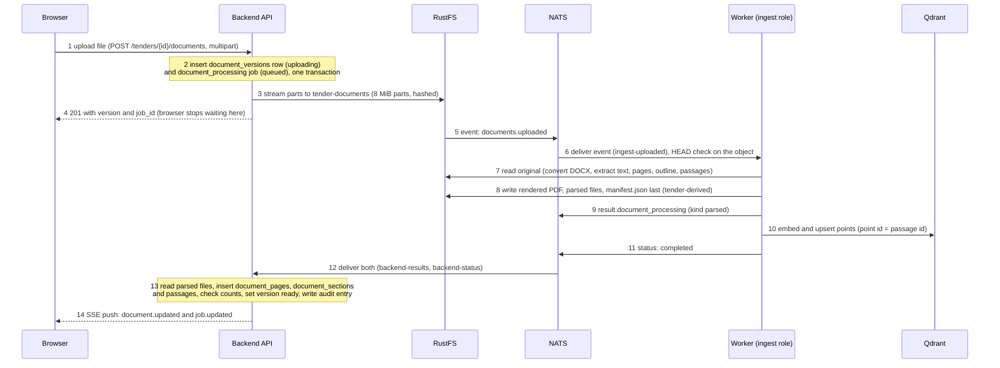
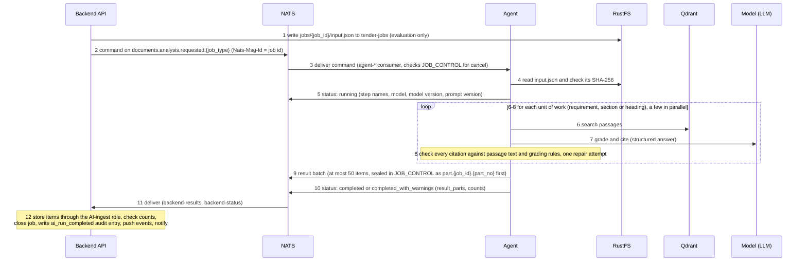

# AI Tender Evaluation Platform – Platform Integration Design

Oct 11, 2026 · @Ahmed

## 1. Purpose, scope and architecture decisions

This document defines how the platform's components connect: the REST API conventions, the Keycloak realm, the RustFS bucket layout, the NATS JetStream streams and subjects, and the configuration and secrets of every component. It builds on AI Tender Evaluation Platform – UX Requirements, AI Tender Evaluation Platform – UX Design and AI Tender Evaluation Platform – Data Model Design. The Python worker and the LangChain agent are designed in AI Tender Evaluation Platform – AI Pipeline Design. Two files go with this document: openapi.yaml, the REST specification, and tender-eval-realm.json, an importable Keycloak realm.

### What each component owns

| Component | Owns | Does not do |
| --- | --- | --- |
| React SPA | The screens, the OIDC sign-in, the idle warning, the push connection, the document viewer | Reach RustFS, NATS, Qdrant, OpenBao or the database |
| Spring Boot reactive REST APIs | Every business rule, authorization, the row-level security context, audit events, persistence, the job lifecycle, upload streaming, push to browsers | Call an LLM or parse a document |
| Keycloak | Identities, passwords, lockout, sessions, single sign-on brokering, invitation and reset emails, the three platform roles | Know about tenders or the Chair |
| OpenBao | Secrets and short-lived database credentials | Hold business data |
| PostgreSQL | The data model | Accept connections from anything but the backend |
| RustFS | Original files, derived files, exports | Business rules |
| NATS JetStream | Transport for commands, events, status and results | Act as a system of record |
| Python worker | Parsing, chunking, embedding, running the agent | Connect to PostgreSQL or Keycloak |
| LangChain agent | The reasoning for extraction, the pre-check and evaluation | Use tools that change anything outside its own output |
| Qdrant | The vector index of passages | Hold anything that is not rebuildable from PostgreSQL and RustFS |
| LLM, OpenAI-compatible API | Text generation and embeddings | See any member's decision |
| Arize Phoenix | Traces of agent runs | Receive secrets |

### Decisions that go beyond the diagram

| # | Decision | Why |
| --- | --- | --- |
| 1 | The browser reaches only the backend and Keycloak. It signs in at Keycloak with the authorization code flow and PKCE, then calls the REST API with the access token. | The diagram shows the SPA talking to the backend only. The Keycloak redirect is added because the SPA must authenticate somewhere. Members may not download proposals (UX-NFR-07), so no signed storage links are ever issued. |
| 2 | Uploads are streamed by the backend into RustFS. | The diagram's upload document arrow starts at the backend. The backend checks the file signature and size while streaming, and creates the document version and its job before the first byte is stored. |
| 3 | The worker and the agent never connect to PostgreSQL. The backend stores what they produce. | The diagram has no such connection. The AI worker role in the data model becomes a separate database connection used only by the backend's result handler. |
| 4 | Large payloads travel by reference. A NATS message carries a small body and an object key, and the data is a file in RustFS. | A parsed 300-page document, or 500 requirements, can exceed NATS's default message limit of 1 MB. |
| 5 | The backend publishes commands for requirement extraction, evaluation and the screening pre-check, and for cancellation. | The bucket event covers document processing only. The other three jobs start from a person or from a screening decision. |
| 6 | Push to the browser uses Server-Sent Events. | Push is one-way, because the browser sends its actions through REST. SSE reconnects by itself and resumes with Last-Event-ID. WebSocket stays an option if a feature ever needs two-way messages. |
| 7 | The worker and the agent read their own secrets from OpenBao. | The diagram links OpenBao to the backend only. The LLM key, the Qdrant key and the NATS credentials belong to the pipeline, and a separate policy per component limits the harm of a leak. |
| 8 | Subjects use the plural domain prefix: documents.uploaded, documents.analysis.status and documents.analysis.result. | The diagram mixes document.uploaded with `documents.analysis.*`. |
| 9 | Qdrant holds one point per passage, and the point id is the PostgreSQL passage id. | Citations resolve between the two stores without a mapping table. |

### Changes this architecture forces on the earlier documents

| Document | Change | Reason |
| --- | --- | --- |
| Data model | users loses password_hash, auth_method, failed_sign_in_count and locked_until. sso_subject becomes required and unique, and holds the Keycloak subject. users.role stays as a copy of the Keycloak realm role. The tables auth_tokens and user_sessions are removed, so the model has 47 tables. The settings table no longer holds the lockout and session timeout. | Keycloak owns credentials, lockout, sessions and the invitation and reset tokens |
| Data model | The upload step says the backend streams the file into storage. The processing steps gain Indexing passages. The AI worker role becomes the backend's AI ingest connection. Open question 15 is closed: embeddings live in Qdrant. | Decisions 2, 3 and 9 |
| Data model | ai_grades gains failure_code. document_versions.failure_reason takes the job failure codes of 5.5. A partial unique index allows one queued or running document_processing job per document version. Passage ids are derived from the document version and the passage number, so a retried parse gives the same ids. | Retries, partial failures and idempotent parsing (AI Pipeline Design) |
| UX design | PG-01 Sign-in and the password reset pages are rendered by Keycloak. The design is delivered as a Keycloak theme, so its layout is limited to what the theme can express. | UX-AUTH-01, UX-AUTH-05 |
| Requirements | None. UX-AUTH-04 is met by two timers: the SPA warns two minutes before the end, and Keycloak's idle timeout enforces it. | See the Keycloak realm section |

## 2. REST API conventions and overview

The REST API is one OpenAPI 3.1 contract, `openapi.yaml`, delivered with this document: 135 operations in 17 groups under `/api/v1`, 193 schemas, validated with no lint warnings. This section states the rules every operation follows; the file is the reference for each field.

### 2.1 Conventions

| Topic | Rule | Serves |
| --- | --- | --- |
| Format | JSON, except uploads (`multipart/form-data`) and the event stream. Timestamps are RFC 3339 UTC. English only. | UX-NFR-01, UX-NFR-08 |
| Authentication | Bearer access token from Keycloak realm `tender-eval`, client `tender-spa`, authorization code flow with PKCE. The API checks signature, issuer, audience `tender-api` and expiry. There is no sign-in endpoint; `GET /me` is the first call after the redirect back. | UX-AUTH-01..05, PG-01 |
| Authorization | Every operation lists the roles that may call it in `x-roles`. The Chair is a per-tender designation read from the committee, never from the token. The database applies row-level security again, so a role check alone never exposes another member's grades. | UX-ROL-01..05 |
| Errors | `application/problem+json` (RFC 9457) with a stable `code` and a `trace_id`. 422 adds `errors` per field and `failures` for pre-check lists. 403 on a tender adds `access_contacts` (who to ask). | UX-ROL-04, UX-NFR-05 |
| Concurrency | Editable resources return an `ETag` equal to their `row_version`. `PATCH` and `PUT` need `If-Match`: missing gives 428, stale gives 412 with the current row, who changed it and which fields. | UX-REQ-12 |
| Justification | Overrides, deletions, rejections, reopenings and reinstatements carry a `note` or `reason`. Shorter than `client_config.min_note_length` (10 by default) gives 422 `note_too_short`. | UX-GEN-04 |
| Action map | Resources carry `actions`: name to `{allowed, reason}`. An action never open to the caller is omitted; one that depends on state is returned disabled with a one-line reason. | UX-ROL-03 |
| Lists | `limit` (default 50, up to 500), opaque `cursor`, `sort` (`name,-last_activity_at`), `q`. The answer is `{items, next_cursor, total}`. | UX-NFR-04 |
| Long-running work | Returns 202 with the job or export and a `Location` header. A request that overlaps a queued or running job gets 409 `job_overlap`; repeating it with `acknowledge_overlap: true` continues. | UX-JOB-01, UX-JOB-08 |
| Idempotency | `Idempotency-Key` on every job and export start. A repeat with the same key returns the first result for 24 hours instead of creating another job. | UX-JOB-08 |
| Uploads | The browser sends the file to the API, which streams it to RustFS (section 4). Larger than `upload_max_bytes` gives 413; anything but PDF and DOCX gives 415. | UX-DOC-01 |
| Viewing | `GET /document-versions/{id}/render` streams the rendered PDF inline with `Range` support and `Cache-Control: no-store`. There is no download operation for an original, and each stream is written to the access log. | UX-NFR-07 |
| Push | `GET /events` is a Server-Sent Events stream: one per tab, a heartbeat every 15 seconds, `Last-Event-ID` resume, a fetch-based client because `EventSource` cannot send a bearer token. Events are hints; the client refetches the object they name. | UX-GEN-06 |
| Rate limits | 429 with `Retry-After` on uploads, search, extraction, re-runs and exports. The limits are configuration (section 7). | Platform |
| Traceability | Each operation lists the requirement and screen IDs it serves in `x-ux`, taken from the UX Requirements and UX Design documents. | all |

### 2.2 Operation groups

| Group | Operations | Callers | Screens |
| --- | --- | --- | --- |
| Session | 2 | any | PG-01 |
| Users | 8 | admin | PG-07 |
| Tenders | 15 | admin, Chair, member, observer | PG-02, PG-03, PG-06, PG-08, PG-09 |
| Documents | 8 | read: all; upload and impact: admin | PG-04 |
| Viewer | 6 | all | PG-10 and every citation |
| Vendors | 13 | admin, Chair, member | PG-05, PG-13 |
| Extraction | 2 | Chair, member | PG-10 |
| Requirements | 17 | read: all; edit: Chair, member | PG-11 |
| Baseline | 8 | read: all; confirm and reopen: Chair | PG-12 |
| Screening | 8 | Chair, member | PG-14 |
| Evaluation | 16 | Chair, member | PG-15, PG-16 |
| Report | 14 | admin and Chair; members after finalization; finalize: Chair | PG-19 |
| Jobs | 4 | read: all; cancel and retry: Chair, member | PG-17 |
| Notifications | 7 | any | PG-18 |
| Audit | 3 | admin, observer | PG-20 |
| Exports | 2 | any | PG-19, PG-11, PG-20 |
| Settings | 2 | admin | none yet (section 8) |

### 2.3 Operations that start background work

Each creates a job (or an export). Uploads answer 201 with the new version and its job_id; the others answer 202 with the job or export. The job type is the one stored in `jobs.job_type`; the API publishes the command to NATS only after the job row is committed (section 5).

| Operation | Job type | Command subject |
| --- | --- | --- |
| `POST /tenders/{id}/documents`, `POST /documents/{id}/versions` | `document_processing` | none: the upload itself triggers `documents.uploaded` |
| `POST /tender-vendors/{id}/proposal-versions` | `document_processing`, one per file | none: each upload triggers `documents.uploaded` |
| `POST /document-versions/{id}/retry` | `document_processing` | `documents.analysis.requested.document_processing` |
| `POST /tenders/{id}/extractions` | `requirement_extraction` | `documents.analysis.requested.requirement_extraction` |
| `POST /tender-vendors/{id}/screening/precheck` | `screening_precheck` | `documents.analysis.requested.screening_precheck` |
| `POST /tender-vendors/{id}/evaluation/rerun` | `evaluation` | `documents.analysis.requested.evaluation` |
| `POST /jobs/{id}/retry` | same as the failed job, as a new job | as above |
| `POST /tenders/{id}/report/exports`, `/requirements/export`, `/audit-events/export`, `.../clarifications/export` | export (no job row) | none: generated by the API |

## 3. Keycloak realm

Realm `tender-eval` owns passwords, sessions and lockout; the platform owns what a role means and who the Chair is. `tender-eval-realm.json`, delivered with this document, imports as written. It was tested on Keycloak 26.4.2: the import ran clean, the backend service account created a user and mapped a role, a user token carried the claims in 3.4, a weak password was refused, the fifth failed sign-in locked the account for 900 seconds, and an authorization request without PKCE or with an unregistered redirect was refused. The invitation email itself was not tested, because the test server had no SMTP.

### 3.1 Realm settings

| Area | Setting | Why |
| --- | --- | --- |
| Accounts | No self-registration. Email is the username. One account per email. Email verification required. | UX-ROL-05 |
| Lockout | 5 failures, then locked 15 minutes (`failureFactor` 5, `waitIncrementSeconds` and `maxFailureWaitSeconds` 900). Two failures within one second lock for 60 seconds. While locked, even the right password gets the same generic "Invalid user credentials". | UX-AUTH-02 |
| Session | Idle timeout 30 minutes, maximum 10 hours. The SPA shows the warning at 28 minutes and refreshes tokens only while the user is active; Keycloak enforces the end. | UX-AUTH-04 |
| Tokens | Access token 5 minutes. Refresh tokens rotate and cannot be reused. Authorization code lasts 60 seconds. | security |
| Password policy | At least 12 characters, not the username or email, not one of the last 5. This is an assumption: the requirements set no policy. | UX-AUTH-01 |
| Reset and invitation | Reset link valid 1 hour. Invitation link valid 3 days. Reset applies to local accounts only; SSO users reset at their identity provider. | UX-AUTH-05 |
| Multi-factor | None in Keycloak: the OTP, WebAuthn, terms and delete-account required actions are disabled. Multi-factor comes from the corporate identity provider (3.6). | UX-AUTH-03 |
| Language | English only. Custom theme optional; Keycloak's default login and email themes work. | UX-NFR-01 |
| Events | Sign-in and admin events kept 90 days, for investigating sign-in problems. The audit trail of record is `audit_events` in the platform database. | UX-AUD-01 |
| Transport | `sslRequired` external, HSTS, `frame-ancestors 'self'`. | security |

### 3.2 Roles

| Realm role | Platform role | Notes |
| --- | --- | --- |
| `procurement_admin` | admin | Manages tenders, documents, vendors, users and settings. |
| `committee_member` | member | Evaluates assigned tenders. |
| `observer` | observer | Read-only audit access. |

The Chair is not a Keycloak role. It is a per-tender designation held in `tender_members.is_chair`, because one person can chair one tender and be a plain member of another (UX-ROL-02). A token must carry exactly one of the three roles; none or several is refused with 403.

### 3.3 Clients

| Client | Type | What it does |
| --- | --- | --- |
| `tender-spa` | Public. Authorization code with PKCE S256. No implicit flow, no password grant. Redirect URI and web origin are `${SPA_BASE_URL}`. | The React application. Full scope is off: it may receive only the three realm roles. Two mappers: audience `tender-api`, and realm roles into the `roles` claim. |
| `tender-api` | Bearer-only. No flows. | Exists to be the audience of access tokens. The backend validates tokens locally against the realm's public keys. |
| `tender-backend-admin` | Confidential. Client credentials only. | The backend's service account for invite, update, deactivate and resend. Holds `manage-users`, `query-users`, `view-users` and `view-realm` on `realm-management`, nothing else. Secret `KEYCLOAK_BACKEND_ADMIN_SECRET` comes from OpenBao. |

### 3.4 Access token contract

| Claim | Value | Used for |
| --- | --- | --- |
| `iss` | `{KEYCLOAK_URL}/realms/tender-eval` | The API rejects any other issuer. |
| `aud` | `tender-api`. A string when single, so the API accepts a string or an array. | The API rejects tokens without it. |
| `sub` | Keycloak user id | Matches `users.sso_subject`. |
| `azp` | `tender-spa` | Must equal the SPA client. |
| `email`, `name`, `given_name`, `family_name` | From the Keycloak profile | Display only. `users.display_name` is the platform's copy. |
| `roles` | One of the three realm roles | Mirrored to `users.role` on the first request of a session. |
| `exp` | Issue time plus 300 seconds | The SPA refreshes it only while the user is active, so refreshing keeps the idle clock running and stopping it lets the session end. |

The token proves identity. Whether the user may act is decided on every request by the platform: `users.status` must be active (cached for 30 seconds at most), so a deactivated user is refused even while a token is still valid. A role change reaches the API with the next token, within 5 minutes.

### 3.5 User lifecycle

Keycloak is changed first. The platform writes its own row only when the Keycloak call succeeded, and removes the Keycloak user again if its own write fails.

| Platform action | Keycloak calls (admin REST, as `tender-backend-admin`) | Platform result |
| --- | --- | --- |
| Invite | `POST /users` with email as username, first and last name; `POST /users/{id}/role-mappings/realm`; `PUT /users/{id}/execute-actions-email` with `VERIFY_EMAIL` and `UPDATE_PASSWORD`, `client_id` `tender-spa`, `lifespan` 259200. First and last name come from `display_name` split at its last space. | `users` row with status invited and `sso_subject` set. |
| Resend invitation | The same `execute-actions-email` call. | A new link; the old one expires with it. |
| Change role | Remove the old realm role mapping, add the new one. | `users.role` updated; effective at the next token. |
| Deactivate | `PUT /users/{id}` with `enabled` false, then `POST /users/{id}/logout` to end live sessions. | Status deactivated; work kept or reassigned per UX-ROL-05. |
| Reactivate | `PUT /users/{id}` with `enabled` true. | Status active. |
| First sign-in | None. | Status moves from invited to active when a token for that `sub` arrives. |

### 3.6 Corporate single sign-on

Optional, and not in the import file because it needs the organisation's identity provider details. To switch it on:

1. Add an OpenID Connect identity provider with alias `corporate-sso` and the provider's discovery URL.
2. Create a first-login flow of two steps: detect an existing user, then link to that user automatically. Leave out "create user". Without this, Keycloak would create an account for anyone who signs in at the provider, which bypasses invitation.
3. Set that flow as the provider's first-login flow. Invitation stays the only way in, and the admin still assigns the role.
4. Require multi-factor at the provider, and optionally hide the password form so SSO is the only way in.

### 3.7 First start

The import file creates one administrator from `BOOTSTRAP_ADMIN_EMAIL` with a temporary password (`BOOTSTRAP_ADMIN_TEMP_PASSWORD`) and a forced password change. The platform has no row for that person yet, so the backend creates it on the first sign-in when the token's email equals `bootstrap.admin_email`, and refuses every other unknown `sub` with 403 `not_invited`. Import with `kc.sh import --dir <folder>` or `--import-realm` at start; the file must be named `tender-eval-realm.json` and the placeholders in section 7 must be set as environment variables.

## 4. RustFS buckets and prefixes

Four buckets, each with one kind of content and one writer. Every key is built from UUIDs, so no object is overwritten (a retry may redo a half-written parse), and only uploaded originals raise an event. The browser never talks to RustFS: the backend streams every upload and every view.

### 4.1 Buckets

| Bucket | Holds | Written by | Read by | Events | Retention |
| --- | --- | --- | --- | --- | --- |
| `tender-documents` | RFP, BRD, addenda and proposal files exactly as received | backend | worker-ingest, backend | `s3:ObjectCreated:*` to NATS subject `documents.uploaded` | For good. Versioning on. Nobody may delete. |
| `tender-derived` | What the worker builds from an original: the rendered PDF and the parsed pages, sections and passages | worker-ingest | backend | none | For as long as the original, because citations point at these pages |
| `tender-jobs` | Inputs of background jobs, written once per job (claim check, section 5) | backend | worker-agent | none | Expire after 90 days |
| `tender-exports` | Generated Excel, PDF and CSV files | backend | backend | none | Expire after 90 days; a file can be generated again |

The lifecycle rules are the only deletions the platform allows itself. They apply to working copies, never to evidence (see the data model's retention rules).

### 4.2 Key layout

| Bucket | Key | Recorded in |
| --- | --- | --- |
| `tender-documents` | `originals/{tender_id}/{document_id}/{document_version_id}.{ext}` | `document_versions.storage_key` |
| `tender-derived` | `rendered/{tender_id}/{document_version_id}/document.pdf`: the PDF the viewer shows. For a PDF original it is a copy; for DOCX it is the conversion. | `document_pages.render_key`, the same value on every page of the version |
| `tender-derived` | `parsed/{tender_id}/{document_version_id}/pages.jsonl`, `sections.jsonl`, `passages.jsonl` | named in the worker's result message |
| `tender-derived` | `parsed/{tender_id}/{document_version_id}/manifest.json`: counts, source SHA-256, worker version, steps done. Written last, so its presence means the parse is complete. For a DOCX, `blocks.jsonl` and `document.md` (markdown blocks for the model, AI 3.3) are written before it. | read by the worker to stay idempotent |
| `tender-jobs` | `jobs/{job_id}/input.json` | named in the command's `input_ref` |
| `tender-exports` | `exports/{tender_id}/{export_id}.xlsx`, `.pdf` or `.csv` | `exports.storage_key` |

Key rules:

- IDs are lowercase UUIDs. `{ext}` is `pdf` or `docx`, decided from the file's checked signature, never from the client's file name.
- The original file name lives only in `document_versions.file_name`. No key holds a person's or a vendor's name, because keys appear in logs and events.
- A DOCX original has no pages of its own. The worker converts it once; those page numbers are the ones every citation uses.

### 4.3 The upload event

RustFS publishes S3-style bucket events to NATS. The payload carries `EventName`, a top-level `Key` (`bucket/key`) and a `Records` array. Tested on RustFS 1.0.1: each record holds the S3 record under `data.s3` (`s3.bucket.name`, `s3.object.key`, and also `s3.object.size` and `s3.object.eTag`) and repeats the names as `bucket_name` and `object_name`; the documented shape has `s3` directly under the record. Keys arrive URL-encoded. The worker accepts all three shapes (`tender_worker/keys.py`) and therefore:

- decodes the key and accepts only `tender-documents` keys that match `originals/{uuid}/{uuid}/{uuid}.(pdf|docx)`; anything else is acknowledged and ignored;
- takes `tender_id`, `document_id` and `document_version_id` from the key, because it is not documented whether user metadata comes with the event;
- reads size, ETag and content type with a HEAD request, not from the event;
- treats a repeated event as normal: if `manifest.json` already exists for the same source hash, it only re-announces completion.

Setup: set `RUSTFS_NOTIFY_ENABLE` and the NATS target. The reference documents only `RUSTFS_NOTIFY_NATS_ADDRESS`; on 1.0.1 the target `primary` works with `RUSTFS_NOTIFY_NATS_ENABLE_PRIMARY=on`, `RUSTFS_NOTIFY_NATS_ADDRESS_PRIMARY` and `RUSTFS_NOTIFY_NATS_SUBJECT_PRIMARY` (found by experiment, `docs/decisions.md` D5; credentials and TLS keys were not tried). Then attach a queue configuration to `tender-documents` with `PutBucketNotificationConfiguration`. Only queue configurations are accepted. Section 8 lists what to confirm on the deployed version.

### 4.4 Upload path

1. The API checks the role and the tender state, then `Content-Length` against `upload_max_bytes` (413) and the first bytes for a PDF or ZIP signature (415).
2. In one transaction it inserts the `document_versions` row (uploading) and the `document_processing` job (queued).
3. It streams the body to `tender-documents` as an S3 multipart upload in 8 MiB parts, hashing as it goes. A body that outgrows the limit mid-stream aborts the multipart upload and soft-deletes the row.
4. When the upload completes it stores size, SHA-256 and `storage_key`, sets the status to processing and answers 201 with the version and its `job_id`.
5. RustFS emits `s3:ObjectCreated:CompleteMultipartUpload`; the worker takes it from `documents.uploaded` (section 5).
6. If no status message arrives within `watchdog.queued_timeout` (2 minutes), the API publishes the same work as a `document_processing` command for the stored key. A lost event therefore delays a document and never strands it.

A cancelled upload aborts the multipart upload, so nothing is stored (data model: soft-deleted row, no file).

### 4.5 Access

One RustFS access key per component, held in OpenBao and rotated every 90 days. Anonymous access is denied on every bucket, and no presigned URLs are issued.

| Identity | `tender-documents` | `tender-derived` | `tender-jobs` | `tender-exports` |
| --- | --- | --- | --- | --- |
| backend | read, write | read | read, write | read, write |
| worker-ingest | read | read, write | none | none |
| worker-agent | none | none | read | none |

An explicit deny on `s3:DeleteObject` and `s3:DeleteObjectVersion` covers `tender-documents` and `tender-derived` for every identity, so the rule "the application never deletes evidence" holds even if the code has a bug. Encryption in transit is TLS everywhere. For encryption at rest, RustFS supports KMS with a Vault-style Transit backend (`RUSTFS_KMS_BACKEND=vault-transit`); pointing it at OpenBao, which speaks the same API, is the intended setup and is on the list in section 8.

## 5. NATS JetStream design

Four streams and one key-value bucket carry every message between RustFS, the backend and the Python worker. Commands are work-queued so each is taken once, reports are kept for replay, and every message names the job it belongs to.

### 5.1 Streams

| Stream | Subjects | Retention | Storage | Max age | Notes |
| --- | --- | --- | --- | --- | --- |
| `DOCUMENTS` | `documents.uploaded`, `documents.analysis.requested.>` | Work queue | File | 7 days | Upload events and commands. Discard policy is new, so a full stream refuses a publish instead of dropping work. Duplicate window 2 minutes. |
| `ANALYSIS_EVENTS` | `documents.analysis.status.>`, `documents.analysis.result.>` | Limits | File | 3 days | What the worker and agent report. Kept so the backend can replay after a bug. |
| `UI_EVENTS` | `ui.push.tender.*`, `ui.push.user.*` | Limits | Memory | 15 minutes | Push hints shared by all backend instances, and the replay window for `Last-Event-ID`. |
| `DLQ` | `dlq.>` | Limits | File | 30 days | Messages that could not be processed, with the reason in headers. |

Key-value bucket `JOB_CONTROL` holds `cancel.{job_id}` entries, written by the backend, and the agent's sealed result parts, `part.{job_id}.{part_no}`, written before each batch is published (extraction and pre-check also write a closing `part.{job_id}.final`), each with a 7-day TTL. Production runs 3 replicas; development runs 1. The server's default maximum message size of 1 MB is kept, and no message of ours exceeds 256 KB.

### 5.2 Subjects

| Subject | Published by | Consumed by | Body |
| --- | --- | --- | --- |
| `documents.uploaded` | RustFS | worker-ingest | The S3 event (section 4.3) |
| `documents.analysis.requested.document_processing` | backend | worker-ingest | Command: retry, or recovery of a lost event |
| `documents.analysis.requested.requirement_extraction` | backend | worker-agent | Command |
| `documents.analysis.requested.screening_precheck` | backend | worker-agent | Command |
| `documents.analysis.requested.evaluation` | backend | worker-agent | Command |
| `documents.analysis.status.{job_type}` | worker-ingest, worker-agent | backend | Status |
| `documents.analysis.result.{job_type}` | worker-ingest, worker-agent | backend | Result batch |
| `dlq.{original subject}` | worker, backend | operations | The failed message, unchanged |
| `ui.push.tender.{tender_id}`, `ui.push.user.{user_id}` | backend | backend instances | `PushEvent` from the API contract |

`{job_type}` is one of the four `jobs.job_type` values. A subject never carries a tender or user id except in `ui.push`; the body does.

### 5.3 Consumers

All consumers are durable, pull-based and use explicit acknowledgement. In a work-queue stream consumer filters may not overlap, which is why each command subject has its own consumer. Concurrency inside a worker is set by configuration (section 7); the figures below are the broker-side ceilings.

| Consumer | Stream | Filter | Run by | Ack wait | Max in flight | Max deliveries |
| --- | --- | --- | --- | --- | --- | --- |
| `ingest-uploaded` | `DOCUMENTS` | `documents.uploaded` | worker-ingest | 60 s | 8 | 5 |
| `ingest-commands` | `DOCUMENTS` | `documents.analysis.requested.document_processing` | worker-ingest | 60 s | 8 | 5 |
| `agent-extraction` | `DOCUMENTS` | `documents.analysis.requested.requirement_extraction` | worker-agent | 120 s | 2 | 3 |
| `agent-precheck` | `DOCUMENTS` | `documents.analysis.requested.screening_precheck` | worker-agent | 120 s | 2 | 3 |
| `agent-evaluation` | `DOCUMENTS` | `documents.analysis.requested.evaluation` | worker-agent | 120 s | 2 | 3 |
| `backend-status` | `ANALYSIS_EVENTS` | `documents.analysis.status.>` | backend, all instances | 30 s | 64 | 10 |
| `backend-results` | `ANALYSIS_EVENTS` | `documents.analysis.result.>` | backend, all instances | 30 s | 16 | 10 |

While a job runs, the worker extends the acknowledgement every third of the ack wait (`in_progress`). A crashed worker's message therefore comes back after one ack wait, not after the job's full duration, and a healthy long job is never redelivered.

### 5.4 Headers and envelope

Every message we publish carries three headers.

| Header | Value | Purpose |
| --- | --- | --- |
| `Nats-Msg-Id` | Command: `{job_id}`. Status: `{job_id}:s:{seq}`, or `dv:{document_version_id}:s:{seq}` when the run started from an upload event and has no job id. Result: `{job_id}:r:{part_no}`. | JetStream drops a duplicate published within 2 minutes. |
| `traceparent` | W3C trace context | The backend starts the trace when the user acts; worker and agent continue it, so Phoenix shows one trace from click to grade. |
| `Tender-Schema` | Name and major version, for example `tender.analysis.requested/1` | A consumer that meets an unknown major version sends the message to the DLQ instead of guessing. |

Command body, common to all four job types:

| Field | Meaning |
| --- | --- |
| `job_id`, `job_type`, `tender_id` | The job row the backend created before publishing. |
| `target` | `{type, id}`: a document version, a proposal version, or a tender. |
| `requested_by` | User id, or null when the system started the job (after an upload, or after a screening decision). |
| `attempt` | 1 for a new job. A retry is a new job with its own id and `retry_of_job_id`. |
| `created_at` | RFC 3339 UTC. |
| `input` or `input_ref` | The job's input inline, or `{bucket, key, sha256}` pointing into `tender-jobs`. |

Inline input stays under 64 KB. What each job type receives:

| Job type | Input | Form |
| --- | --- | --- |
| `document_processing` | `document_version_id`, `storage_key`, `file_format`, `sha256` | Inline. An upload without a command derives the same facts from the event key. |
| `requirement_extraction` | `scope` (document version, section ids, page range), the tender's `categories` and `existing_requirements` (id, number and text of the requirements already in the tender, so the agent can flag duplicates and conflicts) | Inline, or `input_ref` when over 64 KB |
| `screening_precheck` | `proposal_version_id`, the RFP and proposal document version ids | Inline |
| `evaluation` | `proposal_version_id`, `baseline_id`, the proposal's document version ids, and for each requirement its id, number, text, acceptance criteria, importance, category and `requirement_hash`. A re-run of outdated rows lists only those requirements. | `input_ref`: about 300 KB for 500 requirements |

### 5.5 Status messages

Subject `documents.analysis.status.{job_type}`. The first message of a run also carries the run record the backend needs for `ai_runs` and `job_steps`.

| Field | Meaning |
| --- | --- |
| `job_id`, `job_type`, `tender_id`, `target`, `seq` | `job_id` is null only for a document processing run started by an upload event; the backend then finds the one open job for that `target`. `seq` rises by 1 within one delivery of the command. After a redelivery it restarts at 1,000 times the deliveries so far, plus 1, so a number is never reused. |
| `state` | `running`, `completed`, `completed_with_warnings`, `failed` or `cancelled`. |
| `step`, `progress_percent`, `estimated_remaining_seconds` | The named step now running and overall progress, written to `jobs` and `job_steps`. |
| (backend) activity log | The backend writes `job_events` lines from these messages (job started, step started, finished with counts, failed) and from the watchdog. `GET /jobs/{id}` returns them as `events` with `updated_at`; lists leave `events` empty. No worker log text is stored (rule 10). |
| `steps` | First message only: the ordered step names, so the backend creates `job_steps` at once. |
| `run` | First message of an AI job only: `model_name`, `model_version`, `prompt_version`, `input_scope`. |
| `result_parts`, `counts` | Final message only: how many result batches were sent and how many items they hold. |
| `warnings` | `[{code, message, count}]`. Codes in use: `textless_pages`, `tracked_changes` and `not_english` (document processing), `ungrounded_candidate` (extraction), `row_failed` (evaluation), `suspected_injection` (any AI job) and `no_format_found` (pre-check). |
| `failure` | `{code, message, retryable, cause?, params?}` on `failed`. `cause` is a closed reason (`embedding_dimension_mismatch`, `embedding_http_error`, `embedding_unreachable`, `embedding_timeout`, `embedding_unreadable`) and `params` holds whole numbers only. The backend words the cause from fixed templates and shows it as `Job.failure.detail`; the worker's `message` text is never stored or shown (rule 10). |
| `emitted_at`, `worker` | Time, and worker id and version. |

Failure codes. Four are the document failure reasons already in the data model (the three file causes and other); the rest are new and belong in a `jobs.failure_code` list.

| Code | Cause | What the interface offers |
| --- | --- | --- |
| `password_protected`, `no_selectable_text`, `unsupported_format` | The file itself | Upload a new version |
| `source_unavailable` | An object in RustFS cannot be read | Retry |
| `index_unavailable` | Qdrant did not answer after retries | Retry |
| `llm_unavailable` | The model endpoint failed after retries | Retry |
| `model_output_unusable` | The endpoint answered, but every answer was cut off at the token limit, refused or unreadable | Contact administrator |
| `no_content_in_scope` | The chosen pages hold no text | Change selection |
| `timeout` | The job ran past its maximum duration | Retry |
| `other` | Anything else | Contact admin |

### 5.6 Result messages

Subject `documents.analysis.result.{job_type}`. Each message is a batch of at most 50 items or 256 KB, with `part_no` from 1 and `final` true on the last one. Every item has an id chosen by the producer, so the backend can insert it again without harm.

| Job type | `kind` | Items |
| --- | --- | --- |
| `document_processing` | `parsed` | One message, no items. Its `parsed` object names the files in `tender-derived` (`pages`, `sections`, `passages`, `rendered_pdf`, `manifest`, each the fixed key of AI 3.3; the backend refuses any other key) and gives `page_count`, `counts` (`pages`, `sections`, `passages`) and `source_sha256` (checked against the stored original). The backend reads the files and inserts `document_pages`, `document_sections` and `passages` in batches. |
| `requirement_extraction` | `requirements` | `item_id`, `text`, `category_id` (null if none fits), `importance`, `acceptance_criteria`, `sources` (document version, passage, page, quote), `confidence` and `flags` (each with `flag_type` possible_duplicate, compound or conflict, a `detail`, and `related_requirement_id` or `related_item_id`). Becomes a `requirements` row with origin ai, its `requirement_sources` and its `requirement_flags`. The backend adds the `low_confidence` flag from `confidence` and the setting. |
| `evaluation` | `grades` | `item_id`, `requirement_id`, `requirement_hash`, `outcome` (graded or failed), `failure_code` (ungrounded, invalid_output or model_error; only when failed), `grade`, `non_compliance_reason`, `rationale_summary`, `rationale`, `missing_elements`, `confidence` and `citations` (number, document version, passage, page, excerpt). Becomes an `ai_grades` row. |
| `screening_precheck` | `prechecks` | `item_id`, `expected_section`, `found`, `note`. Becomes a `screening_prechecks` row. |

A batch is the unit of saving: if a job fails or is cancelled, the batches already stored stay (UX-JOB-05). The backend persists through the AI-ingest database role, which can write the AI tables and read nothing of a member's own grades.

### 5.7 Order, duplicates and completion

- Delivery is at least once and not strictly ordered across instances, so the backend never relies on arrival order.
- A `completed` status is processed only when `result_parts` batches are stored and their item counts match `counts`; otherwise the message is returned with a 5-second delay.
- For a document, `ready` is set when the job is `completed` and the rows are stored. The worker sends `completed` only after the passages are in Qdrant.
- Inserts use the producer's id with `ON CONFLICT DO NOTHING`. The 2-minute dedup window guards a publisher's own retry; the database guards everything else.
- Messages for a job that is already in a terminal state are logged and dropped.

### 5.8 Failure, retry and the dead-letter stream

| Situation | Handled by | Outcome |
| --- | --- | --- |
| The file or input is bad (password-protected, no text, unsupported) | Worker | `failed` status with the code, message acknowledged. No retry. |
| A dependency fails inside a job (RustFS, Qdrant, the model endpoint) | Worker | Retries in place with backoff (1 s up to 30 s, 5 tries), then `failed` with a retryable code, message acknowledged. |
| The worker crashes or stalls | JetStream | Redelivered after one ack wait, up to the consumer's maximum. A new delivery resumes from the manifest (documents) or the sealed result parts (AI jobs). |
| The message cannot be read (bad JSON, unknown schema or job) | Receiver | Terminated and copied to `dlq.{subject}` with headers `Dlq-Reason`, `Dlq-Original-Subject` and `Dlq-Deliveries`. |
| The last delivery is reached | Receiver | A `failed` status with code `other`, the message copied to the DLQ. |
| The backend cannot store a result | Backend | Returned with backoff (1 s, 5 s, 30 s, 2 min, 10 min); after 10 tries copied to the DLQ and the job marked failed. |

A non-empty DLQ raises an operations alert and a notification to administrators. Three timers in the backend close the remaining gaps: a job queued for longer than `watchdog.queued_timeout` (2 minutes) has its command published again; a running job silent for `watchdog.silence_timeout` (5 minutes) is marked failed with code `timeout`; and a job that outlives the ceiling for its type (`JOB_MAX_DURATION_MINUTES_*`, 7.3) is marked failed with code `timeout` too, and the backend writes its `cancel.{job_id}` key so that the worker stops as for a cancel.

### 5.9 Cancellation

`POST /jobs/{id}/cancel` marks the job cancelled in the database at once and writes `cancel.{job_id}` to `JOB_CONTROL`. A worker checks that key when it picks the job up and then between units of work (a section, a requirement, a batch), at least every 10 seconds. On seeing it, the worker stops, keeps what it already sent and publishes a `cancelled` status. A job still queued is acknowledged and skipped. Retrying a cancelled or failed job is a new job (UX-JOB-05).

### 5.10 Push to browsers

After storing anything a user can see, the backend publishes a `PushEvent` to `ui.push.tender.{tender_id}`, or to `ui.push.user.{user_id}` for a notification. Each backend instance reads `UI_EVENTS` through one consumer and sends each event to the connections whose user may see that tender. The SSE `id` is the stream sequence number. A reconnecting browser sends `Last-Event-ID`, and the server replays from the next sequence inside the 15-minute window. Outside it, the server sends a `resync` event and the browser refetches what is on screen. A user whose access changes has the connection closed and re-evaluated at reconnect.

### 5.11 Access control

One NATS account holds the streams. Each component has its own credentials over TLS, stored in OpenBao.

| User | May publish | May consume or read | Key-value |
| --- | --- | --- | --- |
| rustfs | `documents.uploaded` | nothing | none |
| backend | `documents.analysis.requested.>`, `ui.push.>`, `dlq.>` | `documents.analysis.status.>`, `documents.analysis.result.>`, `ui.push.>`, `dlq.>` | read and write `JOB_CONTROL` |
| worker-ingest | status and result for `document_processing`, `dlq.documents.>` | `documents.uploaded`, `documents.analysis.requested.document_processing` | read `JOB_CONTROL` |
| worker-agent | status and result for `requirement_extraction`, `screening_precheck` and `evaluation`, `dlq.documents.>` | the three matching command subjects | read, and write its sealed `part.*` keys in `JOB_CONTROL` |

## 6. End-to-end flows

Two flows carry the platform's asynchronous work: a document becoming citable passages, and a background analysis job. Each is drawn once; the table under it names every step and what happens when that step fails.

### 6.1 From upload to citable passages

**Diagram 1: upload to citable passages · 14 steps, 6 components**

The browser waits only for the 201 reply of step 4. Everything after the upload event runs without it.

| Step | What happens | If it fails |
| --- | --- | --- |
| 1 | The browser sends `POST /tenders/{id}/documents` as multipart. | 413, 415 or 403, and nothing is stored. |
| 2 | The API inserts the `document_versions` row (uploading) and the `document_processing` job (queued) in one transaction. | The transaction fails and nothing is stored. |
| 3 | The API streams the file to `tender-documents` in 8 MiB parts and hashes it as it goes. | A broken stream aborts the multipart upload and soft-deletes the row. |
| 4 | The API answers 201 with the version (processing) and its `job_id`. | None. |
| 5 | RustFS publishes the bucket event to `documents.uploaded`. | A lost event: after 2 minutes the API's watchdog publishes the same work as a command. |
| 6 | `ingest-uploaded` delivers the event; the worker decodes the key and checks the object with a HEAD request. | A crash returns the message after 60 seconds; an unreadable key goes to the DLQ. |
| 7 | The worker reads the original, converts DOCX to PDF, and extracts text, pages, outline and passages. There is no OCR. | A password-protected file, a PDF with no text or an unsupported format ends the job as `failed` with that code. No retry. |
| 8 | The worker writes the rendered PDF, the parsed files and, last, `manifest.json` to `tender-derived`. | RustFS errors are retried, then `source_unavailable`. |
| 9 | The worker publishes `result.document_processing` (kind `parsed`) with the file keys and counts. | Publish errors are retried with backoff. |
| 10 | The worker embeds the passages and upserts them to Qdrant; the point id is the passage id. | Retried, then `index_unavailable`. The manifest lets a retry skip the parse. |
| 11 | The worker publishes status `completed` with the number of indexed passages. | None. |
| 12 | `backend-results` and `backend-status` deliver both messages to any backend instance. | Redelivered until acknowledged. |
| 13 | The API reads the parsed files, inserts `document_pages`, `document_sections` and `passages` in batches, checks the counts, sets the version to ready and writes the audit entry. | A failed insert is returned with backoff; after 10 tries it goes to the DLQ and the job fails. |
| 14 | The API pushes `document.updated` and `job.updated` over SSE. | A missed push is recovered by refetching when the browser reconnects. |

### 6.2 A background analysis job

**Diagram 2: background analysis job · 12 steps, 6 components**

Extraction, pre-check and evaluation share this path. Only the retrieval and the output differ.

| Step | What happens | If it fails |
| --- | --- | --- |
| 1 | The API creates the job row and, for an evaluation, writes `jobs/{job_id}/input.json` to `tender-jobs`. | The request fails and no job exists. |
| 2 | After the job commits, the API publishes the command to `documents.analysis.requested.{job_type}` with the job id as `Nats-Msg-Id`. | A refused publish (stream full) marks the job failed with code `other` at once. |
| 3 | The matching `agent-*` consumer delivers the command; the agent first checks `JOB_CONTROL` for a cancel. | A cancelled job that was still queued is acknowledged and skipped. |
| 4 | The agent reads `input.json` and checks its SHA-256. | `source_unavailable`. |
| 5 | The agent publishes status `running` with the step names and the run record: model, model version, prompt version. | None. |
| 6 | For each unit of work (a requirement, a section, a proposal heading) the agent searches Qdrant for the passages that matter. | Retried, then `index_unavailable`. |
| 7 | The agent asks the model for a structured answer with citations. | Retried with backoff. A row that still fails is stored as failed (Not evaluated) and the job ends `completed_with_warnings`. |
| 8 | The agent checks every citation against the passage text and the grading rules, with one repair attempt. | Still invalid: the row is stored as failed. |
| 9 | The agent groups its items into parts of at most 50 and seals each part in `JOB_CONTROL` as `part.{job_id}.{part_no}` before it publishes the part as a result batch. Extraction and pre-check seal all their parts first, then write `part.{job_id}.final` with the part count. | After a crash the new delivery publishes the sealed parts again, unchanged, and goes on after them. Extraction and pre-check start again unless `part.{job_id}.final` exists. |
| 10 | The agent publishes the last batch, then status `completed` or `completed_with_warnings` with `result_parts` and `counts`. | None. |
| 11 | `backend-results` and `backend-status` deliver them to the backend. | Redelivered until acknowledged. |
| 12 | The API stores the items through the AI-ingest role, checks the counts, closes the job and writes the `ai_run_completed` audit entry. It then pushes `job.updated` and the object-specific event, and creates the completion notification. | As in 5.8. |

### 6.3 The other flows

| Flow | Path |
| --- | --- |
| Sign-in | The SPA redirects to Keycloak (code flow with PKCE), exchanges the code, and calls `GET /me`. The API validates the token, loads the user by `sub`, refuses an unknown or deactivated user, and returns the profile and `client_config`. |
| Invitation | `POST /users`: the API creates the Keycloak user, maps the role and sends the actions email, then inserts the `users` row. The invitee follows the link, sets a password and signs in; the status becomes active. |
| Viewing a page | `GET /document-versions/{id}/render` with `Range`: the API checks access, writes a `document_access_events` row and streams `document.pdf` from `tender-derived` with `Cache-Control: no-store`. |
| Starting a job | The start operation checks for an overlap (409 `job_overlap`), creates the job and answers 202 with `Location`. Then flow 6.2. |
| Evaluation after screening | When the Chair accepts a vendor and the baseline is confirmed, the API creates the evaluation job itself, with no starter, and publishes the command. Then flow 6.2. |
| Cancel | `POST /jobs/{id}/cancel` sets the job cancelled, writes `cancel.{job_id}` to `JOB_CONTROL`, and the agent stops at its next check. Stored batches are kept (5.9). |
| Retry | `POST /jobs/{id}/retry` or `/document-versions/{id}/retry` creates a new job with `retry_of_job_id` and a new command. A document retry reuses the stored parse when `manifest.json` exists. |
| Export | `POST .../export` answers 202 with an export; the API writes the file to `tender-exports`, and `GET /exports/{id}/file` streams it. |

## 7. Configuration and secrets

Every value the platform needs is listed here with where it lives. Plain configuration is environment variables, one set per component. Secrets live in OpenBao, and each component can read only its own. Business settings that an administrator may change without a release live in the database.

### 7.1 Where each kind of value lives

| Kind | Lives in | Changed by | Examples |
| --- | --- | --- | --- |
| Configuration | Environment variables of the component, set by the deployment | A release or a redeploy | URLs, bucket names, concurrency, timeouts |
| Secret | OpenBao, read by the component at start and again after an authentication failure | An operator, on the rotation schedule in 7.6 | Passwords, access keys, API keys, NATS credentials |
| Business setting | `settings` table, read through the API | An administrator, from the interface | Note length, upload limit, low-confidence threshold |
| Realm setting | Keycloak, from `tender-eval-realm.json` | Realm import or the Keycloak admin console | Lockout, session timeouts, password policy |

Rules that hold everywhere: no secret in an image, a repository, a log line or a trace; configuration is validated at start and the component refuses to run on a missing required key; a `.env` file is for local development only; the single-page application holds no secret, because it is a public client.

### 7.2 OpenBao layout

Each component signs in with its own AppRole, whose secret id is delivered response-wrapped at deploy time, and receives a token valid for 1 hour and renewed while it runs. One policy per component grants read on its own paths and nothing else. Where OpenBao runs on Kubernetes, Kubernetes authentication replaces AppRole (section 8).

| Path | Holds | Read by |
| --- | --- | --- |
| `kv/tender-eval/backend/keycloak-admin` | `client_secret` of `tender-backend-admin` | backend |
| `kv/tender-eval/backend/rustfs` | `access_key`, `secret_key` | backend |
| `kv/tender-eval/backend/nats` | user credentials | backend |
| `kv/tender-eval/backend/smtp` | `password` | backend |
| `kv/tender-eval/worker-ingest/rustfs`, `nats`, `qdrant`, `embedding` | each component's own key or credentials; `qdrant` is the read-write key | worker-ingest |
| `kv/tender-eval/worker-agent/rustfs`, `nats`, `qdrant`, `llm`, `embedding`, `phoenix` | `qdrant` is the read-only key; `llm` and `embedding` hold the API keys | worker-agent |
| `kv/tender-eval/platform/keycloak`, `rustfs`, `qdrant`, `phoenix`, `nats` | Infrastructure secrets (7.5), injected into those services by the deployment, because none of them reads OpenBao itself | operators |
| `database/creds/tender-app` | Dynamic Postgres user for the API: data access with row-level security applied | backend |
| `database/creds/tender-ai-ingest` | Dynamic Postgres user for storing AI results: writes the AI tables, passages and requirements, reads nothing of a member's own grades | backend |
| `transit/keys/rustfs` | Encryption key for objects at rest, if RustFS KMS is used (section 8) | RustFS |

Dynamic database users live 24 hours and are renewed at two thirds of their life; the connection pools drain and reconnect on renewal. Where the database engine is not available, the same two users are stored as static secrets under `kv/tender-eval/backend/` and rotated by hand.

### 7.3 Backend

| Key | Kind | Default | Purpose |
| --- | --- | --- | --- |
| `PUBLIC_BASE_URL` | config | required | The SPA's origin. Source of the CORS allow-list and of links in emails. |
| `KEYCLOAK_ISSUER_URI` | config | required | `https://{host}/realms/tender-eval`. Tokens from any other issuer are refused. |
| `KEYCLOAK_AUDIENCE` | config | `tender-api` | Required audience of every token. |
| `KEYCLOAK_ADMIN_BASE_URL` | config | required | Base of the admin REST API, for invitations and for reading the realm's idle timeout. |
| `KEYCLOAK_ADMIN_CLIENT_ID` | config | `tender-backend-admin` | The service account of section 3.3. |
| `KEYCLOAK_ADMIN_CLIENT_SECRET` | secret | OpenBao `backend/keycloak-admin` | Its secret. |
| `KEYCLOAK_INVITATION_LIFESPAN_SECONDS` | config | `259200` | Invitation link validity (3 days). |
| `BOOTSTRAP_ADMIN_EMAIL` | config | none | Only the first sign-in of this email may create its own `users` row (3.7). |
| `DB_URL` | config | required | R2DBC URL of Postgres. |
| `DB_APP_CREDENTIALS_PATH`, `DB_AI_INGEST_CREDENTIALS_PATH` | config | the two `database/creds/` paths | Where the two dynamic users come from. |
| `DB_POOL_MAX_SIZE` | config | `20` | Connections per pool and instance. |
| `S3_ENDPOINT`, `S3_REGION`, `S3_PATH_STYLE` | config | required, `us-east-1`, `true` | RustFS endpoint. The region is a placeholder the S3 client insists on. |
| `S3_BUCKET_DOCUMENTS`, `S3_BUCKET_DERIVED`, `S3_BUCKET_JOBS`, `S3_BUCKET_EXPORTS` | config | the four names in section 4 | Bucket names. |
| `S3_MULTIPART_PART_MB` | config | `8` | Part size of the streamed upload. |
| `S3_ACCESS_KEY`, `S3_SECRET_KEY` | secret | OpenBao `backend/rustfs` | The backend's RustFS identity. |
| `NATS_URL`, `NATS_TLS_CA_FILE` | config | required | Broker address and CA bundle. |
| `NATS_CREDENTIALS` | secret | OpenBao `backend/nats` | The backend's NATS user. |
| `NATS_PROVISION_STREAMS` | config | `true` | The backend creates or updates the four streams, the key-value bucket and its own consumers at start. Workers only create their own consumers. |
| `WATCHDOG_QUEUED_TIMEOUT_SECONDS` | config | `120` | A queued job older than this has its command published again. |
| `WATCHDOG_SILENCE_TIMEOUT_SECONDS` | config | `300` | A running job silent for this long is failed with `timeout`. The agent repeats its last status every 60 s while it works, so a slow model does not look silent. |
| `JOB_MAX_DURATION_MINUTES_DOCUMENT_PROCESSING`, `_REQUIREMENT_EXTRACTION`, `_SCREENING_PRECHECK`, `_EVALUATION` | config | `30`, `60`, `30`, `360` | Ceiling per job type. These are assumptions to tune against real runs. |
| `RESULT_BATCH_MAX_ITEMS` | config | `50` | Largest result batch the backend accepts. |
| `IDEMPOTENCY_TTL_HOURS` | config | `24` | How long an `Idempotency-Key` is remembered. |
| `RATE_LIMIT_UPLOADS_PER_MINUTE`, `_SEARCH_`, `_JOB_STARTS_`, `_EXPORTS_` | config | `10`, `120`, `20`, `10` | Per user. Assumptions. |
| `SSE_HEARTBEAT_SECONDS` | config | `15` | Comment line that keeps proxies open. |
| `USER_STATUS_CACHE_SECONDS` | config | `30` | How long an active status is trusted (3.4). |
| `EXPORT_RETENTION_DAYS` | config | `90` | Matches the lifecycle rule on `tender-exports`. |
| `SMTP_HOST`, `SMTP_PORT`, `SMTP_FROM`, `SMTP_USER` | config | required, `587`, required, required | Notification emails. |
| `SMTP_PASSWORD` | secret (OpenBao `secret/tender-eval/smtp`; `.env` in development) | none | Notification email login. With `SMTP_HOST` empty no email is sent and pending rows wait. |
| `SMTP_PASSWORD` | secret | OpenBao `backend/smtp` | Mail relay password. |
| `OTEL_EXPORTER_OTLP_ENDPOINT`, `OTEL_SERVICE_NAME`, `LOG_LEVEL` | config | none, `tender-backend`, `info` | Traces, service name, log level. |

### 7.4 Python worker and agent

One image, two deployments: `WORKER_ROLE` chooses the code path. Numeric defaults are starting values to tune against real documents, not requirements; the AI Pipeline Design explains what each one controls.

| Key | Role | Kind | Default | Purpose |
| --- | --- | --- | --- | --- |
| `WORKER_ROLE` | both | config | required: `ingest` or `agent` | Which consumers and which code the process starts. |
| `WORKER_ID` | both | config | host name | Appears in status messages and traces. |
| `NATS_URL`, `NATS_TLS_CA_FILE` | both | config | required | Broker address and CA bundle. |
| `OPENBAO_ADDR`, `OPENBAO_ROLE_ID`, `OPENBAO_SECRET_ID` | both | config, secret id | none | The worker's own AppRole. With an address set, the secrets in this table marked OpenBao are read from `kv/tender-eval/worker-{role}/` once at start and override the environment; without one the environment is used (development and tests). A failed read stops the start. |
| `NATS_CREDENTIALS` | both | secret | OpenBao `{role}/nats` | The role's NATS user (5.11). |
| `S3_ENDPOINT`, `S3_REGION`, `S3_PATH_STYLE` | both | config | required, `us-east-1`, `true` | RustFS endpoint. |
| `S3_BUCKET_DOCUMENTS`, `S3_BUCKET_DERIVED` | ingest | config | section 4 names | Read originals, write derived files. |
| `S3_BUCKET_JOBS` | agent | config | `tender-jobs` | Read job inputs. |
| `S3_ACCESS_KEY`, `S3_SECRET_KEY` | both | secret | OpenBao `{role}/rustfs` | The role's RustFS identity (4.5). |
| `QDRANT_URL`, `QDRANT_COLLECTION` | both | config | required, `passages` | Vector store. |
| `QDRANT_API_KEY` | both | secret | OpenBao `{role}/qdrant` | Read-write for ingest, read-only for agent. |
| `EMBEDDING_BASE_URL`, `EMBEDDING_MODEL`, `EMBEDDING_DIMENSIONS` | both | config | required | The same three values for both roles: the model that indexes must be the model that queries. A change means re-indexing. |
| `EMBEDDING_API_KEY` | both | secret | OpenBao `{role}/embedding` | Key of the embedding endpoint. |
| `DEP_RETRY_MAX`, `DEP_RETRY_BASE_SECONDS`, `DEP_RETRY_MAX_SECONDS` | both | config | `5`, `1`, `30` | In-place retries of RustFS, Qdrant and model calls (5.8). |
| `OTEL_EXPORTER_OTLP_ENDPOINT`, `OTEL_SERVICE_NAME`, `LOG_LEVEL` | both | config | none, `tender-worker-{role}`, `info` | Traces and logs. |
| `INGEST_CONCURRENCY` | ingest | config | `2` | Documents parsed at once per replica. |
| `INGEST_CONVERT_TIMEOUT_SECONDS` | ingest | config | `300` | Limit for one DOCX to PDF conversion. |
| `PASSAGE_MIN_CHARS`, `PASSAGE_MAX_CHARS` | ingest | config | `200`, `1200` | Bounds of a passage. |
| `EMBEDDING_BATCH_SIZE`, `QDRANT_UPSERT_BATCH_SIZE` | ingest | config | `64`, `128` | Batch sizes while indexing. |
| `EMBEDDING_DOCUMENT_PREFIX`, `EMBEDDING_QUERY_PREFIX` | both | config | empty | Role markers some retrieval models require (Nemotron: `passage: ` and `query: `). Indexing and symmetric comparisons use the document prefix, searches use the query prefix. Part of the model identity: changing either needs a new collection and a re-index. |
| `INGEST_PAGE_MIN_CHARS`, `INGEST_MAX_TEXTLESS_SHARE` | ingest | config | `20`, `0.5` | A page with fewer characters counts as empty. A document with more than this share of empty pages fails with `no_selectable_text`. |
| `LLM_BASE_URL` | agent | config | required | OpenAI-compatible chat endpoint. |
| `LLM_API_KEY` | agent | secret | OpenBao `worker-agent/llm` | Its key. |
| `LLM_MODEL_EXTRACTION`, `LLM_MODEL_EVALUATION`, `LLM_MODEL_PRECHECK` | agent | config | required | Model per job type. |
| `LLM_MODEL_VERSION` | agent | config | none | Label stored in `ai_runs.model_version`, since an endpoint may not report one. |
| `LLM_TEMPERATURE`, `LLM_MAX_OUTPUT_TOKENS`, `LLM_TIMEOUT_SECONDS` | agent | config | `0`, `8192`, `600` | Call settings. The timeout bounds one call; a slow local GPU may need more. A reasoning model spends part of the output budget on its reasoning: a budget too small ends in `LengthFinishReasonError`. |
| `LLM_MAX_CONCURRENCY`, `LLM_REQUESTS_PER_MINUTE` | agent | config | `2`, `0` (no limit) | Simultaneous calls per replica (a local server queues more than it can run, and queued calls time out), and a client-side rate limit for providers with a quota. |
| `LLM_STRUCTURED_OUTPUT` | agent | config | `function_calling` | `function_calling` or `json_schema`: how the answer schema is enforced. |
| `LLM_OUTAGE_GIVE_UP_SECONDS` | agent | config | `600` | How long the model endpoint may stay down before the job seals its finished rows and fails with `llm_unavailable`. |
| `AGENT_CONCURRENCY_EVALUATION`, `_EXTRACTION`, `_PRECHECK` | agent | config | `2`, `1`, `1` | Jobs at once per replica, matching the consumers in 5.3. |
| `RETRIEVAL_TOP_K`, `RETRIEVAL_MIN_SCORE` | agent | config | `8`, none | Passages per search, and an optional floor on the dense cosine score of a hit. |
| `RETRIEVAL_CONTEXT_NEIGHBORS`, `GRADE_CONTEXT_MAX_CHARS` | agent | config | `1`, `9000` | Passages added on each side of the best hits, and the cap on the evidence shown for one requirement. |
| `VERIFY_ABSENCE_MAX_SEARCHES` | agent | config | `3` | Further searches allowed when nothing was found for a requirement. |
| `GROUNDING_MAX_REPAIR_ATTEMPTS` | agent | config | `1` | Repairs allowed after a failed citation check. |
| `EXTRACTION_CHUNK_CHARS`, `EXTRACTION_CHUNK_LINES` | agent | config | `3000`, `25` | Size of one extraction chunk of the chosen section: characters and lines, cut on block boundaries (AI 4.3). |
| `EVAL_BATCH_SIZE` | agent | config | `4` | Requirements of one proposal graded in one model call (AI 4.2). |
| `DEDUP_SIMILARITY_THRESHOLD` | agent | config | `0.85` | Cosine similarity at or above which two requirement candidates are compared as a possible duplicate. |
| `RESULT_BATCH_MAX_ITEMS`, `RESULT_BATCH_MAX_BYTES` | agent | config | `50`, `262144` | Result batch limits (5.6). |
| `CANCEL_CHECK_SECONDS` | agent | config | `10` | Longest gap between looks at `JOB_CONTROL` (5.9). |
| `PHOENIX_COLLECTOR_ENDPOINT`, `PHOENIX_PROJECT_NAME` | agent | config | none, `tender-eval` | Where traces go and their project. |
| `PHOENIX_API_KEY` | agent | secret | OpenBao `worker-agent/phoenix` | Needed when Phoenix has authentication on. |
| `TRACE_CAPTURE_CONTENT` | agent | config | `false` | Whether prompts and passage text are stored in traces (section 8). |
| `HEALTH_PORT`, `SHUTDOWN_GRACE_SECONDS`, `DEP_TIMEOUT_SECONDS` | both | config | `8080`, `45`, `30` | Port of the health endpoints, time allowed to reach a safe point after SIGTERM, and the limit for one call to a dependency. |

### 7.5 Infrastructure services and the browser application

None of these services reads OpenBao. The deployment reads their secrets from `kv/tender-eval/platform/` and injects them as environment variables or mounted files.

| Service | Keys | Kind |
| --- | --- | --- |
| Keycloak | `KC_DB`, `KC_DB_URL`, `KC_DB_USERNAME`, `KC_HOSTNAME`, `KC_PROXY_HEADERS` | config |
| Keycloak | `KC_DB_PASSWORD` | secret |
| Keycloak | `KC_BOOTSTRAP_ADMIN_USERNAME`, `KC_BOOTSTRAP_ADMIN_PASSWORD`: first start only, removed afterwards | secret |
| Keycloak realm import | `SPA_BASE_URL`, `SMTP_HOST`, `SMTP_PORT`, `SMTP_FROM`, `SMTP_USER`, `BOOTSTRAP_ADMIN_EMAIL` | config |
| Keycloak realm import | `SMTP_PASSWORD`, `KEYCLOAK_BACKEND_ADMIN_SECRET` (equal to the backend's `KEYCLOAK_ADMIN_CLIENT_SECRET`), `BOOTSTRAP_ADMIN_TEMP_PASSWORD` (single use) | secret |
| RustFS | `RUSTFS_VOLUMES`, `RUSTFS_NOTIFY_ENABLE`, `RUSTFS_NOTIFY_NATS_ADDRESS`, and the remaining NATS target keys for subject, credentials and TLS (section 8) | config |
| RustFS | `RUSTFS_ACCESS_KEY`, `RUSTFS_SECRET_KEY`: the root identity, used only to create buckets, policies and the component identities, never by a component | secret |
| RustFS, if KMS is used | `RUSTFS_KMS_ENABLE`, `RUSTFS_KMS_BACKEND` (`vault-transit`), `RUSTFS_KMS_VAULT_ADDRESS`, `RUSTFS_KMS_DEFAULT_KEY_ID` | config |
| RustFS, if KMS is used | `RUSTFS_KMS_VAULT_TOKEN` | secret |
| NATS server | `nats-server.conf`: JetStream store directory and limits, TLS certificate paths, one account, user public NKeys, cluster routes | config |
| NATS server | TLS private key; the users' NKey seeds, which go to each component's OpenBao path | secret |
| Qdrant | TLS certificate paths, collection settings | config |
| Qdrant | `QDRANT__SERVICE__API_KEY` (read-write), `QDRANT__SERVICE__READ_ONLY_API_KEY` | secret |
| Phoenix | `PHOENIX_PORT`, `PHOENIX_ENABLE_AUTH` (`true`) | config |
| Phoenix | `PHOENIX_SECRET`, `PHOENIX_SQL_DATABASE_URL` when it carries a password | secret |
| Postgres | Roles `tender_owner` (migrations only, never at runtime), `tender_app`, `tender_ai_ingest`, and a management role for OpenBao's database engine | secret, in OpenBao's own configuration |
| Browser application | Served as `/config.json` at run time: `apiBaseUrl` (`/api/v1`), `oidcAuthority` (the issuer), `oidcClientId` (`tender-spa`), `oidcRedirectUri`, `postLogoutRedirectUri` | config; no secret exists |

### 7.6 Rotation

Components read a secret at start and again after an authentication failure, so a rotated value is picked up without a restart.

| Secret | Rotation | How |
| --- | --- | --- |
| Postgres dynamic users | 24 hours, automatic | OpenBao issues and revokes; pools reconnect. |
| RustFS component access keys | 90 days | Create the new key, write it to OpenBao, let the component switch, then delete the old key. |
| Keycloak `tender-backend-admin` secret | 180 days | Regenerate in Keycloak, write to OpenBao; the backend re-reads on its next 401. |
| NATS user credentials | 180 days | Issue a new NKey, add it to the server account, write the seed to OpenBao, remove the old key. |
| Qdrant API keys | 180 days | Change both keys and restart Qdrant; workers re-read. |
| LLM, embedding and Phoenix keys | Per provider policy, at most 90 days | Replace in OpenBao. |
| SMTP password | Per mail provider policy | Replace in OpenBao and in the Keycloak environment. |
| Infrastructure root secrets | Yearly, and whenever someone with access leaves | Replace in `platform/`, redeploy the service. Changing `PHOENIX_SECRET` signs every Phoenix user out. |
| Bootstrap secrets | Single use | Remove `KC_BOOTSTRAP_ADMIN_*` and `BOOTSTRAP_ADMIN_TEMP_PASSWORD` after the first start. |

### 7.7 Business settings in the database

An administrator changes these from the interface with `PUT /settings/{key}`; the change is audited and takes effect without a release. Lockout and the session timeout have left this table: they are realm settings now (section 3), and the idle timeout reaches the browser from the realm through `GET /me`.

| Key | Default | Used for |
| --- | --- | --- |
| `note.min_length` | `10` | Shortest justification note, in characters (UX-GEN-04). |
| `upload.max_bytes` | `104857600` | Largest upload, 100 MB. The gateway's request body limit must be larger. |
| `session.warning_seconds` | `120` | How long before the idle timeout the browser warns (UX-AUTH-04). |
| `ai.low_confidence_threshold` | `0.6` | Grades below it are marked low confidence. A starting value to calibrate. |

## 8. Open questions

Thirteen points need a decision or a check on the deployed system. Each row names the default this design uses, so work can go on while it is open.

| # | Question | Why it matters | Default in this design |
| --- | --- | --- | --- |
| 1 | Which model endpoint may receive proposals, and where does it run? | The RFP and every proposal leave the platform in prompts, and could be stored in traces. | Only an endpoint the organisation has approved, private or self-hosted. Traces keep no content (`TRACE_CAPTURE_CONTENT` false). |
| 2 | Which RustFS keys set the NATS subject, credentials and TLS, and does the event carry size, ETag and user metadata? | The reference documents only `RUSTFS_NOTIFY_NATS_ADDRESS`, and its event example shows the event name, bucket and key. | The design works either way: ids come from the key, size and ETag from a HEAD request. Phase 0 result: subject, address and enable keys work on 1.0.1 and the event does carry size and ETag; credentials and TLS keys are still open. |
| 3 | Which storage features does the deployed RustFS offer: versioning (needs erasure coding on at least 4 drives), Object Lock, lifecycle expiry, KMS through OpenBao Transit, conditional writes? | They would strengthen "never delete evidence" and the 90-day expiry of working copies. | None is relied on. Deletion is denied by policy, keys are never reused, and expiry falls back to a backend sweep. |
| 4 | Do the worker and agent read OpenBao themselves? | The diagram links OpenBao to the backend only. | Yes, each with its own AppRole and policy (7.2). The alternative is injection by the deployment. |
| 5 | Which OpenBao sign-in method does each environment use, and is the database engine available? | Dynamic Postgres users need the engine. | AppRole, and static secrets under `kv/` where the engine is missing. |
| 6 | SSE or WebSocket for push? | The diagram shows both. | SSE: one-way, replayable with `Last-Event-ID`, and friendly to proxies. WebSocket only if the interface later has to send events. |
| 7 | What may an observer read? | UX-ROL-01 says read-only for audit. The API file lists the observer on read operations, and row-level security decides what returns. | The narrowest reading: audit trail, access log and the tender list. |
| 8 | Which corporate identity provider, and which claims and multi-factor rules? | It decides whether password sign-in stays at all. | Optional; linking to invited accounts only; the administrator assigns the role (3.6). |
| 9 | Password policy and maximum session length. | The requirements set neither. | 12 characters, last 5 not reusable, 10 hours. Confirm with security. |
| 10 | Must a role change apply at once? | It reaches the API with the next token, within 5 minutes. | Accepted. The backend can end the user's Keycloak sessions on a role change if the answer is no. |
| 11 | Retention of working copies and logs. | The data model leaves audit retention open too. | `tender-jobs` and `tender-exports` 90 days, Keycloak events 90 days, dead letters 30 days. |
| 12 | Is there a screen for business settings? | The API serves `/settings`, but the requirements list no such screen. | Add a small settings page for the administrator, or leave these values to configuration. |
| 13 | What are the gateway's request body limit and timeouts? | A 100 MB upload streamed over a slow link must not be cut off. | Body limit 120 MB, request timeout 15 minutes. Assumptions. |
