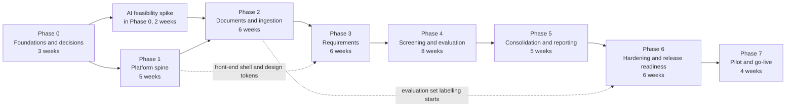

# Roadmap plan

How to build the AI Tender Evaluation Platform: phases, what each delivers, what must be true to leave it, and what can go wrong. The order follows the dependencies in the design, not the order of the documents.

Read [`solution-architecture.md`](solution-architecture.md) first for the parts, and [`implementation-guide.md`](implementation-guide.md) for how to build each one.

## 1. Planning basis

The five design documents define a scope of 20 screens (`PG-01` to `PG-20`), 127 UX requirements (103 must, 20 should, 4 could), 135 REST operations, 47 tables, four background job types, and one Python worker image with two roles.

**Everything about time and team below is an assumption. Replace it after the Phase 0 estimates.**

| Assumption | Value used |
| --- | --- |
| Team | 2 backend, 2 front end, 1 Python and AI, 1 platform and DevOps, 1 QA; a UX designer and a product owner part time |
| Working mode | Vertical slices: each phase ends with something a user can try on a real environment |
| Durations | Calendar weeks for that team, including review and fixes, excluding holidays |
| Environments | Local (containers), shared development, staging that mirrors production, production |

Sizing: S is a few days of one person, M is about a week, L is two to three weeks, XL is a month or more.

## 2. Phases at a glance

Work overlaps. Front end and back end run in parallel inside each phase; the AI plane (worker and agent) runs one phase ahead of the screens that show its output; the evaluation set (see AI 5.6) is labelled from Phase 2 onwards because it gates the release. With that overlap the plan is about 30 to 35 weeks from the start of Phase 0 to the end of Phase 7, against 43 weeks if the phases ran strictly one after another.

## 3. Phase detail

### Phase 0: Foundations and decisions (3 weeks)

Goal: a repository that builds, an environment that runs, and answers to the questions that would otherwise force rework.

| Work | Size | Notes |
| --- | --- | --- |
| Repository, CI (build, test, lint, image build, dependency and secret scanning), branch rules | M | Layout in the implementation guide, section 2 |
| Local environment in containers: PostgreSQL, Keycloak, OpenBao, RustFS, NATS JetStream, Qdrant, Phoenix, a mail catcher | L | One command starts everything, with the realm imported and buckets and streams created |
| Contract pipeline: lint `openapi.yaml`, generate server interfaces and a typed client; export JSON Schemas from the Pydantic message models | M | Both sides test against the same files |
| Shared development environment and staging skeleton, OpenBao policies, AppRoles | L | |
| **AI feasibility spike**: parse one real RFP and two proposals, index them, grade 30 requirements with the draft prompts, and read the results with two reviewers | L | Highest technical risk. Tests table extraction, DOCX pagination and grade quality before the screens depend on them (AI Q7, Q8) |
| Decisions in the table below | M | Defaults exist for all of them; get an owner and a date |

Decisions to close or confirm in this phase (each has a default in the designs, so work can start without them):

| Decision | Default | Source |
| --- | --- | --- |
| Which model endpoint may receive proposals, and where it runs | Approved private or self-hosted; no content in traces | PI Q1, AI Q2, AI Q12 |
| One organisation or several per deployment | One | DM Q1 |
| Brand or design system to apply | Neutral token-based styling | UXD Q1 |
| Corporate single sign-on | Optional | PI Q8, UXD Q3 |
| A real, anonymised RFP and two proposals for the spike and usability tests | Invented text in wireframes | UXD Q6 |
| Which RustFS features exist (versioning, Object Lock, lifecycle, conditional writes) and how bucket events reach NATS | None relied on; ids from the key, size and ETag from a HEAD request | PI Q2, Q3 |
| PDF library licence | pdfplumber and pypdf | AI Q1 |
| Gateway body limit and timeouts | 120 MB, 15 minutes | PI Q13 |

Exit criteria:
- `docker compose up` (or the project's equivalent) gives a working local platform; CI is green on an empty vertical slice (a "hello" request through gateway, backend and database).
- The spike report states what fraction of grades the reviewers accepted, which document features failed to parse, and what the first sizing numbers look like.
- Every row in the decisions table has an owner and either an answer or an accepted default.

### Phase 1: Platform spine (5 weeks)

Goal: people can sign in, an administrator can create a tender with a committee and a Chair, and every write is audited.

| Work | Size | Screens, requirements |
| --- | --- | --- |
| Keycloak realm import, clients, roles, lockout, bootstrap administrator | M | PG-01; UX-AUTH-01 to 09 |
| Database migrations for identity, tender, documents' tables, vendors, jobs, audit; enumerations as check constraints; status-change triggers | XL | DM, Entity catalogue |
| Row-level security: session variables per request, policies for tenders, committees, the Chair triggers; policy tests | L | DM, Independence and access |
| Backend skeleton: token validation, `GET /me` with `client_config`, problem+json errors, ETag and `If-Match`, pagination, action maps, idempotency keys, rate limits | L | PI 2.1 |
| Users and tenders API: invite, role, deactivate, create tender, committee, Chair, stage dates, archive | L | UX-ROL, UX-TND |
| Audit service: every write produces an audit event with before and after values | M | UX-AUD, UX-GEN-05 |
| SPA shell: routing, sign-in redirect, token handling, idle warning, app shell, design tokens, shared components | L | PG-01 to PG-03, PG-06 (first version), PG-07, PG-08, PG-09 (shell) |
| OpenBao integration for the backend, dynamic database credentials or the static fallback | M | PI 7.2 |

Exit criteria:
- An administrator invites a user, the user signs in, is shown only their tenders, and a tender can be opened to the committee.
- Policy tests prove that a member cannot read another tender and that the application role cannot disable row-level security.
- Every write in the API produces an audit event (contract test over all operations that write).
- Accessibility checks pass on the shell (keyboard, focus, contrast tokens).

### Phase 2: Documents and ingestion (6 weeks)

Goal: a 300-page RFP and 150-page proposals become viewable, citable passages. This is the first end-to-end use of NATS, RustFS and the worker.

| Work | Size | Screens, requirements |
| --- | --- | --- |
| Upload streaming to RustFS: signature and size checks, multipart in 8 MiB parts, hashing, soft-delete on abort, 413 and 415 | L | UX-DOC-01 |
| Buckets, key layout, lifecycle rules; NATS streams, consumers, KV bucket and access control as code | M | PI 4, PI 5 |
| Job model: create job row, publish after commit, watchdog timers, status and result handlers, DLQ handling, cancel and retry | XL | PI 5.7 to 5.9; UX-JOB-01 to 10 |
| `worker-ingest`: message loop, heartbeat, idempotency, process pool, parsing (pdfplumber, pypdf), DOCX to PDF with LibreOffice, passages, manifest, embeddings, Qdrant upsert | XL | AI 2, AI 3 |
| Backend result ingestion: store pages, sections, passages in batches through the AI-ingest role, check counts, set the version ready | L | PI 6.1 step 13 |
| Server-Sent Events: `UI_EVENTS`, per-tab connection, `Last-Event-ID` replay, `resync` | L | PI 5.10 |
| Documents, vendors and proposals screens; document viewer with `Range` streaming and access log | XL | PG-04, PG-05, PG-10 (viewer part), PG-17; UX-DOC, UX-VND, UX-JOB |
| Telemetry and health endpoints for the worker; first dashboards for lag and failures | M | AI 6 |

Exit criteria:
- A 300-page PDF and a DOCX of similar size reach `ready`; every passage has a page, a section and boxes; clicking a passage id opens the right page highlighted.
- Failure drill passes: password-protected file, PDF without text, killed worker mid-parse (restart resumes from the manifest), lost bucket event (watchdog republishes after 2 minutes), RustFS and Qdrant outages (retried, then `source_unavailable` or `index_unavailable`).
- No upload path returns a signed storage URL, and no endpoint downloads an original.
- Qdrant can be rebuilt from `tender-derived` with the re-index command.

### Phase 3: Requirements (6 weeks)

Goal: members extract requirements from the RFP with AI help, review them, and the Chair confirms a baseline with a scoring model.

| Work | Size | Screens, requirements |
| --- | --- | --- |
| Agent runtime: command handling, sealing and republishing of result parts, cancellation, LLM client with retries and circuit breaker, Phoenix tracing | XL | AI 2.3 to 2.5, AI 4.1, AI 6 |
| Extraction graph: load scope, plan windows, extract, ground, merge, compare, flag | XL | AI 4.3; UX-EXT-01 to 10 |
| Grounding checks and structured outputs shared with the later graphs | L | AI 4.6, AI 5.1 |
| Requirements API: edit with `If-Match`, add, delete with reason, merge, split, history, bulk review, flags, export | L | UX-REQ-01 to 19 |
| Baseline and scoring: confirm, reopen, snapshot, category weights, pre-checks before confirmation | L | UX-REQ-13, UX-REQ-14, UX-SCO-01 to 05 |
| Screens: extraction on the viewer, requirements overview with the detail panel, baseline and scoring | XL | PG-10, PG-11, PG-12 |
| Evaluation set, part 1: extraction set (two or three RFPs with agreed requirement lists) | M | AI 5.6 |

Exit criteria:
- Extraction on the real RFP produces requirements whose every source quote is found verbatim in a cited passage; a candidate with an unmatched quote is never shown.
- Two members editing one requirement get a clear conflict (412 with who changed what).
- Confirming the baseline copies requirements into a locked snapshot; reopening needs a reason and creates the next version.
- Extraction recall and precision are measured on the extraction set and recorded as the first release record.

### Phase 4: Screening and evaluation (8 weeks)

Goal: the heart of the product. Vendors are screened; each accepted proposal is graded against every requirement with citations; each member reviews independently.

| Work | Size | Screens, requirements |
| --- | --- | --- |
| Conflict declaration and the proposal-access policies | M | PG-13; UX-TND-07; DM read rules |
| Pre-check graph and screening: checklist, recommendations, Chair decision, resubmission, reinstatement | L | PG-14; UX-SCR-01 to 08; AI 4.4 |
| Evaluation graph: load and plan, retrieve (hybrid search, rank fusion, neighbours), grade, verify absence, validate, repair, record, seal and report; parallel branches; resume from sealed parts | XL | AI 4.2, 4.5, 4.6, 5.1 |
| Evaluation job orchestration: system-started after accept and confirmed baseline; re-run of outdated or failed rows | L | UX-EVA, UX-JOB |
| Member evaluation: rows, agree, override with note, flags, needs clarification, independence rules, submit with pre-checks | XL | UX-EVA; DM, Independence and access |
| Outdated detection after baseline or proposal change | L | DM, How Outdated is detected |
| Screens: evaluation sheet with proposal viewer, cross-vendor view, notification centre | XL | PG-15, PG-16, PG-18; UX-NOT |
| Evaluation set, part 2: grading set (at least 300 pairs), pre-check set, injection set | L | AI 5.6 |
| Prompt injection and independence tests | M | AI 5.2, 5.3 |

Exit criteria:
- Policy tests prove independence: another member and the Chair cannot read a member's rows before the release rules; the AI-ingest role cannot read `member_evaluation_rows`.
- A full evaluation of one vendor against 500 requirements finishes with rows appearing while the job runs; a killed agent resumes without recomputing sealed parts.
- Every stored grade has at least one valid citation or is stored as failed with `ungrounded`, `invalid_output` or `model_error`. No row is ever stored as graded without evidence.
- The injection set changes no grade (zero tolerance).
- Overriding a grade without a note of at least 10 characters is refused by the API.

### Phase 5: Consolidation and reporting (5 weeks)

Goal: the Chair settles disagreements and finalizes; everyone can read and export the result.

| Work | Size | Screens, requirements |
| --- | --- | --- |
| Report model: progress matrix, per-vendor results, disagreements, final grades with justification | L | UX-RPT-01 to 13 |
| Scoring: formula, ties, agreement level, mandatory-failure flag; shown with its explanation | M | UX-SCO-03; DM Q7 (decide first) |
| Finalize and reopen: snapshot into a report version; reopening creates a new version | M | UX-RPT-08 |
| Exports: report, requirements list, clarification list, audit log as PDF, Excel and CSV | L | PI 4.1 `tender-exports` |
| Consolidated report screen and audit trail screen | XL | PG-19, PG-20 |
| Reminders to outstanding members; due-date reminders; email delivery | M | UX-NOT-03 |

Exit criteria:
- Finalized reports never change; a reopen creates a new version and keeps the old one readable.
- Admin and Chair see only progress until every member has submitted; members and Observer see the report only after finalization.
- Exports are generated in the background, expire after 90 days, and can be generated again.

### Phase 6: Hardening and release readiness (6 weeks)

Goal: prove that the platform is safe, accessible, fast enough, and that the AI meets a measured bar.

| Work | Size |
| --- | --- |
| Release gate: set targets from the pilot-quality evaluation set; calibrate confidence bands and the Low AI confidence threshold; set tolerances (AI Q3, Q8, Q9) | L |
| Load and soak tests against the sizing assumptions: 500 requirements, 8 vendors, 300-page RFP, 150-page proposals; measure cost and latency per row | L |
| Security review: threat model, penetration test, secret rotation drill, egress rules, dependency and image scanning, NATS and RustFS access review | L |
| Accessibility audit to WCAG 2.2 AA; usability tests per the plan in UX design | L |
| Operations: runbooks (DLQ, stuck job, lost index, key rotation), alerts, backup and restore drill for PostgreSQL and RustFS, Qdrant rebuild drill | L |
| Performance targets: 500-row sheet scrolls without lag, filters under 1 second, cited page under 2 seconds, 300-page document under 3 seconds (UX-NFR-04) | M |
| Data retention and archive jobs; open data questions 11 to 13 closed | M |

Exit criteria:
- The release gate passes on the evaluation set: zero wrong-way errors and zero injection successes, other metrics within tolerance, citation validity 100 percent.
- No open critical or high security finding. Restore and re-index drills have been run once and timed.
- Accessibility audit has no blocker; usability tests show reviewers can complete the evaluation sheet task without help.

### Phase 7: Pilot and go-live (4 weeks)

| Work | Size |
| --- | --- |
| Pilot on one real, anonymised or low-risk tender with a real committee | XL |
| Daily review of override rate, useful or not-useful votes, failures and cost | M |
| Training material and an administrator guide | M |
| Go or no-go review against the gate; production cut-over; hypercare | M |

Exit criteria: the pilot committee finalizes a report; no open severity-1 defect; the go or no-go review is signed by the product owner, security and the procurement lead.

## 4. Where each screen and requirement group lands

| Phase | Screens | Requirement groups |
| --- | --- | --- |
| 1 | PG-01, PG-02, PG-03, PG-06, PG-07, PG-08, PG-09 | UX-AUTH, UX-ROL, UX-TND (except UX-TND-07), UX-GEN, UX-AUD (recording) |
| 2 | PG-04, PG-05, PG-10 (viewer), PG-17 | UX-DOC, UX-VND, UX-JOB, UX-NFR-07 |
| 3 | PG-10 (extraction), PG-11, PG-12 | UX-EXT, UX-REQ, UX-SCO |
| 4 | PG-13, PG-14, PG-15, PG-16, PG-18 | UX-TND-07, UX-SCR, UX-EVA, UX-NOT |
| 5 | PG-19, PG-20 | UX-RPT, UX-AUD (screen) |
| 6 and 7 | All | UX-NFR, quality bar, retention |

## 5. Risks

| Risk | Likelihood | Impact | Mitigation | First check |
| --- | --- | --- | --- | --- |
| AI grades are not trusted or accurate enough | Medium | High | Grounding by code, verify-absence step, measured release gate, members always review | Phase 0 spike, then each evaluation-set run |
| Tables, merged cells and multi-column pages parse badly in real documents | High | High | Row passages with header context, measure on real documents, a dedicated table extractor if the measure says so | Phase 0 spike (AI Q7) |
| The approved model endpoint is slower, smaller or rate-limited | Medium | High | `LLM_REQUESTS_PER_MINUTE`, concurrency settings, replicas sized to throughput, circuit breaker | Phase 0, load test in Phase 6 |
| Proposals may not legally leave the organisation | Medium | High | Decide the endpoint location in Phase 0; private or self-hosted; no content in traces | PI Q1 |
| Row-level security is slow or wrong under real data volumes | Medium | High | Policy tests from Phase 1, indexes from DM, explain plans in CI against realistic volumes | Phase 1 and 4 |
| DOCX page numbers differ from the vendor's own | High | Medium | Convert once, cite converted pages, say so in the viewer | AI Q6 |
| RustFS bucket events or features differ from the reference | Medium | Medium | Design works either way; watchdog covers lost events | Phase 0 (PI Q2, Q3) |
| Server-Sent Events are buffered or cut by proxies | Medium | Medium | Heartbeat every 15 seconds, `Last-Event-ID`, `resync`; test through the real gateway in staging | Phase 2 |
| Scope growth: settings screen, print layout, extra notification types | Medium | Medium | Product owner decides each against the must and should lists; "Could" items are cut first | Ongoing (PI Q12, UXD Q4) |
| Score formula still undecided when Phase 5 starts | Medium | Medium | Decide in Phase 3; the UX needs the formula shown | DM Q7 |

## 6. Ways of working

- **Contract first.** Change `openapi.yaml` or a Pydantic message model before changing code. The pull request that does so must also update the design document section it comes from.
- **Definition of done** for every story: tests at the right level (see the implementation guide, section 9), audit event written, authorization checked in the API and in the database, accessibility checked for UI work, telemetry added, documentation updated, no new lint or scanner findings.
- **Demo at the end of every phase** on the staging environment with realistic documents.
- **Decision log.** Every change to a default in the open-question tables is recorded with its owner and date, and the design document is updated.
- **Gates.** Phase 0 to 1: decisions table complete. Phase 4 to 5: independence and injection tests pass. Phase 6 to 7: release gate passes. Phase 7: go or no-go review.
