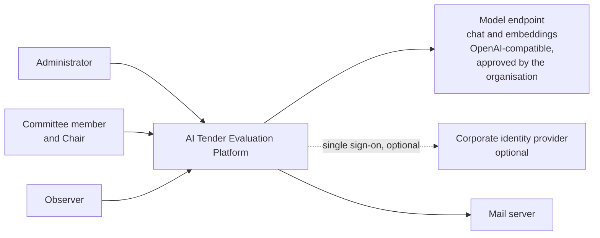
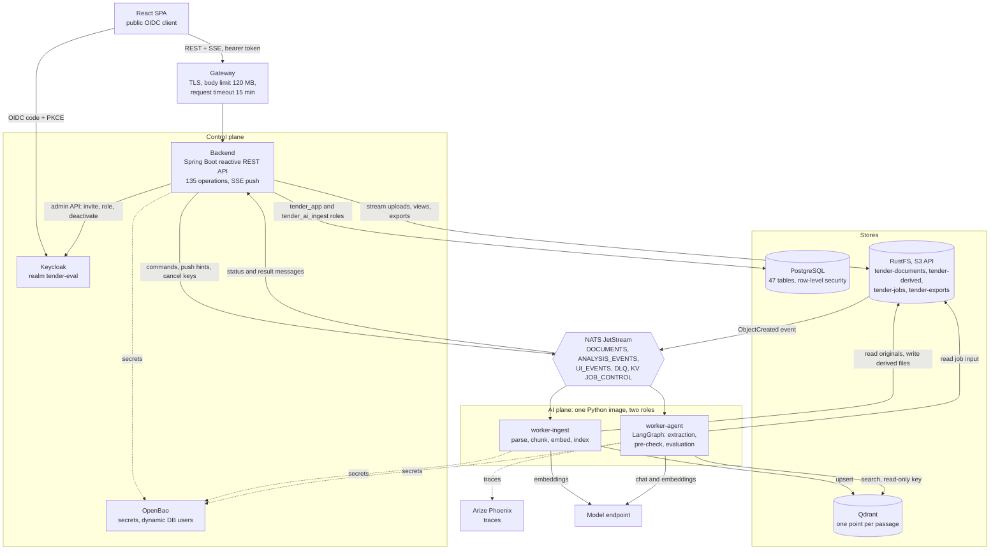
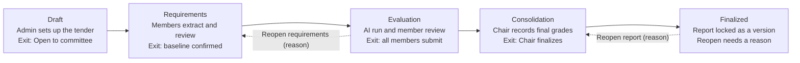
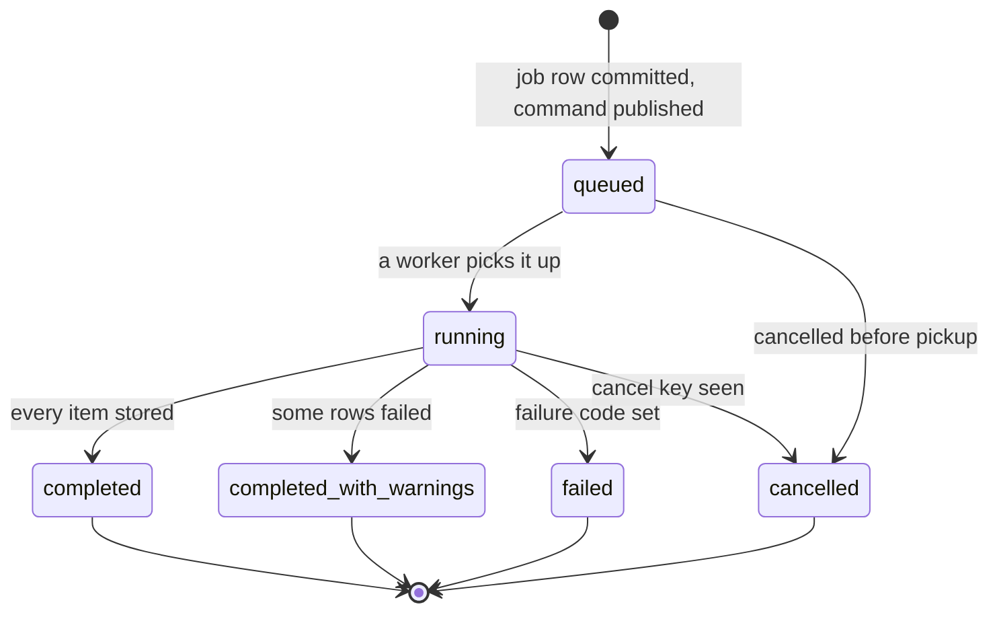
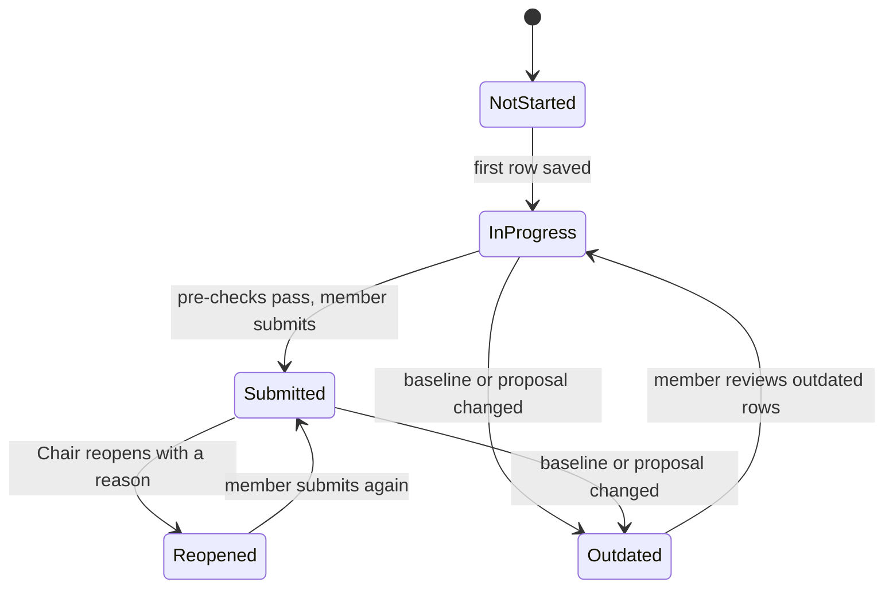
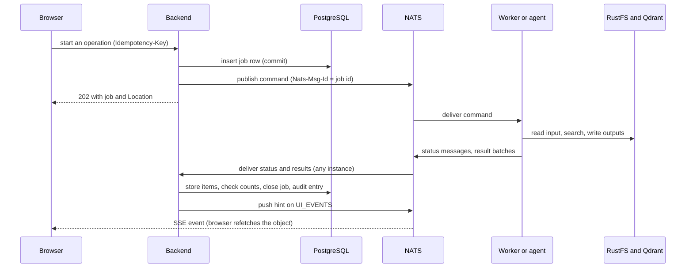
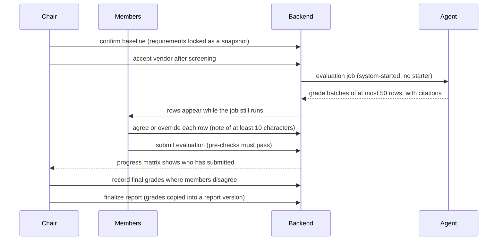

# Solution architecture

The AI Tender Evaluation Platform helps a procurement committee turn an RFP into a confirmed list of requirements, screen vendor proposals, grade every proposal against every requirement with cited evidence, and produce one consolidated report. AI proposes, people decide: every AI grade is a suggestion that a member agrees with or overrides, and the report holds only human-confirmed grades.

This file is the system-level view. It states what the parts are, what each may and may not do, and the rules that hold across them. Field-level detail lives in the five design documents (see [Where the detail lives](#12-where-the-detail-lives)). Where this file and a design document disagree, the design document wins; fix this file.

References used throughout: `UX-xxx-nn` is a requirement in the UX Requirements, `PG-nn` is a screen, `PI x.y` is a section of the Platform Integration Design, `AI x.y` is a section of the AI Pipeline Design, and `DM` is the Data Model Design.

## 1. System context

Four kinds of people use the platform. The Administrator sets up tenders, users, documents and vendors. A Committee Member extracts and reviews requirements and evaluates proposals. The Chair is a member designated per tender and is the only person who confirms the requirements baseline, confirms screening decisions, records final grades and finalizes the report. An Observer is read-only, for audit.

## 2. Containers

Everything below runs as separate deployable units. The browser reaches only the gateway (and so the backend) and Keycloak. The Python workers never touch PostgreSQL or Keycloak. Nothing but the backend writes business data.

### What each container owns

| Container | Owns | Does not do |
| --- | --- | --- |
| React SPA | Screens, OIDC sign-in, idle warning, push connection, document viewer | Reach RustFS, NATS, Qdrant, OpenBao or the database. Hold a secret. |
| Backend | Every business rule, authorization, the row-level security context, audit events, persistence, the job lifecycle, upload streaming, push to browsers | Call an LLM or parse a document |
| Keycloak | Identities, passwords, lockout, sessions, single sign-on brokering, invitation and reset emails, the three platform roles | Know about tenders or the Chair |
| OpenBao | Secrets and short-lived database credentials | Hold business data |
| PostgreSQL | The data model and the independence rules | Accept connections from anything but the backend |
| RustFS | Original files, derived files, job inputs, exports | Business rules |
| NATS JetStream | Transport for commands, events, status and results | Act as a system of record |
| worker-ingest | Parsing, chunking, embedding, indexing | Connect to PostgreSQL or Keycloak |
| worker-agent | The reasoning for extraction, the pre-check and evaluation | Use any tool that changes something outside its own output |
| Qdrant | The vector index of passages | Hold anything that cannot be rebuilt from PostgreSQL and RustFS |
| Model endpoint | Text generation and embeddings | See any member's decision |
| Arize Phoenix | Traces of agent runs | Receive secrets or, by default, document content |

### Who may reach what

`yes` means a network path and credentials exist. An empty cell means the path must not exist; enforce it with network policy and credentials, not by convention.

| From \ To | PostgreSQL | RustFS | NATS | Qdrant | Keycloak | OpenBao | Model endpoint |
| --- | --- | --- | --- | --- | --- | --- | --- |
| Browser | | | | | sign-in only | | |
| Backend | yes (two roles) | read, write | commands, push, cancel; consumes status and results | | admin API | yes | |
| worker-ingest | | originals read, derived write | consumes events; publishes status, results | read, write | | yes | embeddings |
| worker-agent | | job inputs read | consumes commands; publishes status, results; seals parts | read only | | yes | chat, embeddings |

## 3. Technology stack

| Layer | Choice | Notes |
| --- | --- | --- |
| Front end | React single-page application | Public client, authorization code flow with PKCE (S256). Desktop-first at 1280 px and wider, WCAG 2.2 AA, English only. The designs do not fix a build tool or a component library. |
| Backend | Spring Boot, reactive (R2DBC) | Validates Keycloak tokens (issuer, audience `tender-api`). Implements `api/openapi.yaml`. The designs do not fix the Java version; use a current LTS. |
| Database | PostgreSQL 15 or later | UUIDv7 keys, `timestamptz` in UTC, row-level security, triggers for status changes, English full-text search |
| Identity | Keycloak, realm `tender-eval` | Imported from `tender-eval-realm.json`. Clients `tender-spa`, `tender-backend-admin`. Roles `admin`, `member`, `observer`. The Chair is not a role. |
| Secrets | OpenBao | One AppRole and policy per component. Dynamic Postgres users where the engine is available. |
| Object storage | RustFS, S3-compatible API, path style | Four buckets, UUID-only keys |
| Messaging | NATS JetStream | Four streams and one key-value bucket, durable pull consumers, explicit acknowledgement |
| Worker and agent | Python 3.12, one image, `WORKER_ROLE` chooses ingest or agent | asyncio, nats-py, pydantic and pydantic-settings, pdfplumber, pypdf, LibreOffice for DOCX, OpenTelemetry |
| Agent framework | LangChain and LangGraph 1.x, pinned exactly | One `StateGraph` per job type. Structured output through Pydantic schemas. |
| Vector index | Qdrant | Dense plus sparse vectors for hybrid search, payload indexes for filters |
| Observability | OpenTelemetry, Arize Phoenix (OpenInference) | One trace per job, from the user's click to the grade |
| Contract | OpenAPI 3.1 (`openapi.yaml`), JSON Schemas exported from the Pydantic models | The contract is the source of truth for both sides |

## 4. Domain at a glance

### 4.1 Tender lifecycle

A tender moves through five stages and each one ends only when a person confirms. Reopening is allowed with a reason and creates new versions rather than editing old ones.

Screening can start while requirements are still in review. Accepted vendors wait for the baseline.

### 4.2 Data areas

The database has 47 tables in 11 areas (DM, Entity catalogue). The evaluation core, where the central rule lives, is: AI grades are immutable rows; a member's agreement or override is a separate row that points at the AI grade; the report copies final grades at finalization and never changes afterwards.

| Area | Tables |
| --- | --- |
| Identity and settings | users, drafts, requirement_categories, settings |
| Tender | tenders, tender_members, tender_stage_dates |
| Documents | documents, document_versions, document_pages, document_sections, passages |
| Vendors and proposals | vendors, tender_vendors, proposal_versions, proposal_version_files, conflict_declarations |
| Screening | screening_checklist_items, screening_checks, screening_prechecks, screening_recommendations, screening_decisions |
| Requirements and baseline | requirements, requirement_sources, requirement_flags, baselines, baseline_requirements, scoring_models, scoring_category_weights |
| Jobs and AI runs | jobs, job_steps, job_scope_items, ai_runs |
| Evaluation | ai_grades, grade_citations, ai_grade_feedback, member_evaluations, member_evaluation_rows |
| Report | report_versions, report_grades, report_member_grades, report_vendor_results, exports |
| Notifications | notifications, notification_preferences |
| Audit and access logs | audit_events, document_access_events |

### 4.3 Job lifecycle

Four job types exist: `document_processing`, `requirement_extraction`, `screening_precheck` and `evaluation`. A job row is committed before its command is published. A retry is a new job that points back through `retry_of_job_id`.

### 4.4 Member evaluation states

## 5. Runtime flows

### 5.1 Request path and background path

Two paths exist and they never mix. The request path is synchronous: browser, gateway, backend, PostgreSQL. The background path is asynchronous: the backend commits a job row, then publishes a command, and workers report back through NATS. The browser learns of progress through Server-Sent Events and refetches the objects the events name.

The step-by-step versions, with the failure behaviour of every step, are PI 6.1 (upload to citable passages) and PI 6.2 (a background analysis job). Do not re-derive them.

### 5.2 Evaluation, end to end

## 6. Storage and messaging layout

### 6.1 Buckets

| Bucket | Holds | Written by | Read by | Retention |
| --- | --- | --- | --- | --- |
| `tender-documents` | Originals exactly as received | backend | worker-ingest, backend | For good. Versioning on. Nobody may delete. |
| `tender-derived` | Rendered PDF, parsed pages, sections and passages, `manifest.json` | worker-ingest | backend | As long as the original, because citations point at these pages |
| `tender-jobs` | `jobs/{job_id}/input.json`, written once per job | backend | worker-agent | 90 days |
| `tender-exports` | Generated Excel, PDF and CSV | backend | backend | 90 days |

Key rules: lowercase UUIDs only, extension decided from the checked file signature, no vendor or person name in any key, and `manifest.json` written last so its presence means the parse is complete.

### 6.2 NATS

| Stream | Subjects | Retention and storage | Purpose |
| --- | --- | --- | --- |
| `DOCUMENTS` | `documents.uploaded`, `documents.analysis.requested.>` | Work queue, file, 7 days, discard new | Upload events and commands |
| `ANALYSIS_EVENTS` | `documents.analysis.status.>`, `documents.analysis.result.>` | Limits, file, 3 days | Reports from workers, replayable |
| `UI_EVENTS` | `ui.push.tender.*`, `ui.push.user.*` | Limits, memory, 15 minutes | Push hints shared by all backend instances; replay window for `Last-Event-ID` |
| `DLQ` | `dlq.>` | Limits, file, 30 days | Messages that could not be processed, with the reason in headers |

Key-value bucket `JOB_CONTROL` holds `cancel.{job_id}` (written by the backend) and the agent's sealed result parts `part.{job_id}.{part_no}` and `part.{job_id}.final`, with a 7-day TTL. Every published message carries `Nats-Msg-Id`, `traceparent` and `Tender-Schema` headers.

## 7. Security architecture

| Concern | Design | Where |
| --- | --- | --- |
| Authentication | Keycloak, authorization code with PKCE. The API checks signature, issuer, audience and expiry. Password policy 12 characters, session 10 hours (defaults, to confirm). | PI 3 |
| Authorization | Roles from the token; the Chair read from `tender_members`, never from the token. Every operation lists its roles in `x-roles`. | PI 2.1, DM |
| Independence of members | PostgreSQL row-level security hides a member's grades and notes from everyone else until the release rules are met. The application connects with a role that does not own the tables, so it cannot switch policies off. | DM, Independence and access |
| Evidence is never downloadable | Originals cannot be downloaded. Viewing streams the rendered PDF with `Cache-Control: no-store` and writes an access-log row. No signed storage links are ever issued. | UX-NFR-07, PI 4 |
| AI is read-only | The agent has search tools and no tool that writes, sends or deletes. Code, not the model, sets every retrieval filter, so the model cannot reach another vendor's proposal. | AI 1.2 |
| Prompt injection | Proposal text is untrusted data. A hostile passage can influence words, never actions. Citation and rule checks are made in code. | AI 5.1, 5.2 |
| Secrets | Only in OpenBao and process memory. None in images, repositories, logs or traces. Each component reads only its own paths. | PI 7 |
| Least privilege on messaging | Each NATS user may publish and consume only the subjects in PI 5.11. | PI 5.11 |
| Egress | Workers have allow-listed egress per role and no route to the database, Keycloak or the open internet. | AI 2.6 |
| Untrusted files | Signature check by the backend, decompression-ratio and size limits, parsing in a memory- and time-limited child process, LibreOffice with no network and macros off. | AI 2.6 |
| Audit | Every write goes through a service that writes an audit event with before and after values. Audit and access tables allow insert and select only. | DM, Audit trail |

## 8. Reliability, scaling and sizing

- Both workers are stateless. Progress lives in NATS, RustFS and Qdrant, so any replica can be stopped at any time. On SIGTERM a worker finishes or seals what it can within 45 seconds; the deployment grace period is 60 seconds.
- Delivery is at least once. Every identifier is derived from input (passage ids, item ids, part numbers), so a redelivery produces the same rows. Inserts use `ON CONFLICT DO NOTHING`.
- Large payloads travel by reference: a NATS message carries a small body and an object key. The server's 1 MB message limit is never approached.
- A part of a result is sealed in `JOB_CONTROL` before it is published, so a crashed job republishes what it already finished instead of recomputing it.
- Back pressure: the `DOCUMENTS` stream refuses a publish when full; the backend fails that job with code `other` and the interface offers a retry.
- Three backend timers close gaps: a queued job older than 2 minutes has its command published again; a running job silent for 5 minutes fails with `timeout`; a job past its ceiling fails with `timeout` and gets a cancel key.
- Losing the Qdrant index is recoverable: the index is rebuilt from `tender-derived` (about 36 minutes at the assumed rates). Until then agent jobs fail with `index_unavailable` and can be retried.

Working assumptions for sizing (measure on real documents before buying capacity): 500 requirements, 8 vendors, a 300-page RFP, 150-page proposals, about 15 passages per page. That gives about 22,500 passages per tender, about 5,400 evaluation calls on a first run, about 1.9 hours on one agent replica and about 28 minutes on four. Qdrant needs about 4.5 GB of dense vectors a year before quantisation. AI 7.3 has the full table.

## 9. Observability

- One trace per job. The backend starts it when the user acts and passes `traceparent` in every message; the worker and agent continue it, so Phoenix shows one trace from click to grade.
- Traces do not hold document content by default (`TRACE_CAPTURE_CONTENT=false`).
- Logs are JSON and never contain document content or secrets.
- Health: `/healthz` and `/readyz` on `HEALTH_PORT` for both worker roles.
- Alerts: consumer lag, a non-empty DLQ, model error rate, circuit breaker state, share of AI grades that members override (counted per vendor and per run, never per member). See AI 6.3.

## 10. Architecture decisions

| # | Decision | Reason |
| --- | --- | --- |
| 1 | The browser reaches only the backend and Keycloak | Members may not download proposals, so no signed storage links exist |
| 2 | The backend streams every upload into RustFS | The backend checks signature and size while streaming and creates the document version and job before the first byte is stored |
| 3 | Worker and agent never connect to PostgreSQL | The backend stores what they publish, through a separate AI-ingest database role that can insert AI tables but cannot read members' grades |
| 4 | Large payloads travel by reference (claim check) | A parsed 300-page document or 500 requirements can exceed 1 MB |
| 5 | Commands for extraction, evaluation, pre-check and cancel are published by the backend, after the job row commits | The bucket event covers document processing only; publishing before commit could start work for a job that does not exist |
| 6 | Server-Sent Events for push | Push is one-way, reconnects by itself and resumes with `Last-Event-ID`. WebSocket stays an option. |
| 7 | Worker and agent read their own secrets from OpenBao | A separate policy per component limits the harm of a leak |
| 8 | Subjects use the plural domain prefix `documents.*` | Consistency across `uploaded`, `analysis.status`, `analysis.result` |
| 9 | One Qdrant point per passage, point id equals the PostgreSQL passage id | Citations resolve between the stores without a mapping table |
| 10 | The model proposes and code verifies | A grade is accepted only after every citation matches the text of a retrieved passage |
| 11 | One image, two roles | The index format and the query encoder cannot drift apart between releases |
| 12 | Independence enforced by the database | A UI mistake cannot reveal a member's grades |
| 13 | Snapshots, not edits | Confirming requirements copies them into a baseline; finalizing copies final grades into a report version |

## 11. Constraints, assumptions and open decisions

Assumptions the build can proceed on: one organisation per deployment; English only; PDF and DOCX only with no OCR; a DOCX is converted to PDF once and the converted pages are the ones citations use; the Observer reads all tenders but only the audit trail, access log and tender list.

Open decisions that can change the architecture, each with the default the designs use. Ask the owner early; do not wait for the answer to start.

| Decision | Default | Changes if different | Source |
| --- | --- | --- | --- |
| One organisation or several per deployment | One | An `organisation_id` on every top-level table and in every policy | DM Q1 |
| Which model endpoint may receive proposals, and where it runs | An approved private or self-hosted endpoint; traces keep no content | Network egress, data processing agreements, `TRACE_CAPTURE_CONTENT` | PI Q1 |
| What the Chair may see of other members before everyone submits | Database allows the broader rule; the report screen applies the narrower one | One row-level security condition | DM Q3 |
| Which edits make evaluation rows Outdated | Text, importance and acceptance criteria | `content_hash` coverage | DM Q4 |
| Score formula, ties and agreement level | Not decided; computed once at finalization into `report_vendor_results` | Columns of `report_vendor_results`, UX-SCO-03 explanation | DM Q7 |
| PDF library licence | pdfplumber and pypdf (permissive) | Reader sits behind an interface and can be replaced | AI Q1 |
| Corporate single sign-on | Optional, links to invited accounts only | Whether password sign-in stays | PI Q8, UXD Q3 |

The full lists are in PI section 8 (13 questions), AI section 8 (13 questions), DM Open data questions (14) and UXD Open design questions (6).

## 12. Where the detail lives

| You need | Read |
| --- | --- |
| What users must be able to do, with requirement IDs and priorities | `design/01-ux-requirements.md` |
| Screens, wireframes, states, tokens, content rules | `design/02-ux-design.md` |
| Tables, enums, allowed status changes, security policies, retention | `design/03-data-model-design.md` |
| REST rules, Keycloak, buckets, NATS, flows, every configuration key | `design/04-platform-integration-design.md` and `../api/openapi.yaml` |
| Parsing, passages, Qdrant, graphs, prompts, grounding, evaluation set, sizing | `design/05-ai-pipeline-design.md` |
| How to build it, in what order | [`implementation-guide.md`](implementation-guide.md) and [`roadmap-plan.md`](roadmap-plan.md) |
